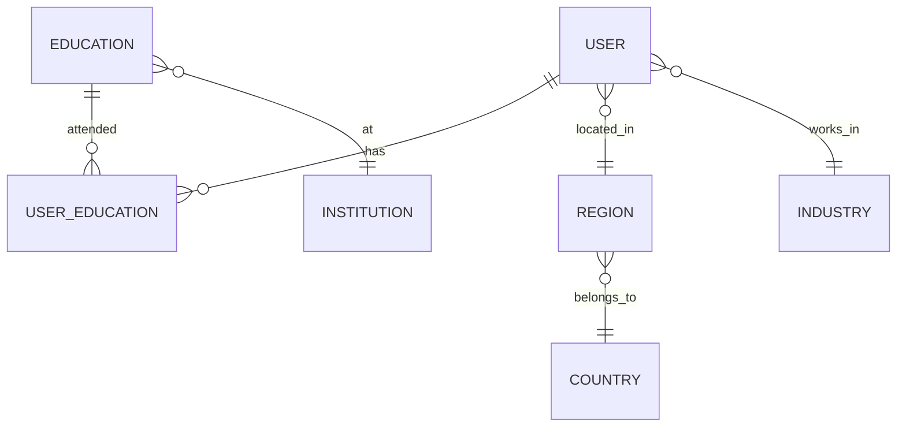

*This article is entirely based on a [YouTube video by Rachit Jain](https://www.youtube.com/watch?v=mPAJF2Jdy_I)*.

---

Strictly speaking, SQL is a query language, while NoSQL is an umbrella term for non-relational data models. In everyday conversation, a SQL database means a relational database that uses SQL, and a NoSQL database usually means a document, key-value, wide-column, or graph store. This article follows that shorthand but focuses on the comparison the video makes: relational tables versus document databases.

The question in the title has no single answer. The useful answer is a set of trade-offs: how data is related, how often shared entities change, how the application reads and writes it, and how much duplication it can tolerate. A resume is a good example because it looks like a perfect document database use case until the shared data starts to change.

# The Resume Example

Suppose an application displays user resumes. Each resume has a name, location, industry, education history, and recommendations.

In a **relational model**, the data is normalized: shared entities are stored once, and other tables reference them by ID. Instead of storing the full region name in every resume row, the resume stores a region ID that references a region table. Country and industry work the same way. Education is a **many-to-many** relationship: a user can have several education records, and an institution can be associated with many users. A join table connects the two, with each row holding a foreign key to a user and a foreign key to an education record. A **foreign key** is a column that references the primary key of another table, and a **join** combines rows from multiple tables using that relationship. A many-to-many relationship needs a join table because neither side can hold a single foreign key.



Fetching a resume means joining the user row with region, country, industry, the user-education join table, education, and institution tables. The result is assembled from normalized rows.

In a **document model**, the resume is one JSON document, as it would be in a store such as MongoDB. Location, industry, education, and recommendations are embedded or grouped inside it. Fetching the resume is one document read, with no joins. Related data has better **locality** because everything needed for the screen is in one place. A document database stores records as JSON-like documents, with nested objects and arrays. This makes the resume a natural unit of storage: the application reads one document and gets the whole screen's data.

```json
{
  "user_id": 238,
  "name": "A. Sharma",
  "region": "Bengaluru",
  "country": "India",
  "industry": "IT",
  "education": [
    {
      "institution": "IIT Roorkee",
      "start": 2014,
      "end": 2018
    },
    {
      "institution": "Delhi Public School",
      "start": 2012,
      "end": 2014
    }
  ],
  "recommendations": [
    {
      "author": "Joey Flores",
      "text": "Great collaborator."
    }
  ]
}
```

At first glance, the document model looks better. The relational schema needs many joins, while the document is self-contained and the application code is simpler: it receives one object instead of assembling a graph of rows. The document is also easier to evolve in the short term. Adding a new field to a resume does not require a schema migration; new documents can include it, and old documents can omit it.

# The Counterexample: Shared, Changing Data

The advantage reverses when embedded data is shared and changes independently.

Suppose the education entry stores the institution name as a string. A popular university appears in hundreds or thousands of resumes. The name is duplicated across all those documents. If the institution changes its name, or if the data contains typos and inconsistent capitalization, every document must be found and updated. If the product later needs the institution's logo, website, bio, and headline, those fields are duplicated too. Storage grows, and consistency becomes an application-level problem.

Relational normalization avoids this. The education row stores an institution ID, and the institution table stores the name, logo, URL, and bio. Renaming an institution is one update in one row; every resume that references the ID sees the new value on the next join. The same applies to a region rename, such as Gurgaon becoming Gurugram. The region table changes once, and the resume rows keep the same region ID.

**Relational normalization moves shared, changing data into one place.**

Recommendations show the same pattern. A document could embed the recommender's name, title, and company. Those credentials change over time. Suppose Joey Flores wrote a recommendation while he was co-founder and CEO of Ear Bits. Three years later he is at another company. If the recommendation embeds his title, every recommendation he wrote now contains stale information. If it stores his user ID, a single profile update fixes all of them. A document design that stores the recommender's user ID and the recommendation text, then fetches the current profile from a separate collection, turns the embedded copy into a reference. The document model starts to look relational at the points where entities are shared and mutable.

Relational databases also have mature support for joins and foreign-key lookups. Document databases can model references, but the join often happens in application code: fetch the document, collect the IDs, fetch the referenced documents, and assemble the result. That is more code to write, test, and optimize. It also means more round trips and more opportunities for partial failure.

None of this means relational is always better. Consider an application that stores logs and counts errors in a time range. The records are not interlinked, and there are no foreign-key lookups. A relational schema with multiple tables and joins would be overkill. A document or log-oriented store fits the access pattern better.

# The Real Trade-off

The comparison is not a contest between labels. It is a comparison between data models.

The document model offers schema flexibility, locality, and a smaller **impedance mismatch** between application JSON and stored JSON. It fits self-contained, read-mostly documents whose shape evolves.

The relational model offers mature joins and foreign keys, handles many-to-many and many-to-one relationships well, and benefits from **query optimizers** and **indexes** that improve performance without changing queries. It also provides strong consistency and transactional guarantees, depending on the database.

| Dimension | Relational | Document |
|---|---|---|
| Data shape | Normalized tables | Self-contained documents |
| Relationships | Joins, foreign keys, many-to-many | Embedded data or application-side references |
| Schema | Schema on write | Schema on read |
| Locality | Data spread across tables | Related data grouped together |
| Querying | Mature optimizers, column selection, filters | Whole-document reads, limited joins |
| Scaling | Vertical, plus horizontal options | Horizontal by design |
| Best fit | Shared, changing entities and relationships | Self-contained, dynamic documents |

The table compares relational with document models. Key-value and wide-column stores have different access patterns, so the same reasoning does not apply unchanged.

Choose the document model when the data is self-contained and usually read whole. Choose the relational model when shared entities and relationships dominate. For highly interconnected data such as a social graph, a **graph database** such as Neo4j may be the better fit.

Document databases are not schema-free in practice. The schema is enforced by application code, not by the database. That is the next important distinction.

# Scaling, ACID, and Migration Myths

Several claims about SQL and NoSQL are repeated so often that they sound like facts. They are simplifications.

The claim that only NoSQL scales horizontally is false as a blanket statement. **Horizontal scaling** means adding more machines; vertical scaling means making one machine larger. Relational databases have added horizontal scaling options, and distributed relational systems such as Google Spanner exist. MySQL's ecosystem includes replication and sharding options. The operational details differ, but the claim that relational cannot scale horizontally is not a law.

NoSQL systems often gained performance by relaxing parts of **ACID**, but the gap has narrowed. ACID stands for atomicity, consistency, isolation, and durability. Some NoSQL databases support transactions. Redis offers optional persistence, which improves durability, but that does not make it a fully ACID relational database. The right question is which guarantees the application needs, not which camp the database belongs to.

A large organization with a working relational application does not usually migrate wholesale to NoSQL because of a scalability problem. The migration is expensive, takes time, and requires retraining. Developers trained on relational systems may not know the operational caveats of NoSQL databases, which can lower service quality. A well-known example is Google AdWords, initially built on MySQL. When it faced scaling challenges, Google did not simply move to MongoDB. It developed Google F1, a distributed relational database management system. The lesson is to diagnose the bottleneck and optimize the existing system before replacing it. New features can still choose a different data model.

Relational and document systems are converging. Modern relational databases can store JSON documents in columns (PostgreSQL, for example, has a JSON type) and support multi-value data; some NoSQL databases add transactions and relational features. The boundary is less sharp than the marketing suggests. Many organizations use both: a relational core for transactional data, and document stores for specific features or read-heavy views. The choice can be per workload, not per company.

# Why Relational Dominated

The relational model appeared in the 1970s and dominated software engineering for more than 30 years. It was designed for business data processing, but it proved adaptable to social networking, e-commerce, games, and many other domains.

The relational model offered a clean interface that hid storage details: application developers used a query language and APIs while the database handled bytes, indexes, and query planning. Query optimizers could improve performance without changing the query; creating an index could make the same `SELECT` statement faster as statistics improved. The model also had a mature ecosystem and broad tooling.

NoSQL gained attention around 2010 because many systems were open source while commercial relational databases such as Oracle were expensive, because developers were frustrated by rigid schemas in dynamic applications, and because horizontal scalability was a major selling point.

Those advantages are real, but they are not absolute. The schema restriction that hurts a dynamic application is a feature for a financial system that needs consistency. The lack of joins that simplifies a self-contained document is a cost when entities are shared.

# Drawbacks of Each Model

## Relational Drawbacks

Schema changes are heavier. In a dynamic application with heterogeneous data, a fixed schema can be a burden. Migrations require `ALTER TABLE`, data backfills, and coordination with deployed application code.

Object-relational impedance mismatch: application classes and relational tables use different structures. A translation layer maps objects to rows, and ORMs reduce the boilerplate but do not eliminate the mismatch. The mapping is another source of complexity.

## Document Drawbacks

Joins are limited. If the application needs data from several documents, it often has to fetch and assemble them in application code. That shifts complexity from the database to the service.

Partial reads are less natural. A relational query can select specific columns and filter rows; a document database is optimized for reading a whole document. Projections exist, but the access paths are different, and fetching a nested element can be awkward.

**Denormalization**, the practice of duplicating data to keep it close to the reader, is easier to start and harder to maintain. Duplicated data becomes inconsistent when the shared entity changes. The application must handle updates, or the data must be periodically repaired.

Query optimization is less mature for join-heavy workloads. Relational optimizers have decades of investment; document databases optimize for different access patterns.

Fault tolerance and concurrency are separate topics. They deserve their own comparison because the behavior depends on the specific database and configuration, not on the SQL or NoSQL label.

# Schema Changes: A Concrete Example

Suppose the application initially stores a user's full name in a `name` field. A business decision later requires separate `first_name` and `last_name` fields.

In a document database, old and new documents can coexist. The application checks whether a document has `first_name`; if not, it falls back to `name`. New documents use the new shape. Old documents do not need to be rewritten immediately. The schema is enforced on read by the application.

In a relational database, the change is a migration: add the new columns, backfill them from `name`, update every row, change the application code, and eventually drop the old column. The work is explicit and coordinated:

```sql
ALTER TABLE users ADD COLUMN first_name TEXT;
ALTER TABLE users ADD COLUMN last_name TEXT;

-- backfill first_name and last_name from name
-- the expression depends on the name format

ALTER TABLE users DROP COLUMN name;
```

The exact syntax varies by database, and a real backfill may need to run in batches. The `UPDATE` that fills the new columns from `name` is the backfill step. It is omitted from the sketch because the expression depends on the name format; in a real migration it runs before the old column is dropped.

This is the practical meaning of schema flexibility. It is not that document databases have no schema. It is that the schema is interpreted when data is read, not enforced when data is written.

# Schema on Read vs Schema on Write

The distinction is often summarized with an analogy. Document databases are **schema on read**, like Python or JavaScript: the application assumes a shape when it reads the data. Relational databases are **schema on write**, like C++ or Java: the database enforces types and constraints when the data is written.

In a schema-on-write system, declaring a column as an integer means the database rejects a string written to it. In a schema-on-read system, the database accepts a document with a new shape; the application must handle the old and new shapes. The schema still exists, but it lives in the application code and in the data itself.

**The document model is not schemaless; it is schema on read.**

Both approaches have costs. Schema on write catches errors earlier and makes shared data more predictable. Schema on read allows faster evolution and heterogeneous data, at the cost of application-level validation and discipline.

# Conclusion

There is no absolute winner. The useful question is not which database is better, but which data model fits the application's data, relationships, access patterns, and change rate.

Use the document model for self-contained documents that are read whole and whose shape evolves. Use the relational model for shared entities, many-to-many relationships, and join-heavy queries. Use a graph model for highly interconnected data, and a document or log store for append-only event data with no relationships.

Relational and document databases are also converging. Modern relational systems can store JSON and offer horizontal scaling options; document systems add transactions and relational features. Choosing a database is a set of trade-offs, not membership in a camp.

Finally, understanding how a database stores data and builds indexes is what makes these trade-offs concrete. The data model determines what is easy; the internals determine what is fast.
