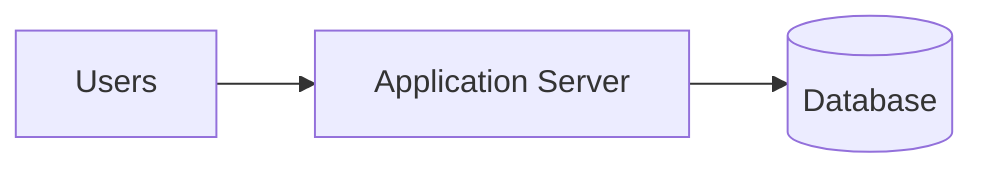
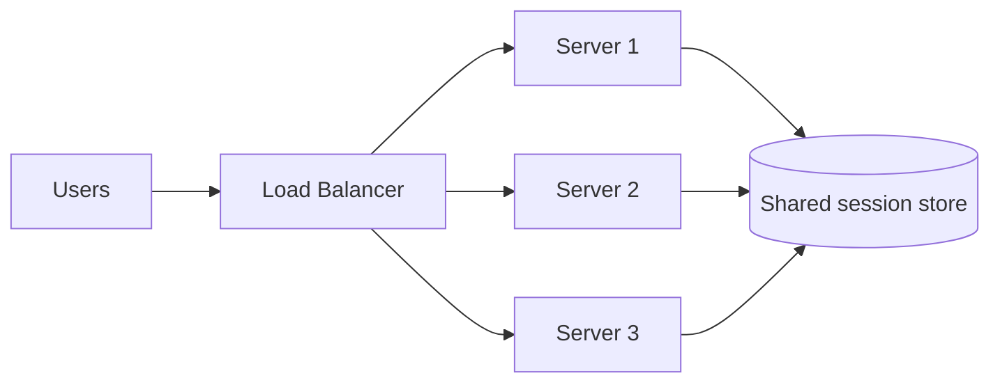
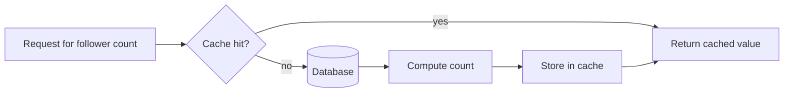
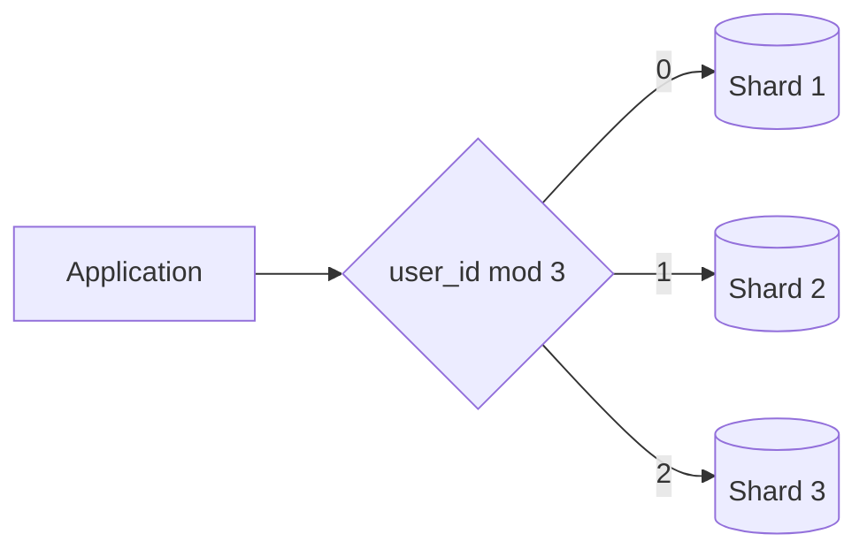
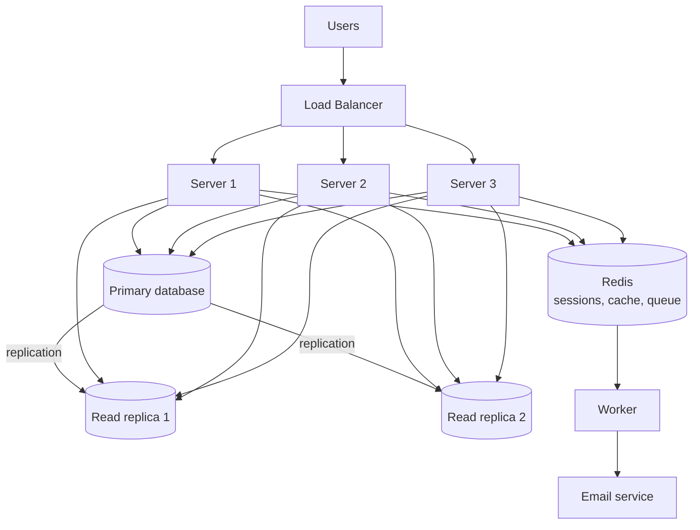

*This article is entirely based on a [YouTube video by JavaScript Mastery](https://youtu.be/EaXHfuHRWwg)*.

---

You can build a full application now: front end, back end, database, deployed and online. With AI, you can do it faster than ever. That raises an uncomfortable question: if anyone can build the app, what is left that actually makes someone a good engineer?

Building the thing was never the hard part. The hard part begins when the application becomes popular: when one server is no longer enough, when the database cannot keep up, and when the system is slow for reasons nobody can immediately explain. That is the territory of **system design**.

Most tutorials present system design as a pile of intimidating terms: load balancers, replicas, sharding, caching, all at once, on day one, for an application that has fifty users. This article takes the opposite approach. It starts with one server and one database, which is already enough for far more users than most people expect. Then it breaks that system on purpose, repeatedly, and fixes exactly one thing each time. By the end, every component will have earned its place, and each will come with a known cost.

# The Starting Point Is Enough

This is the architecture almost everyone has after putting a first application online: one server running the code and one database holding the data.

Before changing anything, it is worth stating clearly that this setup can serve thousands of users, not just dozens. A large share of the applications running today look exactly like this and will never need another shape. That is not a failure, and it is not a stage every system must inevitably outgrow.

# Breaking It on Purpose

Suppose you build a web application for buying concert tickets, the way Ticketmaster, StubHub, or SeatGeek do. You deploy it, test it, and everything works. Then a major show goes on sale: at 10 a.m. if you are lucky, at 5 p.m. on a Friday if you are not. Tens or hundreds of thousands of people open the site at the same moment to grab a ticket, and the application collapses. Pages crawl, requests hang, and some never finish.

Nothing is wrong with the code. There are no bad queries and no bugs. The problem is structural: the application runs on a single server, and a single server can only do so many things at once. When thousands of requests arrive together, they queue up. The queue grows faster than it drains, and requests time out before they are ever reached.

The question is how to serve thousands of people at once instead of letting one machine drown under them. There are two answers: **vertical scaling** and **horizontal scaling**.

# Vertical Scaling: Make the Box Stronger

The obvious option is to buy a bigger server: more processing power, more memory, the same machine but stronger. This is the right first move almost every time. Nothing in the code changes. You pay for a larger machine and are done for the afternoon. If a bigger server fixes the problem, buy the bigger server and get back to work.

The economics are more favorable than they appear. A $20-per-month server can handle hundreds of requests per second for a typical application: millions of requests per day on one inexpensive box.

But vertical scaling has a ceiling. There is a largest machine available for rent, and it becomes very expensive long before you reach it. A bigger box buys time; it does not buy permanence.

# Horizontal Scaling: More Boxes, Same Code

Instead of making one machine stronger, stop making one machine do all the work. Run several ordinary servers and divide users among them.

It is important to be precise about what those servers are, because the distinction trips people up. They are not different parts of the application: one for payments, one for messaging, one for something else. They are **identical copies** of the same application, running the same code, each capable of handling any request. Nor does this mean deploying the application three separate times. You ship it once and tell the platform to run three instances. On a platform such as Vercel, this may already be happening without any explicit configuration.

Horizontal scaling is the approach without a comparable ceiling. If traffic grows again next year, add more copies. The system no longer depends on one machine being large enough.

But the moment there is more than one server, a new question appears: when a request arrives from a user, which server should handle it?

# The Load Balancer

Something has to stand in front of the servers and distribute incoming requests, spreading users evenly so that no server is overwhelmed while the others sit idle. That component is a **load balancer**.

A request arrives, the load balancer selects a server, and that server does the work. If one server is busy, the next request goes to a different one. Add a fourth server next month and the load balancer begins using it. Users never know how many servers exist or which one handled their request. Nginx is the classic implementation; platforms such as Vercel and Railway provide a load balancer implicitly.

This addition has costs. The first is availability. The load balancer is a new box through which all traffic flows, which makes it a **single point of failure**. If it goes down, three healthy servers behind it are unreachable. Real systems therefore run a backup load balancer, which means more infrastructure to operate.

The second cost is quieter, and it invalidates an assumption that is easy to miss. For the load balancer to send any request to any server, all servers must be **interchangeable**. Any of them must be able to handle any request. At this point, they are not. The next section shows exactly where that assumption fails.

# The Session Problem

A user logs in on server A, browses, selects a ticket, and clicks buy. The request goes to server B, which immediately says the user is not logged in. Nothing is broken in the conventional sense, yet this happens as soon as an application runs more than one server without handling sessions properly.

What does being logged in actually mean? When a user logs in, the server verifies the password and then must remember that user on every subsequent request, so the password is not retyped on every click. It writes a note that says "Bob is logged in" and hands the browser a **session ID**, a random string that points to that note. The browser sends the session ID with every request, and the server looks it up.

The critical question is where the server keeps that note. By default, the easy answer is the server's own memory. With three servers, the failure follows directly.

The login request lands on server 1, which writes the note into its memory. The next click produces a new request, and the load balancer sends it to server 2. Server 2 has never heard of this user. It checks its own memory, finds nothing, and does the only thing it can: it asks the user to log in again.

This is the random logout. The user is not being kicked out; they are being routed to a server that does not have their note. With three servers, roughly two out of every three clicks will land on a machine that does not know them. This is precisely the sense in which the servers were not interchangeable: the login state was pinned to one specific server.

The fix is a rule: servers are not allowed to remember anything about a user between requests. No server keeps the note in its own memory. Instead, the note goes into a **shared store** that every server can read from and write to. It no longer matters which server handles the request. On login, the note is written to the shared store; on the next click, whichever server the load balancer selects reads the same store, finds the note, and recognizes the user. A server that keeps nothing about the user in its own memory is called **stateless**. Every server is now interchangeable, exactly as the load balancer requires.

That shared store is often **Redis**, an in-memory data store that is extremely fast to read, which matters because it is consulted on every request.

The cost is twofold. Every request now performs an additional lookup before it can do anything else, adding a small amount of latency. And the shared store becomes infrastructure that must stay available: if it goes down, nobody can be logged in at all.

# The Database Becomes the Bottleneck

At this point the front of the system is solid: a load balancer, several stateless servers, and a request path that no longer depends on a specific machine. All of those servers talk to one database.

Suppose the application is slow again, but this time every server is healthy. None is at capacity, there are no bad queries, and nothing appears broken. The common factor is the database. The servers were scaled; the component behind them was not.

Two distinct problems are hiding here.

## Too Many Connections

The first is **connection limits**. A database will only hold a certain number of open connections at once, because each connection consumes memory and attention. The limit is lower than most people expect: not millions, often a few hundred on smaller hosted plans, sometimes only a few dozen.

Now count what is trying to connect. Three servers, each opening several connections to handle several requests concurrently, add up quickly. Serverless platforms make this worse in a way that surprises people. When a request arrives and no instance is free, the platform spins up a fresh copy of the function, and each copy opens its own connection. A traffic spike can create hundreds of copies at once, each grabbing a connection, and every slot is full within seconds.

The diagnostic detail matters: the symptom is not slowness but errors. A ticketing application can be perfectly fine until a popular show goes on sale. Traffic spikes, and suddenly database connection errors appear at the exact moment things were going well.

The fix sits between the servers and the database, and it is almost boringly simple. Instead of every server opening and closing connections whenever it likes, a small fixed set of connections stays open and is shared. A request that needs the database borrows a connection, uses it, and returns it immediately for the next request. The database only ever sees that fixed number of connections, regardless of how many servers or requests exist. This is a **connection pool**. PgBouncer is a common implementation for Postgres, and most managed databases now include a pooler that can be enabled.

Connection pooling fixes the errors. It does not fix the second problem, which is what people usually mean when they say the database cannot keep up.

## The Database Is Genuinely Out of Capacity

Suppose connections are under control and the database is still maxed out, genuinely doing more work than one machine can handle.

Before reaching for anything clever, check one thing: are the common queries actually using **indexes**? If the application looks users up by email on every login and there is no index on the email column, the database scans every row to find one person, every single time. A missing index looks exactly like a capacity problem, but it is not. Adding the index can make the load disappear. It is the first check because it is free.

If the indexes are in place and the database is still out of room, examine what it spends its effort on. Consider how an application of this kind is actually used. A user opens a social app and scrolls, reading post after post. Occasionally the user writes something: a post, a like, a comment. For every write there are hundreds of reads. This is true of almost any application; on a video platform such as TikTok, users mostly consume content rather than produce it. Reads vastly outnumber writes, which means the database spends nearly all of its capacity answering reads. Remove most of the read load, and most of the problem disappears.

The fix is to make copies of the database. One database remains the original: the only one that accepts writes. Every insert, update, and delete goes there. Call it the **primary database**. Then create copies that are read-only: they cannot be written to, but they can serve reads all day. Whenever something changes on the primary, the change is propagated to the copies so they remain current. These copies are **read replicas**.

The work is now distributed. Writes go to the primary; the vast majority of traffic, which consists of reads, is spread across the replicas. Each machine now handles a fraction of the load that had been drowning a single machine.

This fix has a cost unlike the previous ones. It does not only add money or another moving part; it quietly makes the application slightly wrong. When a write reaches the primary, it takes time, usually tiny but not zero, for the change to reach the replicas. Post something, and the write goes to the primary. Immediately load your feed, and that read may go to a replica that has not yet received the new post. Your own post is missing. Refresh, and it appears. Nothing is broken; the copy was half a second behind.

That gap is called **replication lag**, and it is the price of read replicas. Data on the copies is momentarily out of date, which is usually acceptable: a user seeing someone else's post half a second late does not matter. Sometimes it does matter. Seeing your own post missing feels broken. For those specific cases, applications deliberately read from the primary instead of a replica.

**The broader lesson is that the system was made faster and slightly wrong on purpose. The engineering decision is choosing which parts are allowed to be slightly wrong and which are not.**

# Caching Expensive Reads

With writes on the primary, reads spread across replicas, and connections pooled, the database is under control. But some reads remain expensive. One particular kind of question is asked thousands of times and returns almost the same answer every time. Computing that answer repeatedly is wasteful.

Take a follower count on a profile. To produce it, the database counts every follower record for that person. For someone with two million followers, that is two million rows scanned to produce a single number. The number appears on the profile, so every person who opens that profile causes the same expensive count again, thousands of times an hour, for a number that barely changes. The database is doing hard work over and over to reconstruct an answer it already had a second ago.

Instead of computing the answer every time, compute it once and store it somewhere fast. The next request retrieves the saved answer, and the database is not touched.

The flow is simple. A request asks for the follower count. First, check the cache. If the answer is there, return it immediately without approaching the database. If it is not, query the database, get the number, and write it to the cache on the way back. That last step is the important one: the next request gets it for free. A **cache** keeps data in memory rather than reading from disk, which is why it returns an answer in a fraction of the time.

The cache is very often Redis, the same Redis used for sessions. The same piece of technology takes on a second job; no new system is added to the stack.

The cost of caching is the sharpest trade-off in the entire system. The moment a copy of an answer is stored, that copy can become **stale**. Someone gains a follower: the true count in the database is now one higher, but the cache still holds the old number. Everyone opening the profile sees the old count until the cache is updated or invalidated. The follower count is now sometimes slightly wrong, and deciding when to discard the saved answer so it does not stay wrong for too long is one of the genuinely hard problems in the field. There is an old joke among engineers that the two hardest problems in computing are naming things and **cache invalidation**.

The real skill here is not technical. Caching trades correctness for speed on purpose, and someone has to decide which parts of the application may be slightly wrong for a while and which may not. A follower count that is thirty seconds out of date will go unnoticed and harms no one; cache it aggressively. The balance in a bank account can never be even slightly out of date; never cache it.

That decision is the point. An AI will happily write the caching code, and it will write it well. What it will not do is make the product decision, because the decision is not about code. It is about users and what they will accept. **The typing can be outsourced; the judgment cannot.**

# Moving Slow Work Off the Request Path

Expensive reads are now cached and the database does far less work, so the application is fast from front to back. One more kind of slowness remains, and it has nothing to do with reading data.

Consider a sign-up flow. A user fills out a form, clicks sign up, and expects the account to exist immediately. Creating the account may not be the only work the server has to do. It may also need to send a verification email, record the sign-up in analytics, and initialize data for the new account. If all of that happens before the response is sent, the user stares at a loading spinner until every step finishes.

The problem is worse than latency. Sending the verification email is not something the server does itself; it hands the email to an external service and waits for confirmation. The sign-up is now only as fast as that service. If the service is down, sign-up fails. The account cannot be created because the verification email could not be sent, which ties whether someone can join the application to whether a separate email company happens to be available. That is a bad dependency.

Everyone has seen the better behavior: a verification email that arrives a few seconds later, or an upload that says "processing" and lets the user continue. The delay is not the application being slow; it is the application being built correctly.

Creating the account is the only part the user needs to happen before a response. The verification email does not have to happen in that same moment; it only has to happen soon. So split the work. The instant the account is created, respond to the user. Do not send the email then. Instead, write a note that says "send a verification email to this person" and place it on a list. That list is a **queue**: a line of jobs waiting to be processed in order. A separate process, not the server handling the user's request, takes the note and sends the email a moment later, while the user is already on their logged-in homepage. That process is a **worker**.

The server's job is to answer the user quickly and hand slow work to the queue. The worker's job is to chew through that work in the background. Verification emails are only one example; password resets, notifications, receipts, and any other slow job that should not make a user wait can go through the same queue. In many applications the tool is BullMQ, which runs on Redis. Redis now has a third job: sessions, cache, and queue.

The win is that sign-up becomes instant and no longer depends on the email service being up. If the service is down, the note waits in the queue until it returns. The account already exists either way.

The costs are real. First, the work happens later, which is exactly why the verification email takes a few seconds to arrive. For a verification email, nobody minds, but "done" now means "we have promised to do this," not "this is finished." Second, there are two more components to run and keep alive: the queue and the worker. Third, jobs can fail. The worker tries to send the email and the email service is down, so the system must retry in a minute and, if the failure persists, move the job somewhere a human can inspect it. **A job placed on a queue and never checked is a job that is quietly not being done.**

# Sharding: When the Data Outgrows One Machine

What has been built so far is serious architecture, and most applications never need more than this. But one final thing can break, and it is different from everything before it. Every previous problem was about handling more people. This one is about how much data exists.

Read replicas are full copies of the database, an arrangement that quietly assumes the entire database fits on one machine. What if it does not? What if the data keeps growing until it is too large for any single machine? A copy cannot help, because there is no machine large enough to hold the copy.

The remaining option is to stop keeping all data in one place and split it across several databases, each holding only a portion.

That immediately raises a problem. If data is spread across, say, three databases, how does the application know where to put a new user? Later, how does it know where to find that user again? Users cannot be dropped at random; if they were, every lookup would require searching all three databases, which is slower than the single database the system started with.

A rule is needed. Pick one column that every record has. For users, the obvious choice is the user ID, and that ID determines the database. The simplest rule is to divide the user ID by the number of databases and use the remainder. With three databases, a remainder of zero maps to database 1, a remainder of one to database 2, and a remainder of two to database 3. Users are now distributed evenly, each database holding roughly a third.

If IDs contain letters, such as UUIDs, run them through a **hash function** first. A hash turns any value into a number, and it is deterministic: the same input always produces the same output. The same remainder rule then applies.

Each of these databases is a **shard**, and the approach of splitting a database across shards by a rule is called **sharding**.

The crucial part is what happens on lookup. A request arrives for user number 5. The application applies the same rule: 5 divided by 3 leaves a remainder of 2, so the request goes to database 3. It goes straight there. It does not search, and it does not check the other two databases. It knows.

That is the entire mechanism: the rule is consistent, so the same user always lands on the same shard. Writing data and finding it again use the same calculation, and every operation touches one shard. Each shard now handles roughly a third of the lookups, reads, and writes.

The cost is what the system gives up. As long as a question concerns one user, everything is fine: one shard, one fast lookup. But some questions are not about one user. To count all users, no single shard knows the answer because no shard has all the users. The application must ask all three shards for their counts and add them together. A question that used to be one query is now three queries plus assembly. With ten shards, it is ten databases and ten answers to combine. Anything that must look across all data, whether counting, sorting everything by date, or searching everyone, has to touch every shard. These are **cross-shard queries**, and avoiding them is the art of sharding.

That is why choosing the **shard key**, the column used for the rule, is such an important decision. Choose well, and almost every query stays on one shard. Choose badly, and the common queries hit every machine, producing a system slower than the single database it replaced.

There is one more cost: once data is split and the code is written around that split, reversing the decision is a painful migration. Sharding is the most powerful tool in the system and the one to reach for last. Teams put it off for years, and they are right: it is justified only when the data simply will not fit any other way. Doing it on a live application with millions of users is another level of difficulty; moving all that data onto shards without taking the product down is a serious project. Notion did it, moving from a single database to a sharded architecture at over 200 billion rows while the product stayed online.

# Putting It All Together

The system began with one server and one database. More people arrived than one server could handle, so servers were added and a load balancer was placed in front. The servers could not remember who was logged in, so sessions moved to a shared store. They all hit one database, so connections were pooled and reads were spread across replicas. The same expensive answers were computed repeatedly, so they were cached. Slow work made users wait, so it moved to a queue for a worker to handle in the background. And when the data itself outgrew a single machine, it was split across shards.

*Sharding, when required, replaces the single primary/replica tier with multiple independent shards, each with its own replicas.*

| Component | Problem it addresses | Price it introduces |
|---|---|---|
| Vertical scaling | A single server at capacity | A hard ceiling and rapidly rising cost |
| Horizontal scaling and load balancer | More concurrent requests | The load balancer is a single point of failure; servers must be interchangeable |
| Shared session store | Random logouts across servers | An extra lookup per request and another dependency that must stay available |
| Connection pool | Connection exhaustion | An additional layer to operate and size |
| Read replicas | A read-heavy database | Replication lag and temporarily stale reads |
| Cache | Repeated expensive reads | Stale data and the difficulty of invalidation |
| Queue and worker | Slow work in the request path | Eventual completion, more infrastructure, and failed jobs to manage |
| Sharding | Data too large for one machine | Cross-shard queries, a risky shard key, and a painful migration |

Every box in that diagram can be generated by AI. The difficult part is knowing which boxes the application actually needs, in what order to add them, and what each one costs. That is the work that remains for engineers: not producing the components, but making the calls and owning the trade-offs. Anyone can name a load balancer, a replica, or a shard. The engineer who gets hired can explain why they would choose one option over another and what that choice costs.

**System design is not the boxes. It is the order and the trades we make.**
