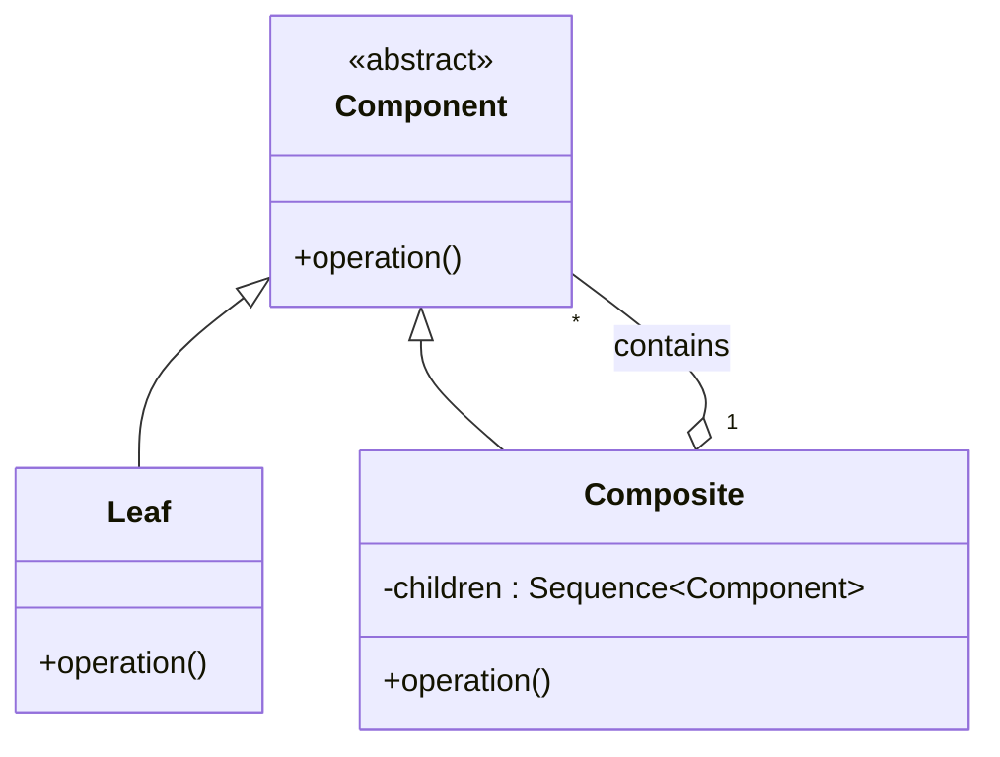
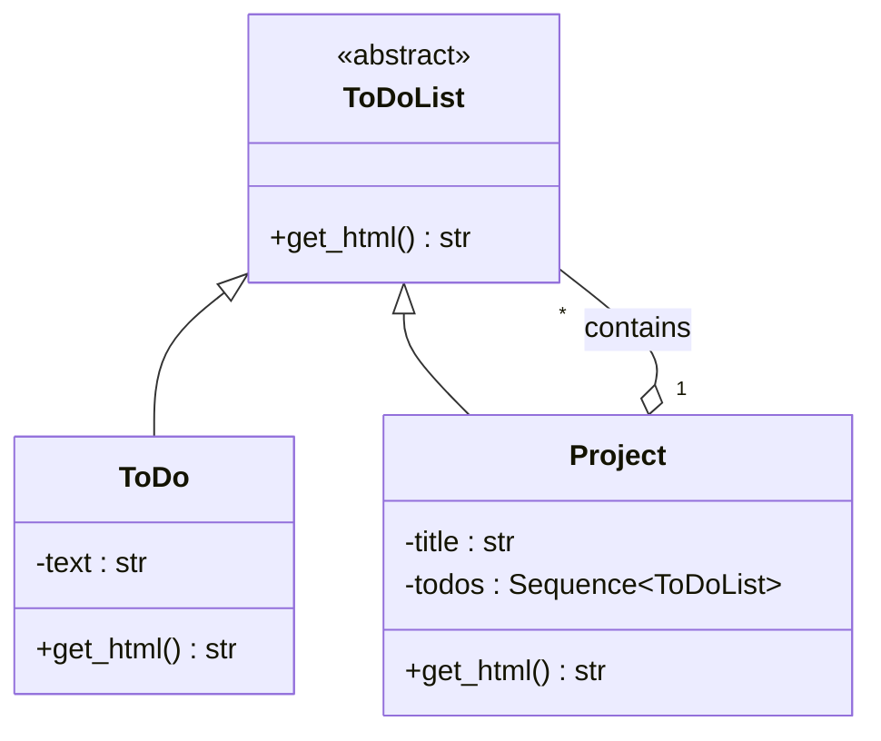

*This article is entirely based on a [YouTube video by Christopher Okhravi](https://youtu.be/EWDmWbJ4wRA?list=PLrhzvIcii6GNjpARdnO4ueTUAVR9eMBpc). The original book was not consulted for this design pattern.*

---

The word composite describes something made up of parts. A composite object is an object composed of other objects. The **Composite Pattern** exists for cases where a **client should be able to treat a single object and a composition of objects in the same way**. Both share a common type, so the same operation can be invoked without asking which kind of node is behind it.

This is useful whenever the domain forms a **part-whole hierarchy**: a tree in which every node is either an individual item or a group of items, and every group can contain further groups. The pattern gives every node a common type and lets recursion carry an operation through the entire tree.

# The Family Tree
1000
Consider a family tree. You are a node. You reference your two parents, each parent references two parents, and so on. The edges point upward, which is the opposite of the usual root-at-the-top drawing, but the direction does not change the structure. Each node references zero or more nodes of the same kind. A node with no further references is a **leaf**. A node that references other nodes is a **composite**. The node from which the whole structure is reached is the root.

The same shape repeats at every level. A parent with two parents is a composite. A grandparent whose parents are unknown is a leaf. Isolate any node and the subtree reachable from it: that node is the root of a smaller tree with the same properties. This self-similarity is **recursion**: an object of a type holds references to other objects of the same type, and an operation on the outer object triggers the same operation on the inner ones.

Suppose the operation is `get_last_names()`. A leaf returns its own last name. A composite returns its own last name and then asks every node it references for theirs. In pattern terminology, those referenced nodes are the composite's children. When the client calls `get_last_names()` on the root, the call propagates through the hierarchy. Each composite asks its children, each leaf terminates the recursion, and the results are concatenated. The client never checks whether a node is a leaf or a composite. It calls one method on the root.

**The client calls the same operation on the root and never checks whether a node is a leaf or a composite.**

The naive alternative is a procedure full of conditionals: if the node is a leaf, return its name; otherwise iterate over its children and combine their names. The pattern removes that conditional by giving both types the same contract and letting **polymorphism** select the implementation. The leaf returns one name; the composite loops over its children. The client sees only the common component type.

The family example happens to be binary, but the pattern does not require that. A composite can hold one child, ten, or a hundred. A collection with one element is still a collection, and a composite with one child is still a composite. An empty composite has no children, so operationally it may behave like a leaf, although its type remains composite. The literature usually assumes at least one child for a meaningful composite.

# The Formal Definition

The Gang of Four definition is compact:

> Compose objects into tree structures to represent part-whole hierarchies. Composite lets clients treat individual objects and compositions of objects uniformly.

The phrase part-whole hierarchy is the only difficult part. It means that each level is a whole made of parts, and each part can itself be a whole made of smaller parts. A project contains tasks and subprojects; a subproject contains tasks and further subprojects. The hierarchy is a tree of containment.

**Uniformly** means that the client can call the same operation on a leaf and on a composite. The operation is declared on the common component type. The leaf implements it directly; the composite implements it by delegating to its children. The client does not branch on the concrete type.

# Structure



The diagram shows the minimal structure. The books add optional structural methods to Component, which is the subject of the next section.

**Component** is the common type. It declares the **operation** that clients invoke. In the literature it is often an abstract class; in Python it is usually an abstract base class (`ABC`). An `ABC` makes the common type explicit and prevents instantiation until its abstract methods are implemented. A `Protocol` is an alternative when structural typing is preferred. This example uses `ABC` so the hierarchy is visible in the code and in the UML diagram. Type hints document the expected types, but they are not enforced at runtime; the `ABC` is what enforces the abstract methods.

Leaf implements Component. It has no children. Its implementation of the operation performs the work for a single object.

Composite implements Component and holds a collection of Component objects. Its implementation iterates over the collection, calls the operation on each child, and combines the results. Because the children are typed as Component, they can be leaves or other composites. That is the recursive relationship that creates the tree.

The client depends only on Component. It can hold a leaf, a composite, or the root of a large tree in the same variable, and it can invoke the operation without an explicit type check.

The operation is whatever the domain needs. The family tree used `get_last_names()`, the to-do example uses `get_html()`, and a later section adds `is_done()`. The operation can return a value, as these examples do, or it can perform a side effect. The pattern does not constrain the signature beyond the need for every node to support it.

UML represents the composite's child collection as an **aggregation**: the composite has components. The distinction between aggregation and plain association is not important here; what matters is the has-a relationship and the fact that the target type is the same Component type.

The GoF and Head First versions also place `add`, `remove`, and `get_child` on Component. That addition is where the design becomes contentious, and it deserves separate treatment.

# The Add and Remove Problem

The motivation for putting structural methods on Component is **transparency**. If every node is a Component, a client can add or remove a child without knowing whether the node is a leaf or a composite. The tree can be modified through the same component type used to traverse it.

The component contract with those methods looks like this (shown as a Python `ABC`):

```python
from abc import ABC, abstractmethod

class Component(ABC):
    @abstractmethod
    def operation(self) -> None:
        ...

    def add(self, child: "Component") -> None:
        raise NotImplementedError

    def remove(self, child: "Component") -> None:
        raise NotImplementedError

    def get_child(self, index: int) -> "Component":
        raise NotImplementedError
```

With this contract, a Leaf inherits concrete implementations for the structural methods it cannot meaningfully support. A leaf has no children, so its inherited `add` has no meaningful behavior. It raises `NotImplementedError`, returns `None`, or silently does nothing. `get_child` has the same problem: there is no child to return. Each option is a compromise:

- Throwing an exception turns a declared contract into a runtime failure.
- Returning `None` pushes a `None` check onto the caller.
- Doing nothing hides a programming error.

None of these makes a leaf a meaningful container. The leaf is forced to depend on operations it cannot support, which violates the **Interface Segregation Principle**: clients should not be forced to depend on methods they do not use.

The alternative is to put `add`, `remove`, and `get_child` only on Composite. The contract stays honest: leaves do not pretend to have children. But the client loses uniformity at the moment it modifies the tree. If the client holds a Component and wants to add a child, it must check whether the object is a Composite with `isinstance` and then call the method. That reintroduces the type check the pattern was meant to remove. Runtime type checks are sometimes unavoidable, but here it is a direct consequence of a contract that tried to be too general.

**Immutability** offers a third route. If the hierarchy is built once and never modified, `add` and `remove` are unnecessary. A change produces a new tree that shares the unchanged parts and replaces the path to the changed node. In this model, `add` on a leaf can return a new Composite containing the original leaf and the new child, so the method can be meaningful on Component. The leaf is not mutated; it is incorporated into a larger structure. The method must therefore return a new Component rather than `None`, which is a different contract from the mutable `add` methods in the books. This is elegant, but it is more machinery than the pattern needs for a first example.

Immutability has a broader motivation. Mutable object graphs are difficult to reason about, especially when multiple threads or asynchronous tasks can change the graph underneath a client. If an object's state is fixed at construction, reasoning is local: the object cannot change after it has been handed to someone else. The cost is that every update rebuilds part of the structure. React and other component-based UI libraries rely on this model: state is replaced rather than mutated in place. The trade-off is real, and the Composite Pattern does not settle it. It only makes the question visible.

The to-do example below therefore accepts a sequence of children in the constructor, stores it as a tuple, and exposes no mutation methods. The hierarchy is immutable by convention. This keeps the focus on the recursive structure rather than on the mutation API.

# A To-Do List

Consider a to-do application. A task can be a single item, or it can be a project containing other tasks and projects. The hierarchy is naturally recursive:

```text
My life (Project)
├── Buy milk (ToDo)
├── Work (Project)
│   ├── Write report (ToDo)
│   └── Reply to email (ToDo)
└── Call Sam (ToDo)
```

The same structure appears in component-based user interfaces. A page is a tree of components; a container holds child components, and each child can hold further children. An operation invoked on the root, such as a render or a refresh, can propagate through the tree. Data often flows down from parent to child, while events flow up. The to-do example is a smaller version of the same idea, with HTML generation as the operation.

The component is `ToDoList`, the leaf is `ToDo`, and the composite is `Project`. A `Project` is a to-do list that contains a list of to-do lists. The naming is deliberate: a project is not a separate concept from a to-do list; it is a to-do list that happens to contain other to-do lists.

The operation is `get_html()`. It returns a string of HTML representing the node. Rendering fits the pattern because the output of a composite is built from the output of its children.



## Rendering the Tree

HTML lists have a simple structure: a `<ul>` contains `<li>` elements, and a nested `<ul>` inside an `<li>` creates a sublist. A project needs a title, an opening `<ul>`, one `<li>` per child containing the child's HTML, and a closing `</ul>`.

A design question appears immediately: which node is responsible for the `<li>`? The leaf could return a complete `<li>text</li>`, or it could return only the text. If the application supported checkboxes, the checkbox markup would be part of the leaf's content as well. If the leaf returns a complete `<li>`, then a leaf rendered on its own produces an `<li>` without a surrounding `<ul>`, which is invalid HTML. A client that holds a `ToDoList` reference might legitimately call `get_html()` on a leaf, so the leaf's output should be valid on its own. The composite is the only node that knows it is building a list, so the composite adds the `<li>` wrappers and the `<ul>`.

**The composite owns the structure; the leaf owns its content.**

This is a general lesson about the pattern: the boundary between leaf and composite is a modeling choice. The pattern fixes the recursive relationship, not the division of markup, formatting, or business logic. Different divisions have different trade-offs. The right one depends on what the client is allowed to do with an individual node.

An earlier version of this example wrapped the title in an `<li>` inside an outer `<ul>`, then opened a second `<ul>` for the children. That produced a list with a single item whose only purpose was to hold the title. The title is a heading, not a list item. The final version uses `<h1>` and a single `<ul>` for the children.

```python
from abc import ABC, abstractmethod
from collections.abc import Sequence

class ToDoList(ABC):
    @abstractmethod
    def get_html(self) -> str:
        ...

class ToDo(ToDoList):
    def __init__(self, text: str) -> None:
        self._text = text

    def get_html(self) -> str:
        return self._text

class Project(ToDoList):
    def __init__(self, title: str, todos: Sequence[ToDoList]) -> None:
        self._title = title
        self._todos = tuple(todos)

    def get_html(self) -> str:
        parts = [f"<h1>{self._title}</h1><ul>"]
        for todo in self._todos:
            parts.append(f"<li>{todo.get_html()}</li>")
        parts.append("</ul>")
        return "".join(parts)
```

With these two classes, the client can build the hierarchy and treat it as a single `ToDoList`:

```python
root = Project(
    "My life",
    [
        ToDo("Buy milk"),
        Project(
            "Work",
            [
                ToDo("Write report"),
                ToDo("Reply to email"),
            ],
        ),
        ToDo("Call Sam"),
    ],
)

print(root.get_html())
```

The client never asks which child is a `ToDo` and which is a `Project`. The constructor accepts a `Sequence[ToDoList]`, and the call to `get_html()` on the root handles the rest.

`Project.get_html` builds the string in document order: the title, the opening list, one list item per child, and the closing list tag.

Two details are worth noticing. First, the constructor accepts a sequence of children and stores it as a tuple. There is no `add` or `remove`; the project is immutable, and later changes to the caller's list cannot alter it. Python does not enforce private attributes, but the leading underscore marks `_text`, `_title`, and `_todos` as internal. Second, `get_html()` in `Project` calls `get_html()` on each child. If the child is a `ToDo`, the call returns text. If the child is another `Project`, the same method runs on that instance, which iterates its own children. The recursion stops at leaves. The client calls `get_html()` once on the root.

For the tree above, the returned string represents the following document:

```html
<h1>My life</h1>
<ul>
  <li>Buy milk</li>
  <li>
    <h1>Work</h1>
    <ul>
      <li>Write report</li>
      <li>Reply to email</li>
    </ul>
  </li>
  <li>Call Sam</li>
</ul>
```

The output is formatted for readability; the actual method returns one continuous string. The example uses `"".join(parts)` instead of repeated concatenation. A production renderer might also vary the heading level with depth and HTML-encode user-provided text. Those changes do not affect the recursive structure.

Because the root is also a `Project`, the entire document is a single tree. The client does not need a separate renderer for leaves and composites, and it does not need to know how deep the tree goes.

# Computing Completion

Rendering is one operation. The pattern becomes more interesting when the same hierarchy supports a second operation with different semantics. Suppose each task can be marked done. A leaf stores a boolean. A project is done only if all of its children are done. Because children can be projects, the rule is recursive.

```python
from abc import ABC, abstractmethod

class ToDoList(ABC):
    @abstractmethod
    def get_html(self) -> str:
        ...

    @abstractmethod
    def is_done(self) -> bool:
        ...

class ToDo(ToDoList):
    def __init__(self, text: str, is_done: bool = False) -> None:
        self._text = text
        self._is_done = is_done

    def get_html(self) -> str:
        return self._text

    def is_done(self) -> bool:
        return self._is_done

class Project(ToDoList):
    # ... existing title, children, constructor, and get_html ...

    def is_done(self) -> bool:
        return all(todo.is_done() for todo in self._todos)
```

`Project.is_done` is a short-circuiting logical AND. `all()` returns false as soon as one child reports false; otherwise it returns true. When a child is a project, the same method recurses. The result propagates upward. In functional terms, this is a map of `is_done` over the children followed by a reduction with a logical AND.

Imagine a project with two subprojects, each containing two tasks. Asking the outer project whether it is done asks each subproject; each subproject asks its tasks. If any task returns false, its subproject returns false immediately, and the outer project can stop at the first false child. The short-circuit is the reason `all()` can stop at the first false child. An empty project returns true because no child contradicts the condition. If an empty project should count as incomplete, the method must check for that case explicitly.

**A project is done only when every child is done.**

In this design, project completion is a **computed value**. Python could expose it as a `@property`, but keeping `is_done()` as a method preserves the uniform operation contract. Not every domain wants those semantics. A project might be closable or cancellable even when some tasks remain open; then the project's done state is stored, not computed from its children. The pattern supports both designs, but the meaning of `is_done()` changes. The question is a requirements question, not a pattern question. The composite structure makes the recursive computation easy; it does not decide what completion means.

# Traversal and Responsibility

`get_html()` and `is_done()` both traverse the tree. The traversal is implicit in the recursion: each composite iterates its children and calls the same method. That is convenient, but it couples two concerns. The method both walks the structure and performs the operation at each node. A strict reading of the **Single Responsibility Principle** would separate traversal from computation. An iterator can walk the hierarchy and yield nodes; a renderer or a completion checker can then process each node. Head First discusses Composite and Iterator together for this reason.

The pattern does not require that separation. For a small operation, the recursive method is clear and compact. For multiple operations, or for operations whose traversal order matters, a separate iterator or visitor can be cleaner. The recursive `get_html` is a depth-first pre-order traversal: a project emits its title, then each child in order. Another operation might need post-order, breadth-first, or a filtered traversal. The composite supplies the structure; the **traversal** strategy is a separate decision.

Separating traversal also makes it easier to add operations without changing the node classes. The trade-off is additional indirection and another abstraction. The pattern's core benefit, uniform treatment of leaves and composites, does not depend on which side of that trade-off you choose.

# Trade-offs

Composite is a good fit when the domain is a tree of parts and wholes and when clients should not care whether they are dealing with one item or a group. It removes type checks from client code, makes recursive operations short, and allows new kinds of leaves or composites to participate through the common component type.

The costs are concentrated in the common contract. Every operation declared on Component must make sense for both leaves and composites. Structural operations such as `add`, `remove`, and `get_child` are the clearest example: they are natural for a composite and meaningless for a leaf. Putting them on the component contract preserves uniformity but violates interface segregation; putting them only on the composite preserves a clean contract but forces clients to perform runtime type checks. Immutability avoids the conflict by removing mutation from the design, at the cost of rebuilding paths.

| Strength | Cost |
|---|---|
| Clients treat leaves and composites uniformly | Every component operation must make sense for every node |
| Recursive operations are short and local | Deep recursion can be harder to trace |
| New leaf and composite types can join the hierarchy | Structural mutation forces a choice between runtime type checks and a polluted contract |

Use Composite when:

- The domain is naturally hierarchical.
- Clients should treat individual objects and groups uniformly.
- Operations can be expressed on a common component type and applied recursively.

Be cautious when:

- The hierarchy changes frequently and clients need structural mutation.
- Only composites support many operations.
- The uniformity would hide meaningful type differences.

Composite is often mentioned together with Decorator because both rely on a common type and recursive composition. Their intents differ: Composite represents a part-whole hierarchy, while Decorator adds responsibilities to an object. The comparison is a separate topic, but keeping the intent in mind prevents the two from being conflated.

# Summary

The Composite Pattern organizes objects into a tree and gives leaves and composites the same contract. A client calls an operation on the root and does not care which nodes are leaves and which are composites. The composite delegates to its children, the leaf terminates the recursion, and polymorphism replaces the conditional that would otherwise distinguish them.

The pattern is simple in structure and subtle in its design choices. The hard part is not the recursion; it is deciding what belongs on the component contract. `get_html()` and `is_done()` are natural because both make sense for every node. `add`, `remove`, and `get_child` are not, because a leaf cannot meaningfully support them. The add/remove debate, the immutability alternative, and the separation of traversal from computation are all consequences of that single question: what should every node be able to do?

**Composite lets a client treat a tree as a single object, and a single object as a tree.**
