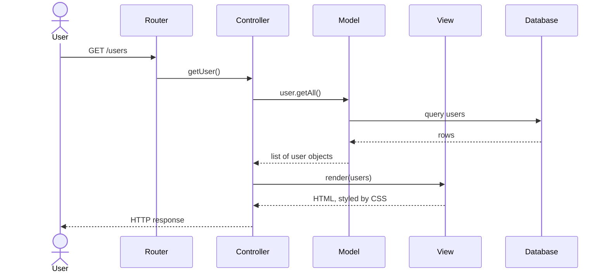
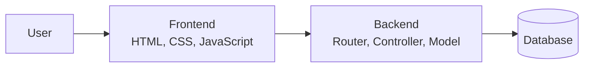

*This article is based on the [YouTube video "Introduction to System Design – MVC and Three-Tier Architecture" by Caleb Curry](https://www.youtube.com/watch?v=0e7yQ43bUtg).*

---

A user experiences an application as a single object. It might be a website, a mobile app, or a desktop program, but from the outside it is a box: a request goes in, a response comes out, and the machinery in between stays invisible. That abstraction is deliberate. Users should not need to understand routers, databases, or caches to send a message or load a page. Engineers, however, spend their time inside the box.

**System design** is the discipline of **deciding what that interior looks like**. The term has nothing to do with visual design. It concerns the **structure of the system**: where data lives, which services exist, how they communicate, and which trade-offs the arrangement imposes. This article starts with the smallest unit of that structure (how code is organized) and builds outward to the architecture of a deployed application. The focus is conceptual: how the pieces fit together, not a step-by-step implementation.

# Design Patterns, Software Architecture, and System Design

Three terms are often used interchangeably, but they describe different levels of organization.

**A design pattern** is a template for organizing code within a project. It defines which responsibilities belong together, which files or classes should exist, and how those pieces should collaborate. The purpose is to prevent a single file from accumulating every feature until it becomes impossible to navigate. MVC (Model-View-Controller) is a common example: it divides the code into logical sections with distinct roles.

**Software architecture** operates one level higher. A design pattern asks how code should be arranged inside an application; architecture asks how separate systems should interact to form a larger system. The questions change: Where will data be stored? Which type of database is appropriate? Should it run in the cloud or on local hardware? Will there be a caching layer? Which components talk to each other, and across which boundaries? Architecture patterns, such as three-tier architecture, provide templates for these decisions.

**System design** is broader still. It is the process of solving a specific problem end to end. Consider a messaging company that needs to send millions of notifications to its users. That is a system design problem. The answer is not one pattern or one technology; it is an architecture describing the databases, backend services, frontends, and communication paths required. Design patterns may appear inside the solution, but at this scale they are usually too granular to be the main concern.

Architecture and system design are the levels that matter most in practice. Growth is the force that exposes their boundaries: as an application scales from a single user to millions, every decision about code, data, and deployment acquires a visible cost.

| Level | Central question | Scope |
|---|---|---|
| Design pattern | How should code be organized? | Files, classes, and modules within one application |
| Software architecture | How should systems interact? | Servers, databases, caches, and services |
| System design | How do we solve this problem end to end? | The complete solution and its architecture |

# MVC: Organizing Code Within an Application

MVC is easiest to understand through a concrete request. Consider a website that displays a list of users. From the outside, the user sees one application. Inside, the code is divided into three responsibilities, all initially living in the same repository and running as a single project.

The flow begins with a request: `GET /users`, asking for the list of usernames.

1. **Router.** The router maps the request path and HTTP method to a handler. Each endpoint typically maps to a controller action.
2. **Controller.** The handler lives in a controller. The controller coordinates the request and calls the model: `user.getAll()`.
3. **Model.** The model handles data access. It queries the database (through an ORM or hand-written SQL) and returns a list of objects, one per user.
4. **View.** The controller passes the objects to the view. The view embeds them in HTML, styled by CSS, producing the page the user will see.
5. **Response.** The view returns the generated markup to the controller, which sends it to the client.

The client receives HTML containing the user data, styled by CSS. The router dispatched the request, the controller coordinated the work, the model retrieved the data, and the view presented it. That is the essential MVC loop.

A variation is worth noting. The response does not have to be HTML. The controller could expose a JSON API endpoint instead; the presentation layer would then serialize data rather than render a page. This becomes important for single-page applications and mobile clients. For now, the simpler model (a user requesting a web page with visible content) is enough.

At this point the application has one repository, one deployment, and one server. The same machine acts as both the web server and the database server, and the database is local to the application. This is the simplest possible structure, and it has a name: a **monolith**. Strictly speaking, a monolith is defined by a single deployable application unit, not by a single repository or server; it can still run on multiple servers and use an external database. It also does not mean that the code is one file. MVC can organize the code internally while the entire system remains a monolith.

# The Monolith and the Microservice Spectrum

Once the application grows, the next question is whether to split it. The alternative to a monolith is to turn some components into independent services. The distinction matters: MVC's model, view, and controller are logical components in code; services are architectural components that are deployed and scaled separately.

A natural first split separates the view from the rest of the application. The original application then retains routing and controller coordination, while the view becomes its own frontend. This first boundary is not yet a microservice architecture. As traffic and features grow, the backend itself can be decomposed into more dedicated services. This is the **microservice** approach: a system composed of small, independently deployable services.

The monolith is operationally simple. There are no network calls between the application's own modules, because they run in the same process; calls to a database, cache, or external API may still cross the network. There is no service discovery and no inter-service contract. The cost is that the application behaves as one large unit: in this single-server deployment, the database, controller, and view cannot be scaled independently. If one part needs more resources, the whole application must be scaled as a unit.

Microservices invert the trade-off. Each service can be scaled, deployed, and evolved independently. The price is communication: more connection points, more failure modes, more latency, and more operational work. A request that was once a function call becomes a network call.

The choice is not binary. Most systems sit somewhere between a single monolithic service and a large mesh of microservices. Having too many services for a small team produces overengineering; the complexity of keeping everything communicating can outweigh the benefit. An application that remains too monolithic becomes difficult to scale and maintain: one large system that is hard to keep organized and current. The goal is a balance appropriate to the system's size and the team's capacity.

The baseline is still one application on one server, handling routing, control, data access, and presentation. The next step is to separate the major responsibilities without turning everything into microservices.

# Three-Tier Architecture

MVC is primarily a code-organization and presentation pattern; some sources classify it as an architectural pattern, but it does not dictate a deployment architecture. The same MVC application can run entirely on one server. But once the system includes a database, routing, and views, it often makes sense to separate the major responsibilities physically. The result is the **three-tier architecture**.

The three tiers correspond roughly (though not exactly) to MVC's components: the view maps to the presentation tier, while the controller, the business logic, and the model, including its data-access code, map to the application tier. The data tier is the database itself, not the model. The mapping is useful, but the boundaries are architectural rather than logical.

The first split moves the database to its own server. In code, the change is minimal: the model's connection string now points to another machine. The model still calls the same data-access methods; assuming the same database engine, only the destination changes.

The controller and the model remain together in the backend application, which now runs on its own server. The controller still calls the model directly, because both are part of the same process; the model's data-access code talks to the database. The view becomes a dedicated frontend application responsible for HTML, CSS, and JavaScript, running on its own server.

Three tiers, three responsibilities: the frontend presents, the backend routes and executes application logic, and the database persists.

The request path changes. In the monolith, the user's request went directly to the application server. In the three-tier system, the user requests the frontend first. The frontend then requests data from the backend through its API. From there, the flow is familiar: the router maps the request to a controller, the controller calls the model, and the model queries the database. The model returns objects to the controller, and the controller returns the response data to the frontend (typically as JSON), which renders it as HTML, CSS, and JavaScript for the user.

The complete flow is:

1. The user requests the frontend.
2. The frontend requests data from the backend through its API.
3. The backend router dispatches to a controller.
4. The controller calls the model.
5. The model queries the database.
6. The database returns rows, and the model returns objects to the controller.
7. The controller returns the data to the frontend.
8. The frontend renders the response for the user.

The system now consists of **two application codebases** (frontend and backend) and **three deployable components**: frontend, backend, and database. You do not write the database engine, but you do design its schema, queries, and migrations. The code changes are conceptually small: extract the frontend into its own application, typically using a frontend library that makes requests to the backend, and update the model's connection string to point at the database's new location. The operational work is not small: the new network boundary brings API contracts, authentication, CORS, deployment, monitoring, and latency.

| Tier | Responsibility | Application code? |
|---|---|---|
| Frontend | Presentation: HTML, CSS, JavaScript | Yes |
| Backend | Routing, request handling, business logic, data access | Yes |
| Database | Persistence and query execution | No (engine); schema and queries are yours |

# Technology Choices and Hosting

The tiers become concrete when mapped to actual technologies. Specific libraries change over time; the responsibilities do not.

| Tier | Example technology | AWS hosting |
|---|---|---|
| Frontend | JavaScript, often with React | S3 |
| Backend | Python with Django | EC2 |
| Database | PostgreSQL, a relational database | RDS |

The frontend and backend can use different languages (JavaScript on one side, Python on the other) because they are separate runtimes that communicate through a network contract rather than through function calls. On AWS, the frontend can be hosted from S3, often with CloudFront; the backend on EC2; and the database on RDS. A cloud provider supplies the infrastructure and service-level agreements (SLAs) and removes the need to own and operate physical machines, but reliability and scalability still depend on how the system is designed. That is why learning at least one cloud provider is valuable.

Separating the tiers pays off primarily through **independent scalability**. If the backend needs more compute, it can run on multiple servers, for example three servers. That immediately raises a new question: when the frontend has three backend servers, which one should it call? A load balancer distributes requests across them. The database can also be scaled independently, but it brings its own set of problems. Every benefit introduces a new complexity; architecture is the practice of choosing which complexities are worth accepting.

For a typical web application with meaningful traffic, the three-tier shape is a sensible default, not a universal requirement. Running everything on a single server becomes uncommon as traffic and operational requirements grow, so many teams start with three tiers.

Monolithic MVC applications traditionally generated views on the server. Most backend ecosystems have a templating or view engine: Razor in .NET, Pug in the JavaScript ecosystem, and equivalents elsewhere. These engines take data and embed it in HTML, producing pages on the server. They are useful for understanding how a monolithic MVC application renders views. A common alternative is a dedicated frontend application built with a JavaScript library such as React. This is one valid path, not a universal rule; server-rendered views remain appropriate for many applications.

# Conclusion

The three levels fit together. A design pattern organizes code. An architecture organizes systems. System design solves a specific problem end to end, and the resulting architecture is the concrete arrangement of databases, services, and frontends.

MVC shows how code can be divided. The monolith shows how that code can be deployed as one unit. The three-tier architecture shows how the major responsibilities can be separated and scaled independently, at the cost of introducing network boundaries and operational complexity.

The next problem is growth: taking an application from one user to millions. That requires multiple servers, load balancing, caching, and a closer look at reliability. Each addition solves a specific bottleneck and introduces a new cost.

# Appendix: Topics for Future Expansion

The following topics are deliberately left out, or only touched on briefly, to keep this chapter close to the original video. They are candidates for a future revision or for separate notes.

- **Tiers, layers, and monoliths**: the difference between physical deployment boundaries and logical separation; why a three-tier architecture can run on one machine; the modular monolith as a middle ground.
- **API contracts and frontend runtime**: HTTP/JSON, GraphQL, versioning; server-side rendering versus single-page applications; why the browser constrains the frontend language.
- **Operational consequences of splitting**: networking, DNS, TLS, CORS, authentication, independent deployment, observability, latency, partial failure, retries, and timeouts.
- **Load balancing and statelessness**: health checks, distribution algorithms, session affinity, and why shared session state matters when the backend scales horizontally.
- **Scaling and caching**: horizontal versus vertical scaling, cache strategies, and the database as a bottleneck (connection pools, read replicas, write contention).
- **Database scaling and consistency**: replication, sharding, consistency, backups, and failover.
- **Requirements and constraints**: functional and non-functional requirements, scale, latency, availability, consistency, and cost as inputs to the architecture.
- **When a monolith is the right choice**: team size, domain complexity, operational maturity, and traffic; microservices as an organizational choice (Conway's law) and their cost.
- **Common pitfalls**: premature microservices, the distributed monolith, treating MVC as an architecture, assuming three tiers require three servers, and assuming the cloud provides scalability automatically.
- **Terminology and diagrams**: a glossary (ORM, API, JSON, repository, deployment, server, service, load balancer, S3, EC2, RDS), a three-tier sequence diagram, and a comparison table for monolith, modular monolith, and microservices.
