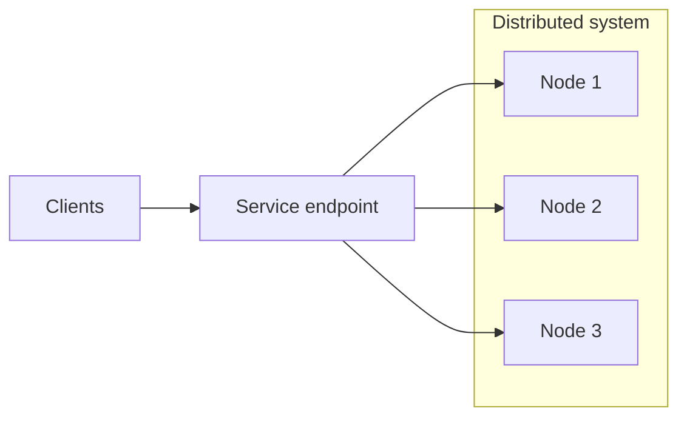
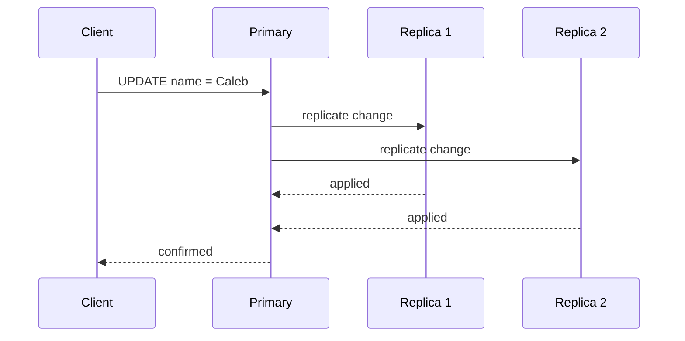
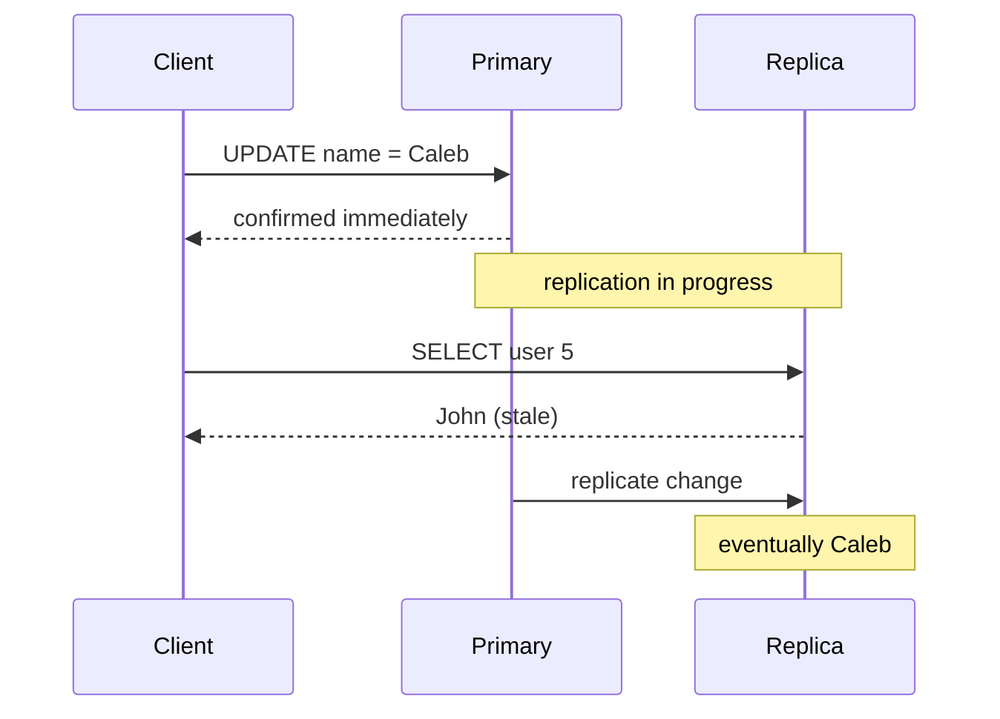
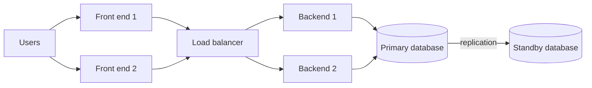
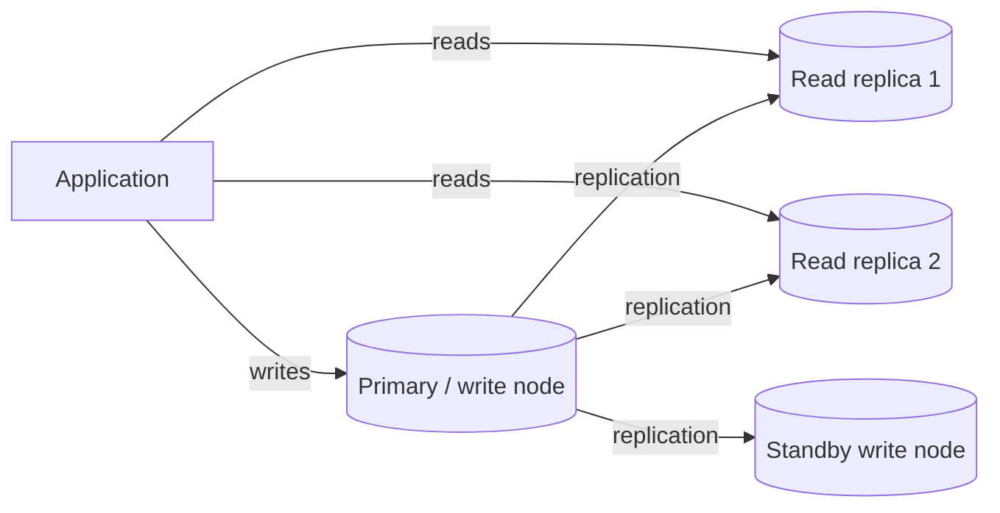
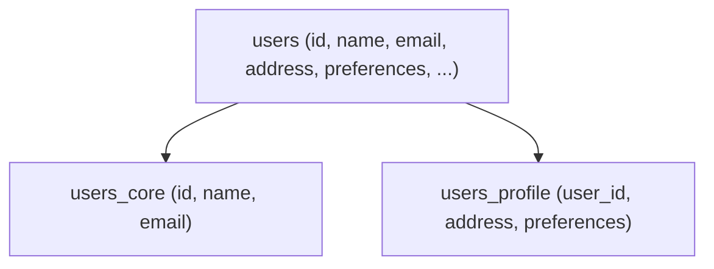
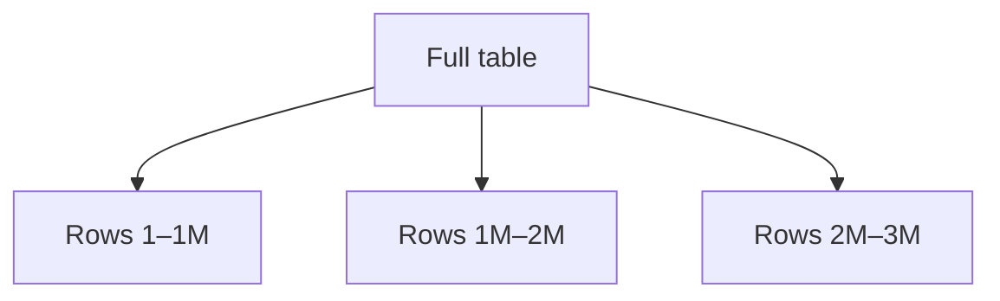
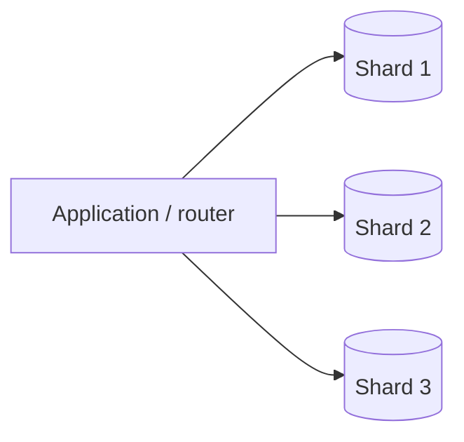

*This article is entirely based on a [YouTube video by Caleb Curry](https://www.youtube.com/watch?v=uxskKNcsFLU).*

---

System design has a vocabulary of its own. Before an application can be scaled from a handful of users to millions, the terms used to describe its behavior need to be clear: availability, reliability, consistency, scalability, redundancy, replication, partitioning, sharding, and ACID. None of them is difficult in isolation. The difficulty comes from the way they interact, and from the fact that improving one usually means paying for it somewhere else.

What follows is a map of that vocabulary. It is not a complete design methodology, and it does not try to turn every term into a recipe. The goal is to establish what each concept means, why it exists, and which trade-off it represents, so that the deeper lessons have somewhere to attach.

# Distributed Systems

An application is **distributed** when it **runs across multiple computers** rather than on a single machine. The term is general: it can describe the backend, the database, or any other part of the system. The defining property is not the technology but the arrangement. Several computers must cooperate to produce what the user experiences as one result.

Distributing a workload is how a system can exceed the capacity of one machine. It is also how a system acquires a new class of problems. Once there is more than one computer, the system must coordinate work, route requests, tolerate partial failure, and decide what happens when two nodes disagree. Most of the concepts in this article are consequences of that single step.



The three nodes cooperate to produce one logical service. A client does not need to know which machine handled a request, or that more than one machine exists.

# Availability and the Nines

**Availability** is the ability to access a service. A **highly available** system keeps accepting requests even when one of its **components fails**. If three nodes can serve the same request and one goes down, the other two can absorb its load; a request that would have gone to the failed node is routed to a healthy one.

An availability target of 100% is impossible. Hardware fails, networks partition, deployments go wrong, and no guarantee can cover every eventuality forever. The practical goal is to get as close to 100% as the application's budget and risk tolerance justify.

Availability is usually expressed in **nines**: the percentage of time the service is expected to be operational. Each additional nine is a tenfold reduction in allowed downtime.

| Availability | Nines | Downtime per year |
| --- | --- | --- |
| 90% | 1 | 36.5 days |
| 99% | 2 | 3.65 days |
| 99.9% | 3 | 8.76 hours |
| 99.99% | 4 | 52.6 minutes |
| 99.999% | 5 | 5.26 minutes |
| 99.9999% | 6 | 31.5 seconds |

A two-nines target sounds reassuring until it is translated into days: a service can be unavailable for more than three and a half days a year and still meet a 99% target. Four nines is a common ballpark for production systems, because it translates to less than an hour of downtime per year. That is still unacceptable for some domains. Medical, financial, or military systems may need five or six nines, but four is a reasonable starting point for many applications.

Moving from one nine to the next is not a linear improvement in engineering effort. It requires more redundancy, better failover, more monitoring, and more operational discipline. The cost rises sharply, often exponentially, and so does the difficulty of hiring and retaining people who can run the system. Availability is therefore an economic decision as much as a technical one.

# Reliability Is Not Availability

Reliability is a service's ability to do what it is supposed to do. Availability asks whether the service can be reached; reliability asks whether the service is correct once it is reached.

A service can have six nines of availability (99.9999%) and still be unreliable. If it accepts requests but loses data, returns incorrect results, or completes only part of a transaction, the uptime number is meaningless. The system is up, but it is not doing its job.

Reliability is harder to express as a single number because it depends on the application's definition of success. For a payment system, a successful operation may mean that the balance changed exactly once and the ledger is consistent. For a messaging system, it may mean that a message is delivered at least once, or exactly once, depending on the contract. The team has to define what correct behavior looks like, then measure against that definition.

The difference is easy to remember with an analogy. Imagine a friend who always answers the phone, always replies to messages, and is never hard to reach. That friend is highly available. Now imagine you ask that friend to help you move, and they either fail to show up or arrive without doing anything useful. They were available, but they were not reliable. Availability is about access; reliability is about whether the interaction produces the promised result.

# Consistency

Consistency describes whether everyone sees a consistent view of the data. Informally, it means that once a write is visible, no client should observe the old value. In a single-server system, the question almost disappears: there is one source of truth, so a read sees the current committed state rather than a stale replica. A distributed system removes that guarantee.

Consider three database nodes, with different clients reading from different nodes. A user's name is updated from John to Caleb on one node. If the change has not yet reached the other nodes, one client may see Caleb while another still sees John.

```text
After UPDATE name = 'Caleb':

Node 1 → Caleb
Node 2 → Caleb
Node 3 → John    ← stale
```

The results are inconsistent. This is the difference between strong consistency and eventual consistency.

## Strong Consistency

With strong consistency, a write is not acknowledged until the system can guarantee that no later read will observe the old value. A common way to implement this is to combine a write quorum with a read quorum that overlaps: if a write is acknowledged by `W` replicas and a read consults `R` replicas, then `W + R > N` (where `N` is the number of replicas) ensures that at least one node in the read set has seen the latest write. The protocol must also use versioning or read repair to identify the newest value. Waiting for every replica that can serve reads (or routing all reads to the primary/leader) is an alternative. Waiting for a write quorum alone is not enough: a read served by a replica outside that quorum can still return stale data. The change may be pending while it propagates, and the client waits.

The benefit is correctness: once the write is confirmed and the read path uses an intersecting quorum (or the primary), no client can observe the old value. The cost is time: the write takes at least as long as the slowest node in the required quorum needs to respond. The system has traded latency for consistency.



## Eventual Consistency

With eventual consistency, the write is confirmed on the node that accepts it, and replication happens in the background. The other nodes will receive the change eventually, provided the system keeps running and no new writes interfere, but there is a window in which they can return stale data.

The benefit is speed: the client does not wait for every replica. The cost is a temporary inconsistency. A read immediately after the write may return the old value, and different clients may see different states.



Eventual consistency is not consistency in the strong sense. It is a weaker promise: if writes stop, the replicas will converge to the same value, but there is no guaranteed upper bound on how long that convergence takes. Between the write and that convergence, stale reads are possible.

## Choosing Between Them

Neither model is universally correct. The choice depends on what stale data would cost.

Banking is the canonical example for strong consistency. Suppose you transfer the last $100 in your account. The primary node records the transfer and shows a balance of zero. If another node still shows $100, a second transfer could be approved against money that no longer exists, or a loan decision could be made on the wrong balance. Core ledger operations and balance-changing transactions usually belong on the strong side of the spectrum.

Medical and military systems often fall on the same side, especially when decisions depend on current state. A record that has not propagated can affect a diagnosis, and a stale view of a battlefield can affect a decision. The caveat is that not every medical record needs strong consistency: much of that data changes rarely, and the cost may not be justified. The real question is whether a stale read at the wrong moment is merely inconvenient or actually harmful.

Social media and ordinary CRUD applications usually sit on the eventual side. If a status update takes a few seconds to appear for some users, nothing catastrophic happens. The application gains faster writes and can serve readers from replicas without waiting for global agreement.

Strong consistency also has a hidden cost that reappears later. The CAP theorem states that, during a network partition, a distributed system must choose between consistency and availability: a system that insists on strong consistency may have to refuse some operations, while a system that prioritizes availability may return stale data. The consistency in CAP is usually understood as linearizability, and the trade-off applies only while the partition lasts.

# Scalability

Scalability is the ability to support an increase in workload. The increase can be gradual, such as more users every month, or sudden, such as a Black Friday traffic spike. A scalable system can absorb that growth without collapsing.

Scalability is the term most likely to be used as a synonym for "good engineering," which is precisely why it deserves a precise definition. It is necessary, but it is not sufficient, and it is not the same as availability or reliability.

## Over-Provisioning

The simplest way to make a system scalable is to provision more capacity than it currently needs. A server has a fixed amount of CPU, memory, and storage. If normal usage consumes 20% of that capacity, there is room to grow. As utilization approaches the maximum, response times rise, queues form, and failures become more likely.

The goal is to keep enough headroom for both ordinary variation and peak load. If peak usage still fits comfortably within the server's maximum, the service can absorb the spike. The trouble begins when the peak itself exceeds what one server can provide; at that point, over-provisioning has reached its limit.

## Vertical and Horizontal Scaling

When a single server is no longer enough, there are two directions to grow.

**Vertical scaling** (scaling up) means making the server stronger: more CPU, more memory, faster storage. The application still runs on one machine, but that machine has more capacity. It is often the first move because it requires no architectural change.

**Horizontal scaling** (scaling out) means adding more servers and distributing the workload across them. Instead of one large machine, the system runs several smaller ones. The two approaches can be combined: add servers and make each server stronger.

```text
Vertical scaling (scale up)

  ┌─────────────┐        ┌───────────────────┐
  │   Server    │  ───▶  │   Larger server   │
  │  4 CPU/8 GB │        │ 16 CPU/64 GB      │
  └─────────────┘        └───────────────────┘

Horizontal scaling (scale out)

  ┌─────────────┐        ┌─────────────┐
  │   Server    │  ───▶  │   Server 1  │
  └─────────────┘        ├─────────────┤
                         │   Server 2  │
                         ├─────────────┤
                         │   Server 3  │
                         └─────────────┘
```

A single server has a ceiling: there is a largest machine available, and it becomes expensive well before the workload stops growing. Horizontal scaling has no equivalent hard ceiling, but it introduces coordination. Requests must be distributed, sessions may need to be shared, and the database may become the next bottleneck.

## Elasticity

Scalability and elasticity are related but not identical. Scalability is about handling an increase in workload. Elasticity is about adjusting capacity automatically in both directions: up when demand rises, down when demand falls.

An elastic system might add servers during a daily peak and remove them overnight. A scalable but non-elastic system might require an engineer to add capacity manually, and might keep that capacity running even when it is idle. Elasticity is therefore as much about cost as about performance.

Elasticity is usually provided by a cloud platform. Because the underlying resources are virtualized, the provider can allocate more CPU or memory to an application without physically installing hardware. The application sees a larger or smaller machine, while the provider moves capacity around behind the scenes.

Scalability can be achieved through over-provisioning, vertical scaling, horizontal scaling, or automation. Elasticity is the automation of capacity in response to current demand. A system can be scalable without being elastic (for example, manual vertical scaling), and it can be elastic without being scalable if the added capacity does not relieve the actual bottleneck (for example, autoscaling application servers in front of a single-writer database). Elasticity can enable scalability, but it does not guarantee it; the terms emphasize different things.

## Scalability Does Not Imply Availability

One clarification prevents a common confusion: scalability is not availability. A single server can be scaled vertically until it reaches the largest available machine. If that server fails, the entire service goes down. The system handled more load, but it did not become highly available.

This is the idea of a **single point of failure**: a component whose failure takes down the whole system. A single database with no standby is a single point of failure, no matter how much CPU it has. Availability requires redundancy, not just capacity.

# Single Points of Failure, Redundancy, and Fault Tolerance

A single point of failure is any link in the chain that has no backup. If it fails, the system fails. The job of a system designer is to find those links and decide which ones are worth duplicating.

Redundancy is the presence of an extra component that can take over when the primary one fails. The everyday meaning of redundant is negative, something unnecessary that should be removed, but in computing it is usually desirable. A spare tire is the classic analogy: it does nothing while the car is running normally, but it turns a flat tire from a disaster into an inconvenience.

Redundancy costs money. Two database instances cost more than one, and the standby must be kept current. The question is whether the cost of downtime is higher than the cost of the spare.

Consider an application with a redundant front end, a load-balanced backend with multiple servers, and a single database. The front end and backend can survive a failure, but the database cannot. That database is the single point of failure. Adding a standby database removes it; the diagram below shows the resulting system, with the standby receiving replication from the primary.



The standby is different from the backend servers. The backend servers share the load; the standby database normally receives no client traffic. It exists to be promoted if the primary fails. Because it holds a copy of the data, it can take over when that happens. With synchronous replication, the standby is up to date but the primary may have to wait for it; with asynchronous replication, the primary is not slowed down, but the standby may be missing the most recent writes.

A system that continues to provide its service correctly when a component fails is **fault tolerant**. Fault tolerance is related to high availability but not identical: high availability focuses on keeping the service reachable, often through failover and possibly with a brief interruption, while fault tolerance focuses on continuing correct operation in the presence of faults. Redundancy is one of the mechanisms; removing single points of failure is the method. The specific mechanism used for the database is **replication**: the primary's data is copied to a secondary node.

A **node** is simply one computer in a multi-computer system, one server participating in the larger arrangement. The term is deliberately generic because the same idea applies to application servers, database servers, and other components.

# Database Replication

Replication is the process of creating and maintaining copies of data on multiple nodes. In a database cluster, a common arrangement is one primary node that accepts writes and several replica nodes that serve reads.

Terminology varies. You may hear master/slave, primary/replica, or leader/follower. In a single-leader setup, the names change but the roles are the same: one node is authoritative for writes, and the others hold copies.

## Read Replicas and Write Nodes

Read replicas are useful because most applications read far more than they write. A typical ratio might be 80% reads and 20% writes. If every read has to go to the primary, the primary becomes the bottleneck even though the replicas are idle. Routing reads to replicas spreads the load and lets the read capacity scale independently.

In this setup, the primary remains the only node that accepts writes. A standby write node can exist for redundancy, but it does not normally accept write traffic; it waits to be promoted if the primary fails. Running multiple active write nodes is a multi-master setup, which introduces conflict resolution and coordination problems that are best deferred until the basics are solid.



## Synchronous and Asynchronous Replication

The consistency model of a replicated database depends on how replication is performed and on where reads are served.

**Synchronous replication** waits for the replicas, or for a quorum of them, to apply the change before confirming the write. It is a common building block for strong consistency, but it is not sufficient by itself: if the write waits for a quorum `W`, reads must consult an intersecting quorum `R` such that `W + R > N`, or must be served by the primary/leader. Otherwise a read from a replica outside the write quorum can still see the old value. With that read-path guarantee in place, every replica in the required set has the new value once the client receives confirmation. The cost is latency. The write takes as long as the slowest required replica needs to respond, and a slow or unavailable replica can hold up the entire operation.

**Asynchronous replication** confirms the write on the primary and sends the change to the replicas in the background. It is commonly used to implement eventual consistency: the write can be confirmed without waiting for the replicas, but a read from a replica may return stale data until replication catches up. The guarantee also depends on where reads are served; a system with asynchronous replication can still provide strong consistency for reads that go to the primary.

Latency is the time between a request and its response. Consistency increases latency because the system must wait for more work to finish before it can answer. That delay is not free: it is visible to users as a slower application.

A useful way to remember the trade-off is that synchronous replication buys correctness with time, while asynchronous replication buys time with a window of incorrectness.

## Multi-Master Replication

Multiple write nodes are possible, but they are a significant step up in complexity. If two nodes accept writes to the same record at the same time, the system needs a rule for which write wins, or a way to merge conflicting changes. Those rules affect correctness and are easy to get wrong.

For most applications, the first scaling step is not multi-master. It is a single write node, several read replicas, and a standby for failover. That arrangement handles the common read-heavy workload while keeping the write path simple.

# ACID

The previous sections dealt with data spread across nodes. A single database has its own set of guarantees, and those guarantees matter even on one computer. The acronym is **ACID**: atomicity, consistency, isolation, and durability.

Most relational databases, such as PostgreSQL, aim to be ACID-compliant. Some databases relax one or more properties in exchange for scalability or flexibility. ACID is therefore a useful baseline for judging what a database promises, not a universal law.

| Property | Guarantee | What it prevents |
| --- | --- | --- |
| Atomicity | A transaction is all-or-nothing. | Partial completion. |
| Consistency | A transaction moves the database from one valid state to another. | Violations of integrity rules. |
| Isolation | Concurrent transactions do not interfere. | Interleaving that produces impossible results. |
| Durability | Committed data survives failures. | Loss of acknowledged writes. |

## Atomicity

Atomicity treats a transaction as a single unit. It either succeeds completely or fails completely; there is no state in which half of the work has been applied. A transfer that debits one account must also credit the other. If the credit fails, the debit is rolled back.

The name comes from the idea of an atom as indivisible, even though physics later complicated that metaphor. In a database, the important part is the all-or-nothing behavior.

## Consistency

ACID consistency is not the same as distributed consistency, and the shared word is unfortunate. Here, consistency means that a transaction takes the database from one valid state to another. The database enforces rules, constraints, foreign keys, uniqueness, and other integrity checks, and a transaction that would violate them is rejected.

Referential integrity is a concrete example. If an order references a customer, the database can enforce that the customer exists. A transaction cannot leave the order pointing at a customer that was never created. The result is data that satisfies the schema's invariants.

## Isolation

Isolation means that concurrent transactions behave as if they ran independently. One transaction should not see another transaction's uncommitted intermediate state. The strongest isolation level, serializability, makes the final result equivalent to some serial execution of the transactions; weaker levels allow certain anomalies but still define a consistent contract for concurrency.

Real databases offer isolation levels rather than a single binary guarantee, because full serializability can be expensive. The details depend on the database and the level chosen, but the purpose is always the same: prevent concurrent work from corrupting the result.

## Durability

Durability means that once a transaction is committed, it stays committed. A power failure immediately after the commit should not erase the write. The database may use a write-ahead log, fsync, or other mechanisms to make the commit persistent; the implementation varies, but the promise is that acknowledged data survives.

This is the property that lets an application treat a successful commit as a checkpoint. After that point, it does not need to worry that the data will silently revert to an earlier state.

# Partitioning and Sharding

Replication copies the same data to multiple nodes. Partitioning takes the opposite approach: it divides the data into smaller pieces. The two techniques solve different problems, and they are often used together.

Partitioning can happen inside a single database instance or across a cluster. The term is general; **sharding** is a specific kind of partitioning that distributes the pieces across different nodes.

## Vertical Partitioning

Vertical partitioning splits a table by columns. A wide table with many columns is divided into narrower tables, each holding a subset of the columns. Every partition keeps the original primary key (or a shared unique key), so the original record can be reconstructed by joining the pieces on that key. A foreign key may be used in the detail table to enforce the relationship with the base table, but the defining mechanism is the shared primary key, not a foreign key.

This is useful when a table is large because each row contains a lot of data, and when different columns are accessed by different workloads. A query that needs only one of the narrower tables reads fewer columns and therefore less data per row, although queries that need columns from multiple tables must pay for a join. The schema also becomes more modular.



## Horizontal Partitioning

Horizontal partitioning splits a table by rows. Instead of dividing the columns, it divides the records into subsets: rows 1 through 1,000,000 in one partition, the next million in another, and so on.

A query that filters on the partition key and needs only one subset touches fewer rows, which reduces I/O and improves performance. Without such a predicate, the database may have to scan every partition. The partitions can live in the same database instance; PostgreSQL, for example, supports declarative partitioning and presents the partitioned table as a single logical table. Without native support, a view can combine the pieces behind a common interface.



## Sharding

Sharding takes horizontal partitioning one step further: the partitions are placed on separate nodes. Each node holds only a subset of the data, so no single node needs to store or process the entire dataset.

If the data is divided into three shards, each node handles roughly a third of the rows. That reduces storage and query load per node, and it allows the dataset to grow beyond the capacity of one machine. The cost is that the application or a routing layer must know which shard holds a given record.



The choice of shard key is critical. A poor key can concentrate traffic on one shard, recreate the original bottleneck, or make common queries require a fan-out across every node. Rebalancing is also harder than adding a read replica, because moving data between shards changes where records live.

Replication and sharding are complementary. Replication can improve availability and read capacity by copying data, provided reads are routed to the replicas; sharding can improve read, write, and storage capacity by splitting the data across nodes. A large system may shard the data and replicate each shard.

# Caching and Managed Databases

The final pieces are not new distributed-systems primitives. They are practical ways to avoid needing all of the machinery at once.

## Caching

Caching stores a copy of frequently used data in a fast layer, usually in memory, so that repeated requests do not have to recompute a result or query the database. If a large share of reads can be served from the cache, the database load drops dramatically. Common implementations include Redis and Memcached.

That can change the architecture. A system that would otherwise need a complex cluster of read replicas may be perfectly comfortable with a primary database, a standby for availability, and a cache in front of the hot data. The cache does not remove the need for a database; it reduces how often the database is asked to do expensive work.

Caching introduces its own problems: the cached copy can become stale, and invalidation is notoriously easy to get wrong. Those details deserve dedicated treatment. The important point here is that caching is a scalability tool, and sometimes the most effective one.

## Serverless Databases

Cloud providers offer managed databases that hide much of the operational work: provisioning, replication, failover, backups, and scaling. A serverless database takes this further. The name does not mean that no servers exist; it means that the provider manages them completely, and the customer pays for usage rather than for a fixed instance.

Serverless databases are elastic by design. They grow and shrink with demand without an operator adding or removing hardware. That convenience can be worth a lot, especially for a small team that does not want to become a database operations team. It can also be expensive at scale, and it can hide costs that are easier to see with a fixed instance.

The trade-off is the familiar one: control and predictability versus convenience. A managed service removes work; it does not remove the need to understand the concepts. Someone still has to choose the consistency model, the replication strategy, and the sharding key, or at least understand the defaults.

# The Map, Not the Territory

These concepts form a connected map rather than a list of independent definitions.

| Concept | Question it answers |
| --- | --- |
| Distributed system | How do multiple computers cooperate to act as one? |
| Availability | Can clients reach the service? |
| Reliability | Does the service do the right thing? |
| Consistency | Do all clients see a consistent view of the data? |
| Scalability | Can the system handle more work? |
| Elasticity | Does capacity adjust automatically? |
| Fault tolerance | Does the system keep working correctly when something fails? |
| Replication | How is data copied to other nodes? |
| Partitioning | How is data divided into smaller pieces? |
| Sharding | How is partitioned data distributed across nodes? |
| ACID | What does a single database guarantee about transactions? |

The interactions are where the real design work happens. Strong consistency strengthens the data guarantee but can hurt availability. More nines improve uptime but raise cost and complexity. Replication can improve read capacity and fault tolerance but introduces lag. Sharding can improve capacity but complicates routing and rebalancing. Caching improves speed but introduces staleness. There is no configuration in which every property is maximized; there are only choices about which risks are acceptable for a given application.

The next step is to apply these terms to a concrete system: start with a small application, add users, and watch which component becomes the bottleneck first. That is where the vocabulary stops being a glossary and starts being a design method.

# Appendix: Topics for Future Expansion

The following topics are only touched on briefly, or deliberately left out, to keep this chapter close to the original video. They are candidates for a future revision or for separate notes.

- **Quorums and consistency**: how read and write quorums (N, W, R) can provide strong consistency without requiring every replica to participate.
- **Read-your-writes and replication lag**: the problem of reading from a replica immediately after a write, and how routing or session guarantees solve it.
- **Isolation levels**: read uncommitted, read committed, repeatable read, serializable, and the anomalies each level permits.
- **Cross-shard queries and transactions**: fan-out reads, distributed transactions, two-phase commit, and application-level compensation.
- **Failure domains and tested failover**: why a standby in the same rack, power supply, or region is not real redundancy, and why failover must be exercised.
- **Backups versus replicas**: why replication does not protect against accidental deletion or logical corruption.
- **CAP, PACELC, and ACID versus BASE**: the precise meaning of consistency and availability in CAP, the latency/consistency trade-off outside partitions, and how distributed databases relax ACID guarantees.
- **Capacity and performance metrics**: throughput, latency, utilization, and the read/write ratio as ways to make “workload” concrete.
- **Caching strategies and invalidation**: cache-aside, write-through, TTL, invalidation, and cache stampede.
- **Load balancing and statelessness**: how requests are distributed across horizontally scaled servers, and why shared session state matters.
