*This article is entirely based on a [YouTube video by Caleb Curry](https://www.youtube.com/watch?v=tjubQ97lxA4).*

---

Scaling a web application is often presented as a checklist: add a load balancer, add a cache, add a CDN, shard the database. That checklist is misleading. Each component exists to solve a specific problem, and each one introduces a new cost. The useful exercise is to start with the smallest system that works, let it reach its limit, and add only the component that removes that limit.

This chapter follows that exercise from beginning to end. It starts with a single server running the frontend, the backend, and the database, then moves through the three-tier architecture, horizontal scaling, load balancing, caching, CDNs, and database scaling. The order is deliberate: the backend is addressed before the database because the backend performs computation for every request, while the frontend is mostly static and the database can be scaled vertically for a long time.

The goal is not to memorize the final diagram. It is to understand why each box appears, what it fixes, and what it makes more complicated.

# What Scalability Means

**Scalability** is the ability of a system to support more users without collapsing when it reaches its maximum capacity. The definition sounds simple, but the important part is the word *more*: more traffic, more data, more concurrent work. A system that works for a hundred users is not necessarily scalable to a million; it may simply be sized for a hundred.

Capacity is usually discussed in terms of utilization. A server at 50% utilization has room to absorb a burst. A server at 70% may still be perfectly healthy if the load is steady. The exact threshold is not universal: it depends on how much variation the computation requires. A constant 70% can be safer than an average of 60% with regular spikes to 90%. The average hides the moments that actually break the system.

Real traffic varies on at least two timescales. The first is short-term variation: time of day, day of the week, season, or a periodic event. An application may sit at 60% most of the time and jump to 90% on weekends. The second is long-term growth: the application may have twice as many users next year. These are different problems. Short-term variation calls for enough capacity or elasticity to absorb peaks. Long-term growth may require structural changes, because adding capacity to a poorly structured system eventually stops working.

Scalability therefore has two dimensions: the ability to handle ups and downs, and the ability to grow over time. The first can often be solved by adding a stronger server or more servers. The second often requires introducing new systems or reorganizing the backend. This chapter addresses both.

# Vertical and Horizontal Scaling

**Vertical scaling**, or scaling up, improves the power of a single system: more CPU, more RAM, faster storage, a larger machine. **Horizontal scaling**, or scaling out, adds more servers and distributes work across them.

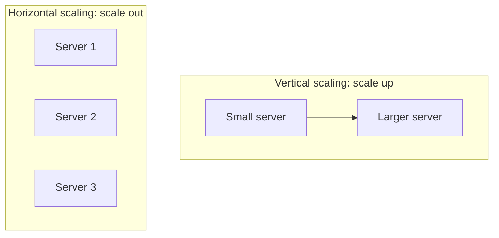

The two approaches can produce similar results. A single server with twice the resources and two servers with the original resources may both support roughly twice the load. Most real systems use a combination. The choice is not ideological; it depends on cost, operational complexity, and the workload.

Horizontal scaling introduces a conceptual shift: multiple servers must behave as a single logical unit. That only works if the backend is designed for it, usually with a load balancer in front of the pool. A stateless API is the easiest case: each request contains everything the server needs, so any server can handle any request. A database is much harder because it holds state; adding another database does not automatically give you twice the capacity, and keeping the copies consistent is a separate problem.

**Autoscaling** automates the horizontal dimension. When traffic rises, the platform adds nodes; when the spike passes, it removes them. This is often described as **elasticity**, which is related to scalability but not identical. Scalability is the ability to support growth; elasticity is the ability to adjust capacity dynamically. A system can be elastic without being scalable (if the added nodes do not relieve the actual bottleneck) and scalable without being elastic, for example when capacity is added manually. The number of nodes is not dictated by a rule: three is a common illustration, not a requirement. A node is simply a server, and the right number is the one the workload requires.

# The Architecture We Will Scale

The reference architecture for the exercise is the three-tier architecture: a database layer, a backend layer, and a frontend layer.

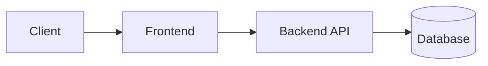

The frontend can be a website, a mobile application, a desktop application, or even a video game. What matters is that it connects to a centralized backend and that the backend connects to a database. The tiers are drawn separately because they scale differently. The frontend often consists mostly of static files and client-side code; the backend performs computation for every request; the database stores state and is the hardest tier to distribute.

This is why the backend is the first focus. It is where computation happens for each request, and it is usually the first bottleneck. It is also the tier where changes can reduce pressure on the database: if the backend can answer a repeated read from a cache, the database never sees that request. The database can then be scaled vertically for longer, avoiding the complexity of distributed data. The frontend, by contrast, is mostly a distribution problem, and the database is a state problem. The backend is the computation problem, and it sits in the middle.

# Stage 1: Everything on One Server

The simplest architecture puts the database, the backend, and the frontend on a single server. This is what happens when you install PostgreSQL on your laptop, run a backend process, and put Nginx or Apache in front of it.

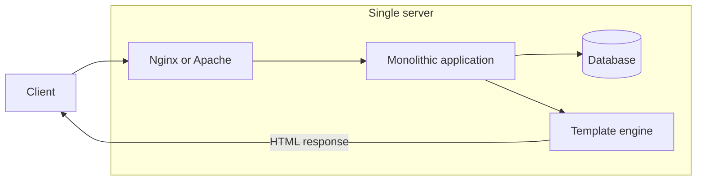

The request path is straightforward. A client sends an HTTP request. Nginx or Apache accepts it and forwards it to the application. The application is a monolith: it contains the routing, the API, the business logic, and the ORM used to talk to the database. Because the database is on the same machine, the query does not leave the machine. The application then renders the response, often with a template engine such as Jinja2, Razor, or Pug, which combines backend data with an HTML template on the server. The result is an HTML document that references the CSS and JavaScript the browser will fetch.

The code may be organized with the MVC pattern. A request hits a controller; the controller uses models to read or write the database; the view renders the template; the response goes back to the user. MVC is a useful way to organize the code, but the architectural fact that matters here is simpler: every component shares one computer.

## Advantages of the Single Server

**It is the easiest way to start.** For a first web application, this setup is hard to beat. There is one machine, one deployment, and one place to look when something fails. A beginner can have a working application in a short time.

**Scaling is simple, but only in one direction.** If the application needs more memory or CPU, resize the server. There is a single lever. This is simple, but not necessarily easy or cheap: vertical scaling has diminishing returns and a hard ceiling, and the price often grows faster than the capacity at the high end.

## Costs of the Single Server

**The tiers cannot scale independently.** If the database is the bottleneck, the entire machine must grow, including the backend and frontend that may not need it. There is no way to give one tier more resources without giving them to all.

**There is no separation of concerns.** Everything is tightly coupled in one application on one server. A small team can work with this, but as the team grows, coordination becomes harder. This is not a performance metric, but it is a scaling constraint: if the code cannot be maintained and extended by a larger team, the application will struggle to reach millions of users regardless of how much hardware it has.

**The server is a single point of failure.** If the machine fails, the frontend, backend, and database all disappear at once. This is the biggest red flag in the design. A denial-of-service attack has the same shape: an attacker can flood the single machine, exhaust its resources, and take the entire application offline.

**Only vertical scaling is available.** You can make the machine bigger, but you cannot add a second machine and share the load. Eventually, the largest available machine is still not enough.

This architecture is not automatically wrong. For a small personal project with few users, a single cloud VM is a perfectly reasonable choice. It becomes a problem as soon as the requirements include reliability, failover, or growth beyond the capacity of one machine.

# Stage 2: The Three-Tier Architecture

The next logical move is to split the tiers onto dedicated servers: one for the database, one for the backend, and, if needed, one for the frontend. The split is not strictly required (you could run the backend and frontend together), but it is a logical boundary, and it allows each tier to be scaled independently.

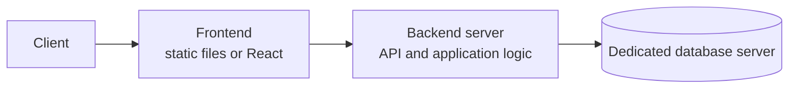

In AWS, the mapping is straightforward: RDS for the database, EC2 for the backend, and S3 for static frontend hosting. Other cloud providers and self-hosted environments have different products, but the shape is the same.

| Tier | AWS example | Responsibility |
| --- | --- | --- |
| Frontend | S3 | Static HTML, CSS, and JavaScript |
| Backend | EC2 | API and application logic |
| Database | RDS | Persistent state |

On the frontend, the architecture also changes. Instead of rendering templates inside the backend, you can build a separate frontend application with React or another frontend library. That application is often hosted on a serverless static service. **Serverless** here means the provider manages capacity and you pay for usage rather than provisioning a server of a fixed size. For static files, this is cheap and simple: the browser downloads HTML, CSS, and JavaScript, executes the JavaScript on the user's machine, and calls the backend API for data.

The frontend is usually not the bottleneck. It serves static files and pushes computation to the client. The backend is different: it performs computation for every API request, potentially for millions of users. That is why the next several stages focus on the backend and on reducing the work that reaches the database.

This is the first real check-in. The monolith had one server. The three-tier architecture has three sections, and each can be scaled independently. If the database is saturated, you can see it and resize the database server. If the backend is saturated, you can resize the backend. The biggest upgrade is not raw capacity; it is the ability to identify and address the actual bottleneck.

## Advantages of the Three-Tier Architecture

**It is a common architecture.** This is not an exotic setup. There are countless articles, tools, and engineers who understand it, so problems are easier to diagnose and resolve.

**Each tier scales independently.** The frontend, backend, and database can grow according to their own load. This is a major improvement over the single-server monolith.

## Costs of the Three-Tier Architecture

**The application now needs an API layer.** In the monolith, a template engine could render pages without a separately designed API. Now the frontend and backend communicate over an API, which means more interfaces to design, document, and maintain.

**Networking and cross-origin concerns appear.** Browser requests cross origins, so CORS must often be configured. The backend and database are on different machines, so permissions, connectivity, and firewall rules must be handled.

**Scaling requires diagnosis.** More granular scaling is an advantage only if you know which tier is the bottleneck. You can no longer simply make one server bigger and hope the problem disappears.

**The backend and database are still mostly vertical.** The frontend can be serverless, but the backend and database are still single machines or single primary nodes at this stage. Horizontal scaling for the backend is the next step.

# Stage 3: Horizontal Scaling and the Load Balancer

The backend is often the first bottleneck in compute-heavy applications. The frontend is easy to distribute, and the database can often be scaled vertically for a while. The backend does computation for every request, so it can run out of headroom first; in read-heavy applications, however, the database is often the first bottleneck. The right answer depends on the workload.

The first move is horizontal scaling. One backend server is a single point of failure: if it goes down, every request fails. Add more servers and the system gains redundancy. Three servers roughly triple the capacity, and if one fails, the other two can continue, assuming they have enough headroom and the load balancer has health checks. The problem is no longer raw capacity; it is routing.

## The Load Balancer

If the frontend knows about three backend servers, which one should it call? It could keep a list of endpoints and choose one, but then it would also need to detect failures, retry, and balance load. That logic is better centralized in a **load balancer**.

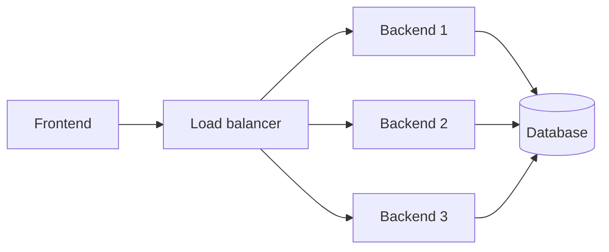

The load balancer is a service that receives requests and forwards them to the appropriate backend server. The frontend connects to a single endpoint, such as `api.example.com`, which resolves to the load balancer's IP address. The load balancer hides the backend topology: the frontend does not know how many servers exist or which one handled a request. It also monitors the servers through health checks. If one goes down, the load balancer stops sending traffic to it and redistributes the load across the remaining nodes. If three servers become two, the traffic is split roughly 50/50 rather than doubling on one server.

## Advantages of the Load Balancer

**The backend is no longer a single point of failure.** A failed server no longer takes down the entire application.

**High availability and failover.** If one server fails, the service continues on the others. The user may never notice.

**Horizontal scaling is possible.** In theory, horizontal scaling is cheaper than vertical scaling because vertical scaling has diminishing returns. Stateless APIs are especially well suited to it: they store no per-user state, so any server can handle any request. There is no session data to synchronize between nodes.

**Autoscaling becomes practical.** The load balancer can distribute traffic across a pool that grows and shrinks with demand.

## Costs of the Load Balancer

**A load balancing service must be added and operated.** This is not a huge obstacle, but it is another component to configure, monitor, and secure.

**The load balancer becomes the new single point of failure.** If it fails, every backend server becomes unreachable. In production, it must be redundant or provided as a managed, highly available service.

**There is still no dedicated caching layer.** Every request is treated as a fresh request: the client calls the API, the API queries the database, and the result travels back. Even if 80% of requests ask for the same data, the database performs the same work every time. That is the next bottleneck.

# Caching

The core idea of a cache is to keep a copy of frequently read data in a faster storage layer, so repeated requests do not reach the slower source. A cache sits between the consumer and the slower data source. On a read, the application checks the cache first. If the value is present, that is a **cache hit**, and the value is returned immediately. If it is absent, that is a **cache miss**; the application reads from the database, stores the result in the cache, and returns it.

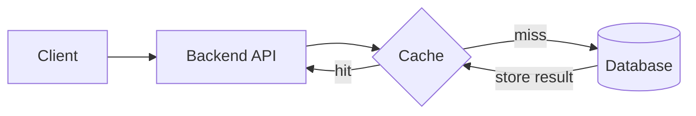

Consider a database that stores values and a cache in front of it. A client requests the value `5`. The cache is empty, so the request misses, queries the database, stores `5`, and returns it. A second client requests `5`. The cache now has it, so the request is served without touching the database. One database read has served two clients. If a client requests `7`, the same sequence repeats: miss, database read, cache write, response. The first request for a value is slower because it pays the database cost; later requests are much faster.

This is often called the cache-aside pattern, although the name matters less than the behavior. The cache reduces both latency and database load. At scale, the load reduction is often the more important effect: relational databases are often the hardest tier to scale horizontally, so every request removed from them is valuable.

# The CDN

A **content delivery network** (CDN) applies the same idea geographically. The problem is distance. A user may be far from the origin server, and every request must travel across the internet and back. That distance adds latency. A CDN places cached copies of content at edge nodes in many locations. When a user makes a request, it goes to the nearest edge node instead of the origin. If the content is cached there, the response is immediate. If not, the edge fetches it from the origin, caches it, and returns it.

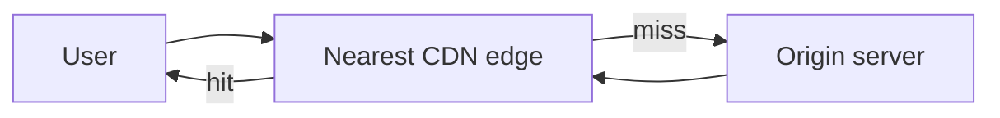

A CDN provides two major benefits. The first is lower latency for the end user, because the response travels a shorter distance. The second is reduced computational effort and bandwidth on the origin, because most requests never reach it. The origin can therefore serve more users with the same capacity. The benefit depends on cacheability: for content that cannot be cached, the CDN can add a network hop rather than remove one.

CDNs are typically used for static content: HTML, CSS, JavaScript, images, and videos. The goal is to make the application feel fast and to put files as close to the user as possible. Some API responses that change infrequently can also be cached at the edge, but for dynamic backend data, a dedicated cache such as Redis is usually more appropriate. For an application with millions of users, a CDN is one of the highest-leverage improvements available. Cloudflare is a common example.

## Advantages of the CDN

**Lower latency.** The user receives content from a nearby edge rather than a distant origin.

**Global reach.** A CDN is the easiest way to make an application feel global. It is not a perfect solution for dynamic requests that must reach a backend on another continent, but it is a strong first step: relatively simple to set up, affordable, and significantly faster for users.

**Security.** Many CDNs provide DDoS protection and other edge security services.

**SEO.** When configured correctly, faster delivery can improve search performance.

**Media and downloads.** A CDN is especially valuable for images, videos, and large downloads, where it improves performance and can reduce bandwidth costs.

## Costs of the CDN

**Complexity increases.** You have to understand how the CDN caches content and how its configuration interacts with your application.

**TTL and invalidation become part of the design.** Every cached object has a time to live (TTL): how long it remains valid before the CDN revalidates or refetches it. When static files change, you must wait for the TTL to expire or purge the cache manually. If you get this wrong, users see stale content.

**Cache hit ratio matters.** The benefit depends on how often requests are served from the edge. A low hit ratio means the CDN adds a layer without absorbing much traffic.

**Stale data is a risk.** TTL limits how long stale data can survive, but it does not eliminate the problem. Invalidation must be deliberate.

# The Request Flow with a CDN

With the CDN in place, the request path becomes more involved. A user enters a URL into the browser. DNS maps the domain to an IP address. Without a CDN, that address belongs to the frontend server. With a CDN, it may belong to an edge node. The browser is sent to the edge, which serves the frontend assets from cache or fetches them from the origin. The frontend then makes API calls to a separate domain, which resolves to the load balancer. The load balancer distributes those calls across the backend servers, and each backend server connects to the same database.

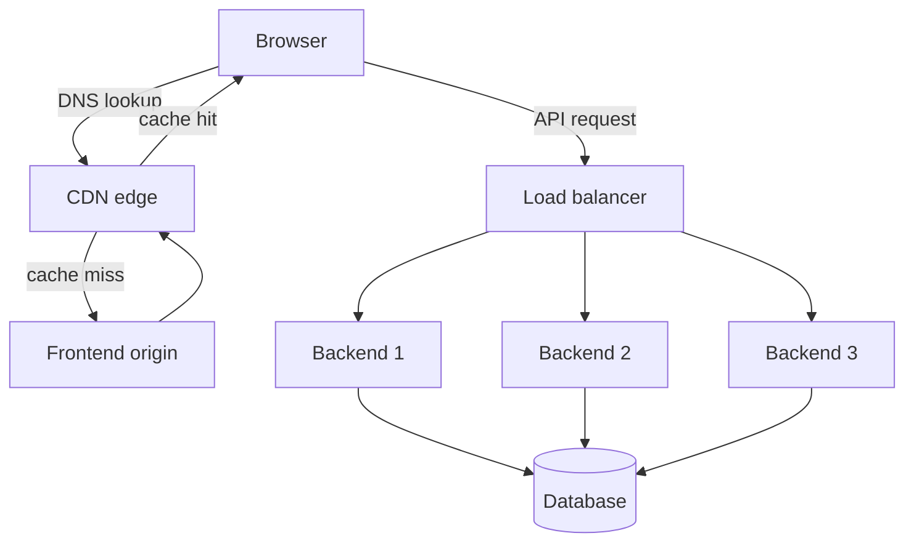

This is the first complete picture: CDN for static content, frontend for the user interface, load balancer for the API, multiple backend servers for computation, and a shared database for state. The cache between the backend and the database is still missing.

# The Backend Caching Layer

The CDN handles static content, but it does not solve repeated dynamic reads. If the API receives the same database query thousands of times per second, the database still performs that work. The next layer is a cache between the API and the database, typically Redis or Memcached. It stores data in memory, so reads avoid the database query path and its associated I/O and query processing.

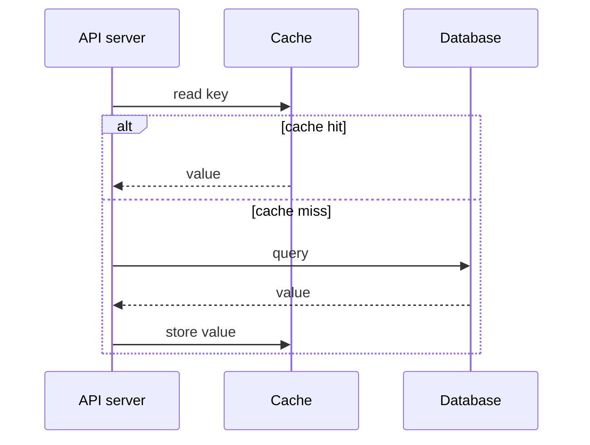

The flow is the cache-aside pattern again: check the cache, return on a hit, and on a miss query the database, store the result, and return it. The first request for a given key is slower; subsequent requests are served from memory.

The effect can be dramatic because data access is often skewed. A common pattern is that 80% of requests retrieve 20% of the data. If that hot 20% fits in memory, the cache can absorb the majority of reads and shield the database, potentially removing around 80% of database requests. The hot set is often small relative to the entire database, so the cache does not need to hold everything. This is not only a latency optimization; it can reduce the database's compute load by a large factor. Complex queries and joins are especially good candidates: caching the result avoids repeating the same expensive computation for every request.

## Keeping the Cache Consistent

A cache introduces a consistency problem. If the database value changes from `5` to `6`, the cache may still hold `5`. The application must update or invalidate the cache when it writes to the database. Updating the database and the cache in the same code path is a common starting point, but it is not atomic: concurrent writes or a failed cache update can still leave stale data. TTL, versioning, and a deliberate invalidation strategy reduce the risk.

A TTL provides a fallback. If the cache entry expires periodically, the system self-corrects after some delay. For some applications, a small lag between the database and the cache is acceptable. For others, it is not. Invalidation still has to be correct; the TTL is a safety net, not a substitute.

## Cache Volatility and Scaling

A cache is treated as volatile: entries can be evicted or lost when the process or machine restarts, even if the cache store supports persistence. This is usually acceptable because the database remains the source of truth. The cache repopulates on demand. The cost is a temporary performance dip while the cache is cold and requests fall through to the database.

Caches can be scaled horizontally. Redis supports clustering and sharding, and the cache can be sized to the request volume. As a rule, scale the cache before scaling the database horizontally, unless the database itself handles horizontal scaling well. The cache is a data store too, but it is optimized for speed and temporary data, not primarily for durability.

An extra layer might seem like extra cost, but it can be cheaper overall. It absorbs load that would otherwise require a larger database, and it reduces latency. The trade-off is complexity: application code must read from and write to the cache, and invalidation must be handled correctly.

## Advantages of the Backend Cache

**Less database compute.** Repeated reads are served from memory.

**Lower latency.** The API avoids a database round trip for cached data.

**Often cheaper at scale.** A cache can be less expensive than the database capacity it replaces.

## Costs of the Backend Cache

**More complexity.** The application must manage cache reads, writes, and invalidation.

**More code and more failure modes.** CDN caching is largely automatic; application caching is not. The development effort is real, and an incorrect invalidation strategy can produce stale data or subtle bugs. The system becomes harder to reason about, which has a cost in time and money even when the infrastructure itself is cheap.

# The Database Layer

After the frontend, CDN, load balancer, API servers, and cache, the database remains. Up to this point, the database has probably been scaled vertically: a large server with enough CPU, memory, and disk. For many applications, that is enough for a long time. For typical read-heavy web applications, the database is usually the last tier to need horizontal write scaling. It is tempting to shard the database early, but that is usually the wrong first move: distributed data introduces consistency, routing, and operational problems that are much harder than adding a bigger database server.

The first concern is high availability. A single database server is a single point of failure. A common solution is a **standby** database: a second server kept synchronized with the primary. If the primary fails, the standby can take over. This is simpler than multi-master clustering, where multiple nodes accept writes and must coordinate with each other.

## High Availability and Read Replicas

Another option is **read replicas**. The primary node handles writes, while one or more replicas handle reads. The application, or a proxy in front of the database, routes write queries to the primary and read queries to the replicas. This allows reads to scale independently of writes; write capacity remains bounded by the primary until the data is sharded or multi-master replication is introduced. Replication is often asynchronous, so replicas can lag and read-after-write consistency must be handled. Most applications are read-heavy, so it is common to have one large writer and several read replicas, with reads scaling further than writes.

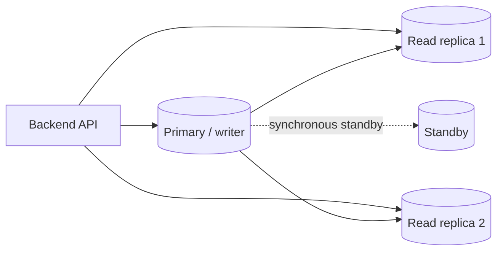

This is a common setup for relational databases hosted in a service such as RDS. Larger cluster services for relational databases offer more options, and NoSQL systems often support multi-master configurations. In a multi-master setup, multiple nodes accept writes; some systems partition data across nodes (sharding), while others replicate the same data across nodes (multi-master replication). The details vary by database.

To summarize the database layer: scale vertically as far as practical before scaling horizontally, unless the database service handles horizontal scaling well. For high availability, a standby (synchronous or asynchronous depending on the recovery point objective) provides a failover target. The first bottleneck depends on the workload: it may be the API, the cache, the CDN, or the database itself. Measure before deciding; do not assume the database is always last.

## Splitting the Database and the Backend

There is another structural option. Instead of storing everything in one massive database, split it into smaller, focused databases. For example, a dedicated database for user authentication can be scaled and maintained separately from the rest of the application.

The same idea applies to the backend. A monolith can be split into smaller, focused services, moving toward a microservice architecture. Each service can then be scaled independently. This introduces communication complexity between services, but the rule of thumb is simple: if a service becomes a bottleneck, scale it horizontally, scale it vertically, or split it into smaller services and scale those independently. It is the same monolith-to-three-tier move, applied at a finer grain.

# The Complete Architecture

The full architecture now looks like this.

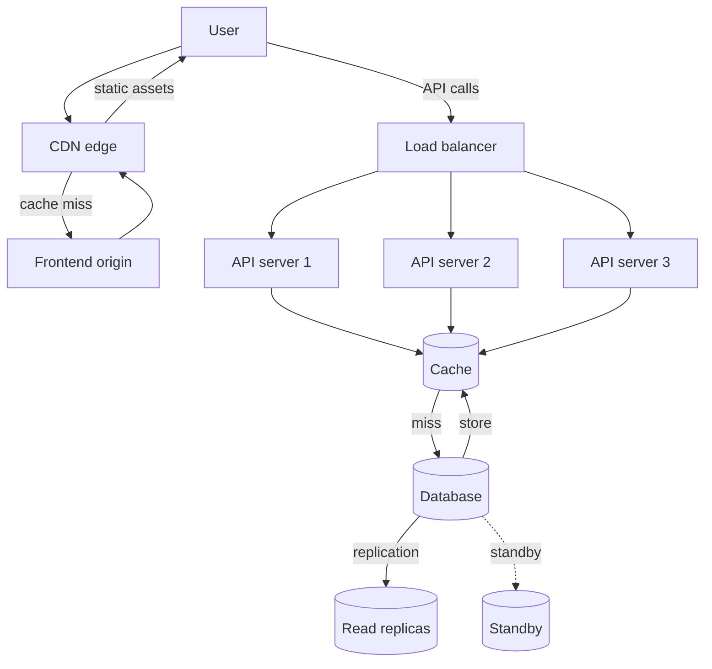

The user reaches the CDN edge, which serves static assets or forwards a cache miss to the frontend origin. The frontend calls the API through the load balancer. The load balancer distributes requests across the API servers. Each API server checks the cache before querying the database. The database may have a standby or read replicas for availability and read scaling.

The cache and the database are both data stores; the difference is one of durability and source-of-truth semantics, not simply memory versus disk. The cache is optimized for fast, temporary reads, while the database is the durable source of truth. In code, the request path checks the cache first and falls back to the database on a miss. There are many valid ways to draw this diagram. Components can be grouped or separated, and the cache can be drawn beside the database or between the API and the database. The important part is the responsibility of each component and the direction of the request flow.

# The Order of Operations

The progression can be summarized as a sequence of bottlenecks and responses:

1. **Single server.** The simplest architecture. It scales only vertically and is a single point of failure.
2. **Three-tier architecture.** Splits the frontend, backend, and database so each can be scaled independently. It introduces API boundaries and networking concerns.
3. **Horizontal backend with a load balancer.** Removes the single backend server as a point of failure and supports high availability and autoscaling, but the load balancer itself must be highly available. It still has no dedicated caching layer.
4. **CDN.** Moves static content close to users, reducing latency and origin load. It adds TTL and invalidation complexity.
5. **Cache.** Absorbs repeated dynamic reads in memory, reducing database load and latency. It adds cache invalidation and application complexity.
6. **Database scaling.** Adds high availability and read scaling through standbys and read replicas, with multi-master and sharding as more advanced database options. Service decomposition is a related backend strategy, not a database-scaling technique.

The order reflects a broader principle: for the backend and the database, vertical scaling remains the first lever. The frontend is usually a distribution problem, solved with static hosting and a CDN. Horizontal scaling is introduced when a single machine is no longer enough, and it brings coordination and consistency costs that must be justified.

None of these components is mandatory at the start. Each one earns its place by solving the bottleneck exposed by the previous stage. The final architecture is not the goal; it is the accumulation of specific solutions to specific problems. That is the practical lesson of scaling: measure the bottleneck, add the smallest component that removes it, and make sure the new complexity is worth the capacity it buys.

# Appendix: Topics for Future Expansion

The following topics are only touched on briefly, or deliberately left out, to keep this chapter close to the original video. They are candidates for a future revision or for separate notes.

- **Observability and capacity planning**: p95/p99 latency, error rate, saturation, queue depth, load testing, tracing, and back-of-the-envelope capacity estimates.
- **Database connection pooling**: connection limits, pool sizing, and poolers or database proxies such as PgBouncer and ProxySQL.
- **Load balancer algorithms and high availability**: round-robin, least-connections, consistent hashing, health checks, connection draining, and how the load balancer itself is made highly available.
- **Cache stampede, eviction, and invalidation patterns**: thundering herd, request coalescing, TTL jitter, LRU/LFU eviction, write-through, write-behind, and CDC/outbox-based invalidation.
- **CDN cache busting and uncacheable content**: content-hashed filenames, versioned assets, purge APIs, and cases where a CDN adds a hop instead of removing one.
- **Sharding, read replicas, and cross-database consistency**: replication lag, read-after-write consistency, shard keys, rebalancing, cross-shard queries, distributed transactions, and the trade-offs of splitting a database by domain.
- **Microservices: operational complexity**: deployment, observability, network failures, data ownership, and eventual consistency between services.
- **Multi-region and global backends**: multi-region deployment, data replication, latency-based routing, and active-active versus active-passive trade-offs.
- **Security and cost at scale**: TLS termination, authentication and authorization, rate limiting, WAF, secret management, egress costs, cross-AZ traffic, and the cost of managed services.
