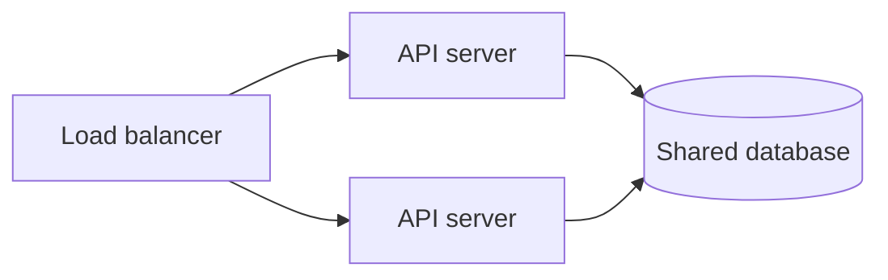
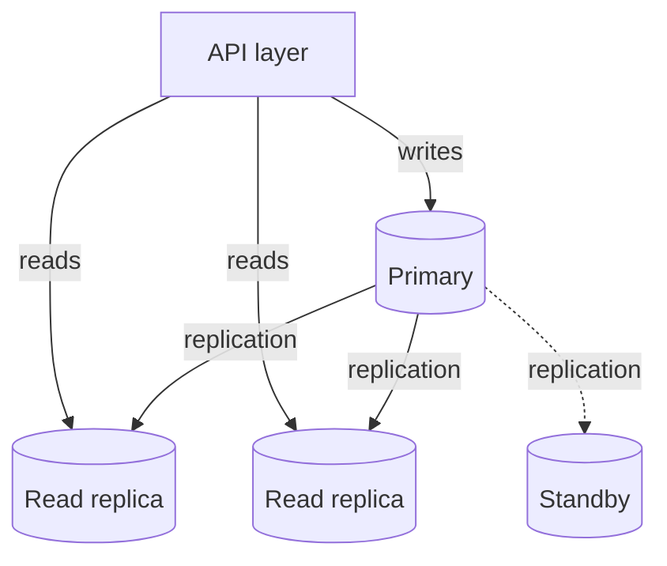

*This article is entirely based on a [YouTube video by Caleb Curry](https://www.youtube.com/watch?v=XqzoUlmJrB4).*

---

Scaling an application is often reduced to a binary choice: make the server bigger, or add more servers. The choice is real, but the answer is not universal. A stateless API, a relational database, a static frontend, and a message queue each have different constraints. The cost of adding capacity also changes with scale, and cloud and on-premises environments expose different trade-offs.

This article builds the decision from the simplest case (a stateless backend API) and then generalizes it to frontends, databases, and serverless services. The goal is not to memorize a rule, but to understand when each approach is cheaper, simpler, and more resilient.

# In-House vs. Cloud

The principles of scaling are similar in a data center and in the cloud, but the constraints are not. In an on-premises environment, capacity is physical. Adding twenty servers requires space, power, cooling, and network ports. Replacing a component may be more practical than replacing an entire machine, because the machine is already there. In the cloud, the underlying hardware is virtualized: changing an instance type is a configuration change, but it usually requires a restart or a replacement. The provider allocates resources from a shared pool, and the service is decoupled from any specific physical machine.

Virtualization does not remove hardware limits; it moves them behind an API. The practical difference is the speed and granularity of experimentation. A cloud team can try a larger instance, measure the result, and revert in minutes, using a rolling replacement if the service must stay available. An on-premises team may need procurement and maintenance windows.

The rest of this article uses the cloud perspective, but the principles apply on-premises with these constraints in mind.

# Vertical and Horizontal Scaling

**Vertical scaling**, or scaling up, makes a single server more powerful: more CPU, more RAM, faster disk, more network capacity. **Horizontal scaling**, or scaling out, adds more servers and distributes work across them.

The two approaches are not symmetric. Vertical scaling keeps the service on one machine; horizontal scaling requires the servers to behave as one logical unit. For an API, that means a load balancer in front of several identical nodes. The user connects to one address and does not know how many servers are behind it.

Analogies help: vertical scaling is a taller skyscraper; horizontal scaling is a city with more buildings. The skyscraper is one structure with a hard height limit; the city can grow by adding buildings, but it needs roads, utilities, and coordination.

| Dimension | Vertical (scale up) | Horizontal (scale out) |
|---|---|---|
| Unit of growth | A more powerful machine | More machines |
| State | Remains on one machine | Must be shared or partitioned |
| Availability | Single point of failure unless replicated | Failover across nodes |
| Operational complexity | Low | Load balancing and coordination |
| Cost at small scale | Often cheaper | Upfront cost per node |
| Cost at large scale | Rises steeply | Roughly linear after the upfront cost |

# Why the Service Type Matters

The correct choice depends on the service. An API, a database, a cache, a queue, and a static frontend have different state, traffic, and failure characteristics. Even within databases, the engine matters: a relational database, a document store, and a wide-column store do not scale writes in the same way.

Because of this, there is no rule such as “always scale horizontally” or “always scale vertically.” There are general heuristics, and they are easiest to learn on the simplest service: a stateless backend API. It is common, it holds no durable state, and most backend engineers already understand it. Database clustering, by contrast, becomes complex quickly.

The API case establishes the framework; the later sections show where the framework changes.

# The Stateless API

An API server should be stateless: it should not store user data or application-specific state on its local disk or in memory. It can read and write data, but the source of truth must live elsewhere.

In local development, running the API and the database on the same machine is convenient. In production, it is usually a bad idea unless the service is very small. The problem appears as soon as the API scales horizontally. If each API node has its own database, a write to one node is invisible to the others. A request that writes to node A and then reads from node B may see stale or missing data.

The fix is to separate the database from the API. All API nodes connect to the same database server. The database becomes the shared source of truth; the API nodes become interchangeable compute.

The database can run on a separate server or as a separate service on the same machine, but for scalability it should be outside the API process. This is the first step: remove state from the server before adding more servers.

# Vertical Scaling the API

Vertical scaling is usually the first thing a team does, and for a stateless API it is straightforward. The four resources to watch are CPU, RAM, disk, and network. Disk matters less for a stateless API because it does not store application data, but its capacity and read/write speed still matter for logs, temporary files, and the operating system.

The goal is to keep the resources reasonably balanced. If one resource is near saturation while the others are idle, the server is overprovisioned in some dimensions and underprovisioned in another. Consider a server at 90% CPU, 20% RAM, 20% disk, and 20% network utilization.

| Resource | Initial utilization | Double the whole server | Double only the CPU |
|---|---|---|---|
| CPU | 90% | 45% | 45% |
| RAM | 20% | 10% | 20% |
| Disk | 20% | 10% | 20% |
| Network | 20% | 10% | 20% |

Doubling the entire server cuts every utilization in half, but it also doubles resources that were not the bottleneck. Doubling only the CPU brings the CPU to 45% while leaving the other resources unchanged. The second configuration is more balanced and cheaper.

These numbers should represent peak utilization, not averages. A server that averages 45% but spikes to 90% is closer to its limit than the average suggests. A reasonable target is around 75% at peak, but the exact number depends on the variability of the workload. A constant workload, such as video encoding, can sustain a higher target because the risk of an unexpected spike is lower; a spiky workload needs more headroom. Pushing to 90% leaves little room for a spike, while running at 20% wastes most of the machine.

The goal is not to maximize utilization for its own sake. It is to use the hardware efficiently without running out of headroom.

As demand grows, the utilization of each resource rises at a different rate. The application may need more CPU but not more RAM, or more network but not more disk. Vertical scaling can therefore mean changing the instance type or upgrading an individual component, rather than doubling everything. In the cloud, monitoring dashboards show which resource is the bottleneck; on-premises, the team must instrument the machine itself.

This is step one: adjust the instance type until the resources are reasonably balanced and utilization has sensible headroom. It is not about building a supercomputer; it is about finding a starting point that is neither wasteful nor fragile.

# Horizontal Scaling the API

Step two is to scale horizontally to at least two nodes. The reason is not raw capacity; it is availability. A single server is a single point of failure. If it goes down, the service goes down. With two nodes behind a load balancer, one node can fail while the other continues to serve requests. The failed node can be repaired or replaced, and traffic can be routed back when it returns.

The load balancer is the component that makes the collection of nodes look like one service. It receives requests and distributes them across the healthy nodes. In a cloud environment, this is usually a managed service and requires little operational work. Once it is in place, adding more nodes is a matter of registering them with the load balancer.

The transition to horizontal scaling introduces new concerns: the nodes must be stateless or share state, health checks must detect failures, and the load balancer itself must be highly available. For a stateless API, these concerns are manageable. For a database, they are substantially harder.

Step three is the ongoing choice between vertical and horizontal growth. For a stateless API, horizontal scaling is usually the better long-term direction: it provides availability and can grow incrementally. But the nodes should not be the smallest possible instances. A collection of tiny nodes can require more coordination and networking than a smaller number of reasonably sized nodes. The practical approach is to use decent instances, then add nodes as needed.

# The Cost Curve and Diminishing Returns

Vertical scaling eventually runs into diminishing returns. The idea is familiar: doubling the investment does not always double the output. Training five times a week is good; training ten times a week does not make someone twice as fit.

A concrete example makes the cost curve easier to see. A laptop that costs $800 may come with only 64 GB of storage, enough to be nearly useless for computer science work. Spending $1,000 might buy 1 TB; spending $1,200 might buy 2 TB. The first $200 increase buys roughly sixteen times the storage. The second $200 increase buys only twice the storage. Part of the price is the base cost of manufacturing and shipping the machine, independent of the hardware inside it. The returns diminish as the specification rises.

The same pattern appears in server hardware, though the numbers vary. At the high end, doubling CPU cores or memory can cost more than twice as much. A 32-core processor with roughly twice the performance of a 16-core model may cost 2.5 times as much. The cost curve is not linear.

Horizontal scaling has a different shape. Adding a server has an upfront cost: the machine, the rack space, the network, the operating system, and the operational overhead. Once that cost is paid, adding more capacity is roughly linear. A large storage system illustrates the point: 200 TB can be built from ten 20 TB drives, which is usually cheaper than a single 200 TB drive, if such a drive exists at all.

The practical switch point is where horizontal scaling becomes cheaper than vertical scaling for the same increase in capacity. Below that point, vertical scaling is often the simpler and more cost-effective choice. Above it, the exponential cost of high-end hardware makes horizontal scaling attractive.

Cloud environments complicate the curve. Because the hardware is virtualized, doubling an instance size may cost less than twice as much; the provider is allocating resources from a shared pool, not installing new hardware for each customer. On-premises, the curve is usually steeper: doubling the hardware often costs more than twice as much. The theory is a guide, not a formula; the actual prices and workload determine the crossover.

# Frontend and Serverless

For a static or client-rendered frontend, scaling is usually the easiest part. A typical frontend in that model is a collection of HTML, CSS, and JavaScript files. It can be hosted on object storage such as Amazon S3, often with a CDN such as CloudFront; the provider handles the servers, storage, and distribution. The team pays for usage and does not choose between vertical and horizontal scaling for that tier.

Serverless options exist for the other tiers as well. AWS Fargate and AWS Lambda can run backend services without managing servers; Amazon DynamoDB is a serverless database. These services shift the scaling responsibility to the provider, but they do not remove trade-offs. Cost models, cold starts, concurrency limits, execution time limits, and platform constraints become the new design concerns. These details deserve a separate discussion; the important point is that serverless is another way to move the scaling decision out of the application.

# Scaling the Database

Databases are stateful, and state changes the problem. If an API node fails, another node can take over because the API holds no durable state. If a database node fails, the data must still be available, and writes must not be lost. Horizontal scaling therefore requires replication, failover, or partitioning.

The first approach for a relational database such as PostgreSQL is usually vertical scaling. A single large database instance avoids the complexity of distributing data: there is one source of truth, one write path, and no cross-node consistency problem. Modern database instances can be surprisingly powerful; many applications never outgrow a single well-sized primary. Resizing a database instance often requires a maintenance window, so the operation has a cost even when the architecture stays simple.

The obvious weakness is the single point of failure. A standby database (replicated from the primary but not used for normal reads or writes) provides a failover target. If the primary fails, the standby can be promoted. With synchronous replication, failover loses no committed writes but adds write latency; with asynchronous replication, failover may lose recent writes.

Managed databases often automate promotion and connection routing; self-hosted systems require orchestration. The standby approach improves availability without introducing the complexity of a multi-write cluster.

Read replicas address a different problem. They are copies of the primary that serve read traffic. Because most applications read more than they write, offloading reads can relieve the primary. Replicas can also be placed in different regions, reducing read latency for users far from the primary. The primary remains the write node.

Read capacity can now be scaled independently of the primary, while write capacity remains tied to the primary. A social media feed is read-heavy: many users scroll, while relatively few publish. It can use several read replicas and a modest primary. An instant messaging system is both read-heavy and write-heavy: messages are written constantly and delivered to many readers. The balance between primary and replicas must reflect that ratio.

Replication is not free. Each replica consumes primary resources and adds compute, storage, and network cost; replicas can also lag behind the primary, so a read immediately after a write may return stale data. Read-after-write consistency has to be considered. The limitation is also structural: there is still one write location. If the primary is in one region and users write from another, every write crosses a long network path. Reads can be served locally by replicas, but writes cannot. If write latency or write volume becomes the bottleneck, the next step may be sharding, queueing, or multi-master clustering, depending on the database and access pattern.

Multi-master replication is powerful and complex. The term *master* traditionally refers to the write node; *slave* or *replica* refers to a read node. Multi-master means multiple write nodes. The database must handle conflicts, ordering, and consistency across them. The advice is not to avoid it forever, but to avoid it until the workload actually requires it. Premature optimization creates complexity that the application may never need.

Horizontal scaling of reads is relatively straightforward because replicas are copies. Horizontal scaling of writes is harder, and the approach depends on the database engine. Some databases support it natively; others require external sharding or a different data model. Some distributed NoSQL databases are designed with multi-node writes in mind (a messaging application is a common example) and provide these trade-offs by default. The details vary by engine and deserve a dedicated treatment.

# Conclusion

There is no universal answer to the vertical-versus-horizontal question. The right choice depends on the service, its state, its traffic pattern, the cost curve, and the deployment environment. The useful framework is:

1. Make the service stateless where possible.
2. Move the database out of the application server.
3. Scale vertically until the resources are balanced and utilization has headroom.
4. Scale horizontally to at least two nodes for availability.
5. Choose further growth based on workload and cost.
6. For databases, start vertical, add a standby and read replicas, and consider multi-master only when writes demand it.

The goal is not to use every scaling technique. It is to use the simplest technique that removes the current bottleneck while meeting the availability and reliability requirements, at the lowest total cost. Complexity should be added only when the workload justifies it. The crossover point is different for every application; measurement and experimentation matter more than a rule of thumb.

# Appendix: Topics for Future Expansion

The following topics are only touched on briefly, or deliberately left out, to keep this chapter close to the original video. They are candidates for a future revision or for separate notes.

- **Load balancer algorithms and health checks**: round-robin, least connections, consistent hashing, health checks, connection draining, and how the load balancer itself is made highly available.
- **Session state and statelessness**: sticky sessions, external session stores, token-based authentication, and why shared state complicates horizontal scaling.
- **Autoscaling and elasticity**: metrics, thresholds, cool-down periods, scheduled scaling, and the difference between adding capacity and absorbing bursts.
- **Observability, load testing, and capacity planning**: p95/p99 latency, error rate, saturation, tracing, load tests, and how to choose a target utilization.
- **Serverless trade-offs**: cold starts, concurrency limits, execution time limits, cost models, and vendor lock-in.
- **Database replication topologies**: synchronous versus asynchronous replication, primary-standby, read replicas, multi-master, quorum, and failover.
- **Failover automation and split-brain**: promotion, DNS and connection routing, application reconnection, quorum, and fencing.
- **Connection pooling and database limits**: pool sizing, PgBouncer and ProxySQL, and connection exhaustion when API nodes scale.
- **Sharding and partitioning**: shard keys, rebalancing, cross-shard queries, and distributed transactions.
- **Consistency and replication lag**: read-after-write consistency, eventual consistency, and routing reads to replicas.
- **Backups versus replicas**: why replication does not protect against accidental deletion or logical corruption, and why restores must be tested.
- **Caching and queues**: offloading reads, absorbing write spikes, backpressure, and cache invalidation.
- **Multi-region and cost**: geo-replication, latency-based routing, egress costs, and cloud versus on-premises cost models.
- **Security at scale**: TLS, authentication, authorization, rate limiting, WAF, and secrets management.
- **Vertical scaling limits and instance families**: downtime during resizing, compute/memory/storage-optimized instances, and cloud quotas.
