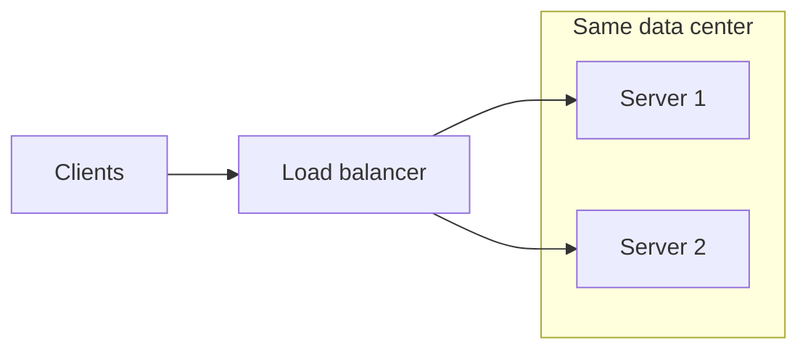
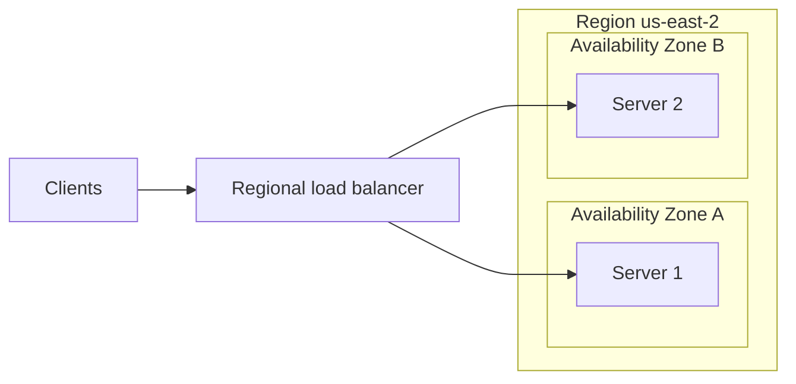
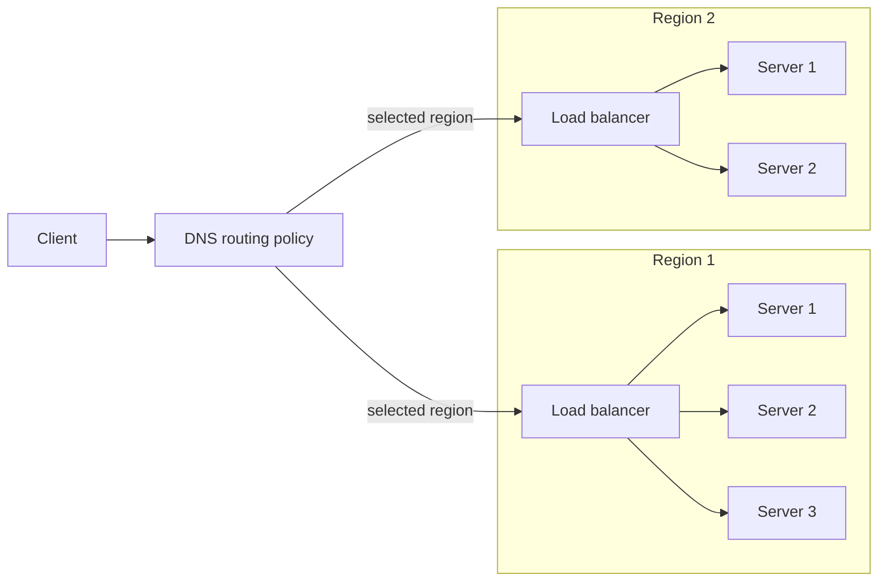
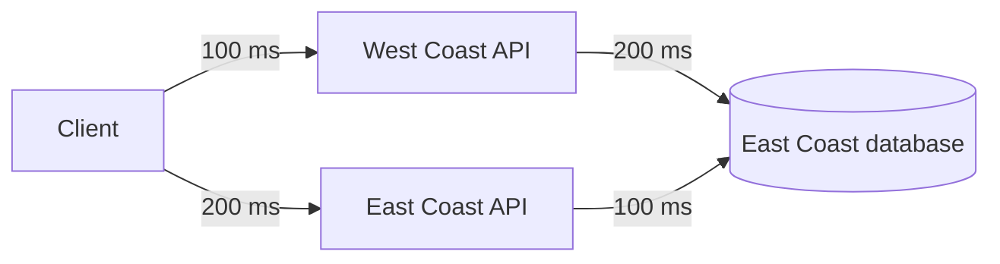
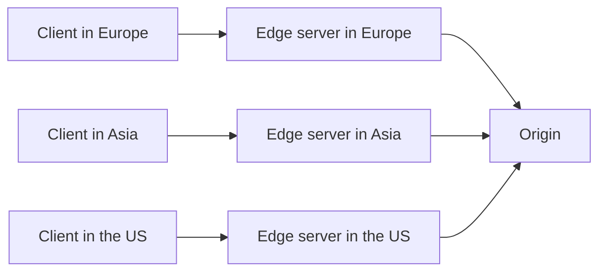

*This article is entirely based on a [YouTube video by Caleb Curry](https://www.youtube.com/watch?v=syAUXNxAiHs).*

---

Horizontal scaling answers one question: how can several servers act as one logical service? It does not answer where those servers should be. Two servers in the same rack, two servers in different buildings, and two servers on different continents are all horizontally scaled, but they provide different guarantees. Increasing the distance can reduce latency for nearby users and help the system survive larger failures, but it also adds complexity and cost.

This chapter follows that progression from the closest arrangement to the most distributed one. At each step, the question is the same: what does this arrangement buy, and what does it cost?

# Same Data Center

A data center is a building, or a group of buildings, in one physical location. A cloud provider may operate many customers' workloads from the same facility, but from the application's perspective the important property is that all of the servers are close together.

If two servers sit in the same data center, the arrangement improves availability and scalability. When one server fails, the other can take its traffic, assuming the surviving server has enough capacity. Two servers also provide more total compute than one, so the application can serve more users. What the arrangement does not improve is latency: both servers are roughly the same distance from every user, so moving a request from one to the other does not make the response meaningfully faster. The benefit is throughput and redundancy, not proximity.

This is the baseline form of horizontal scaling: multiple machines, one location.

# Regions and Availability Zones

A **region** is a geographic unit defined by the cloud provider. The exact definition varies between providers, but the practical meaning is a collection of data centers in a related geographic area. Providers often group regions by continent. AWS, for example, uses names such as `us-east-1`, `us-east-2`, `us-west-1`, and `us-west-2`. At the time of recording, AWS listed eight regions in North America; the exact count changes as providers expand.

The region should be chosen with the user base in mind. An application serving users in California is usually better served from a West Coast region than from the East Coast; an application serving users in Ohio is usually better served from `us-east-2`. The difference is not only distance. Network paths, peering, and the availability of specific services can also vary by region.

Within a region, providers operate multiple **availability zones**. An availability zone is a logically isolated group of data centers with its own power, cooling, and network infrastructure. AWS names them with a letter suffix, such as `us-east-2a`, `us-east-2b`, and `us-east-2c`. The zones are physically separated, but they are connected by low-latency, high-bandwidth links, so services in different zones can communicate efficiently.

Spreading servers across availability zones improves availability beyond what a single data center can provide. A power outage, cooling failure, or network problem that takes down one zone is less likely to affect the other. The servers are still close enough that latency for an individual request does not change much: a user in California is not meaningfully faster hitting a server in `us-east-2a` than one in `us-east-2b`. The gain is protection against a location-level failure, not proximity.

This step is relatively simple and is usually worth doing early. It removes the data center or availability zone as a single point of failure without introducing the complexity of a multi-region architecture. It does not protect against a regional failure: the region itself remains a failure domain, which is why the next step exists.

# Multiple Regions

The next step is to place servers in different regions. A US application might run one deployment on the West Coast and another on the East Coast. The goal is no longer just redundancy: it is to put the application closer to the user.

That requires routing decisions that a single regional load balancer cannot make. If the system blindly split traffic between the two regions, a user in California might be sent to the East Coast, which defeats the purpose. The system needs a policy for choosing a region: usually the one with the lowest expected latency, not necessarily the geographically closest one.

This is typically done at the DNS level with **geolocation routing**, **latency-based routing**, or **geoproximity routing**. Geolocation returns a region based on the client's apparent location, which is usually derived from the DNS resolver; latency-based routing chooses the region with the best measured latency; geoproximity combines geography with a bias. AWS Route 53 supports these policies, and other DNS providers offer similar capabilities. IP geolocation is approximate: VPNs, corporate resolvers, and cached DNS answers can make the client appear somewhere else. The DNS layer acts as a coarse-grained, cross-region routing layer, while each region keeps its own load balancer for the servers inside it.

A region is a logical unit, not a single computer. It may contain several servers, its own load balancer, and multiple availability zones. Each region can be scaled independently: if one region receives 75% of the traffic and the other receives 25%, the first can be given more servers or larger servers. Horizontal scaling is usually the more natural lever at this level, but vertical scaling within a region remains possible.

The request path is now layered:

1. The client asks DNS for the application's address.
2. DNS returns the endpoint of a region selected by the routing policy.
3. The regional load balancer chooses a server.
4. The server may be in one of several availability zones.

DNS routing is coarse-grained and subject to caching. A change does not necessarily reach every client immediately, and a low TTL reduces propagation delay at the cost of more DNS queries. This matters for failover, which is discussed later.

# The Database Problem

Routing a user to a region is only useful if the rest of the request path is also nearby. The most common counterexample is the database. It is one of the hardest services to move because it holds state: a stateless API server can be duplicated in another region with relatively little effort, but the data cannot be in two places without replication.

Suppose the application has an API server on the West Coast and a database on the East Coast. A user in California is routed to the West Coast API, which is good for the first hop. But that API must then query the East Coast database, which adds a long network round trip. The user could have been routed directly to the East Coast API instead, with a longer first hop but a shorter database hop. The total latency may be the same.

| Path | Client to API | API to database | Total |
| --- | --- | --- | --- |
| Client → West Coast API → East Coast database | 100 ms | 200 ms | 300 ms |
| Client → East Coast API → East Coast database | 200 ms | 100 ms | 300 ms |

The lesson is that latency is a property of the entire request path, not of a single server's location. Moving the API closer to the user is not enough if every request still has to cross the country to reach the data. The same reasoning applies to any downstream dependency, including third-party APIs: moving the frontend closer to the user does not help if every request still calls a service in another region.

There are three common ways to address this. The database techniques appear later in the series; caching was covered earlier.

**Multiple write nodes.** A multi-primary, or multi-master, database keeps write nodes in more than one region. Each API can write to a nearby node instead of sending every write across the country. This can reduce write latency, but it introduces one of the hardest problems in distributed data: conflict resolution. If two regions update the same record at the same time, the system needs a rule for which write wins or a way to merge the changes.

**Read replicas.** A read replica is a copy of the database that serves reads but does not accept writes. The primary remains in one region, and replicas are placed in others. Reads can be served locally, while writes still travel to the primary. This is simpler than multi-primary and works well for read-heavy applications such as social media, where users spend far more time reading feeds than writing posts. It is also a common first step for relational databases such as PostgreSQL. The trade-off is that replicas may be behind the primary, so a read immediately after a write may return stale data.

**Caching.** Caching stores frequently used data closer to the application. A page cache can serve an entire response without calling the API. A local cache can sit in the same region as the API and answer repeated reads without crossing to the database. A database cache can keep hot data in memory near the database itself. In each case, the database is consulted only on a cache miss. Caching is often the cheapest way to remove cross-region read traffic, but it introduces staleness and invalidation problems.

Multi-region deployment buys three things: lower latency for users near a region, higher availability because a regional failure does not take down the whole service, and more aggregate capacity because regions scale independently. It costs three things: architectural complexity, cross-region communication between services, and data-transfer charges (cross-AZ traffic, cross-region traffic, NAT gateways, and egress). It also does not automatically make the application global: if the database or another critical service remains in one region, the benefit is limited.

# Different Continents

Spreading across regions within one country is a latency and availability exercise. Spreading across continents adds another dimension: law.

Different countries impose different rules on where data may be stored and how it may be processed. An application that stores user data in another country may be subject to that country's privacy, security, and data-residency requirements. Localization also includes language, currency, and content, but the constraint that most often shapes the architecture is data residency: the legal requirement that certain data remain within a jurisdiction. The details depend on the type of data, the countries involved, and the application itself. This is not legal advice, and the requirements should be researched with the same care as the technical architecture.

A few examples illustrate the range. In the United States, **Controlled Unclassified Information** (CUI) is sensitive but unclassified data that may be subject to storage and handling restrictions. Classified information is stricter still, and cloud providers offer specialized environments such as AWS GovCloud for some regulated workloads. In Europe, the **General Data Protection Regulation** (GDPR) restricts transfers of personal data outside the European Economic Area (EEA) unless a legal transfer mechanism applies; it is not a blanket data-localization law, although some health data or member-state rules may impose stricter residency requirements. Other countries, including China, have their own rules that may affect where data can be stored or who can access it.

The two biggest technical considerations for a multi-continent deployment are therefore:

- **Latency.** Keeping the entire request path, including the database, close to the user produces the largest improvement. A global database such as DynamoDB Global Tables supports reads and writes in multiple regions and can reduce the distance a request must travel. Global Tables offers two consistency modes. With multi-Region eventual consistency (MREC), replication is asynchronous and conflicting writes are resolved with a last-writer-wins policy, so the latency gain comes with an eventual-consistency trade-off. With multi-Region strong consistency (MRSC), writes are synchronously replicated to at least one other region before they are acknowledged, and strongly consistent reads return the latest version; the price is higher write latency. A request from Europe to the United States will generally be slower than one that stays in Europe.
- **Local law and data residency.** Data may be required to remain in a particular country or region. That constraint can override the usual availability calculations: a region that would be technically suitable for failover may be legally unavailable.

The legal constraint also affects failover. A multi-region system can normally route users to another region when one fails. If the data is not allowed to leave its jurisdiction, the surviving region may not be a valid destination. The failover plan has to respect the same boundaries as the data.

When the law permits it, multi-region failover is a powerful availability tool. If one region becomes unavailable, DNS can direct all traffic, not just local traffic, to another region. With health checks, the switch can happen automatically. Failover is not free: with asynchronous replication, the surviving region may be missing the most recent writes, so the recovery point objective (RPO) is greater than zero; DNS TTL and health-check timing also determine the recovery time objective (RTO). With multi-primary writes, a network partition can create split-brain unless the system uses quorum or fencing.

During normal operation the API layer can be **active-active**, with each region serving nearby users; during a failure it becomes **active-passive**, with the surviving region serving everyone. The data layer follows a different rule: with a single primary and read replicas, reads can be active-active but writes remain active-passive even during normal operation. Truly active-active writes require multi-primary replication, which brings conflict resolution or a consensus protocol.

# Deployment Options at a Glance

The progression can be summarized by what each arrangement isolates and what it improves.

| Arrangement | Failure domain addressed | Latency benefit | Complexity |
| --- | --- | --- | --- |
| Same data center | Server failure | None | Low |
| Same region, different availability zones | Availability zone failure | Negligible | Low |
| Multiple regions | Regional failure | Significant, if the full request path is local | Medium to high |
| Multiple continents | Continental-scale failure | Significant, subject to law and network paths | High |

The table is not a recommendation to climb every step. It is a map of the trade-offs. A small application may never need more than one region. A global application may need several, but each additional location must justify its cost in infrastructure, complexity, and operational risk.

# CDN and Edge Computing

A **Content Delivery Network** (CDN) is a different way to get some of the benefits of global presence without building a full multi-region backend. A CDN places copies of content on edge servers around the world. When a user makes a request, it is served by a nearby edge server instead of traveling to the origin.

CDNs are most effective for static content: HTML, CSS, JavaScript, images, and video. The edge server can return the cached asset directly, and the origin is contacted only on a cache miss. This reduces latency for users and load on the origin.

The same idea can be extended to some API responses. If a response does not change frequently and is not personalized, it can be cached at the edge for a short time. The cache must also respect `Cache-Control`, `Vary`, and `Authorization`; authenticated or private responses should not be cached by default. The result is not a fully distributed server; it is a snapshot of a recent response. That distinction matters: the data can be stale, and cache invalidation becomes part of the architecture. Personalized or rapidly changing data is usually a poor fit for this approach.

**Edge workers** go further by running code at the edge. A platform such as Cloudflare Workers can execute application logic close to the user, which makes it possible to distribute part of the API layer rather than only static files. Edge workers are not a complete replacement for a regional backend: they have runtime limits, limited state, and still need to reach data somewhere. But they can remove a significant amount of latency for logic that does not require a full server.

A CDN is often one of the earliest global steps because it improves performance for users around the world without requiring a complete redesign. It also frequently brings secondary benefits such as security, DDoS protection, and SEO improvements. It is not a substitute for multi-region compute or for compliance with data-residency rules, but it is a high-leverage layer in front of them.

# What Comes Next

Global scale is not a single architecture. It is a sequence of choices about where computation and data live, how requests are routed, and which failures the system must survive. The next step in the series moves into the database layer: the CAP theorem, the different types of databases, and the techniques used to scale data across regions.

The right deployment is the smallest one that satisfies the application's latency, availability, and legal requirements. Each additional location buys isolation and proximity, but it also adds cost, operational complexity, and new failure modes. The goal is not to be global everywhere. It is to be global where the users, the data, and the law require it.

# Appendix: Topics for Future Expansion

The following topics are only touched on briefly, or deliberately left out, to keep this chapter close to the original video. They are candidates for a future revision or for separate notes.

- **DNS routing and failover mechanics**: geolocation, latency-based routing, geoproximity, health checks, TTL, resolver caching, and IP geolocation limitations.
- **Multi-region replication and consistency**: active-active versus active-passive, global tables, conflict resolution, replication lag, read-your-writes, and consistency models.
- **Data residency and compliance**: GDPR, CUI, GovCloud, China, data classification, and legal review.
- **Multi-region failover operations**: health checks, runbooks, split-brain, RPO/RTO, fencing, and disaster-recovery testing.
- **CDN internals**: cache hierarchy, TTL, purge, cache keys, `Cache-Control`/`Vary`/`Authorization`, anycast, dynamic acceleration, and cacheable versus personalized content.
- **Latency measurement and observability**: RTT, p95/p99 latency, cold starts, cross-region hops, end-to-end request paths, per-region metrics, and tracing.
- **Cloud networking and egress costs**: cross-AZ and cross-region traffic, peering, private links, NAT, and data-transfer pricing.
- **Regional capacity planning**: traffic weighting, autoscaling, load testing, quotas, and headroom.
- **Edge workers**: runtime limits, state, data access, and consistency.
- **Global database options**: multi-primary, read replicas, global tables, multi-region eventual vs strong consistency, last-writer-wins, and consensus.
