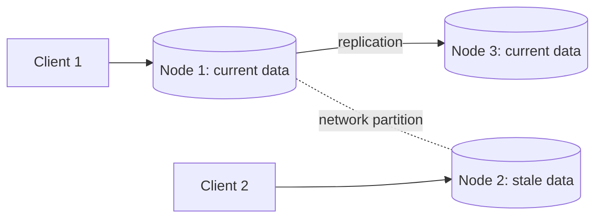
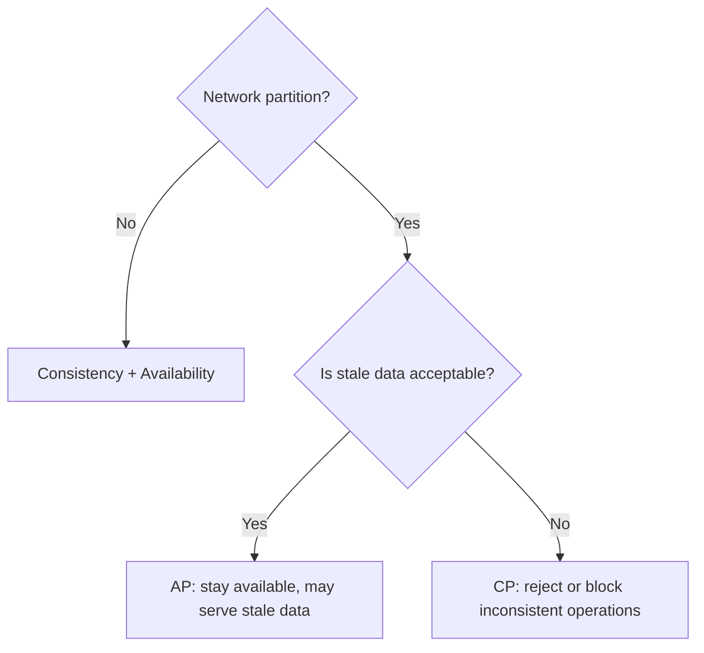

*This article is entirely based on a [YouTube video by Caleb Curry](https://www.youtube.com/watch?v=t5WPGMXOtds).*

---

The CAP theorem is usually introduced with a slogan: “consistency, availability, partition tolerance: pick two.” The slogan is memorable, but it hides the condition that gives the theorem its meaning. CAP is not a statement that a system must permanently sacrifice one property. It describes what a distributed system can guarantee **when the network partitions**. When the network is healthy, a system can be both consistent and available. When the network splits, it must choose.

The theorem is usually discussed in the context of distributed databases, but it applies to any distributed system that replicates data across nodes. This chapter starts with the two properties most people already know (consistency and availability), then introduces partition tolerance, the condition that makes the theorem relevant. It then turns the abstract choice into concrete examples and ends with the practical question to ask when designing a system.

# Consistency and Availability

## Consistency

In CAP, **consistency** means that reads and writes behave as if there were a single copy of the data: once a write completes, any later read sees it. The system may have multiple nodes, but it must not expose a stale value to a read that begins after the write has completed. In the strict formulation, this is **linearizability**: operations appear to take effect atomically in a single global order, and a read returns the latest completed write. It is stronger than saying that the nodes will eventually agree; it is a guarantee about the ordering of reads and writes.

This is not the same as ACID consistency. ACID consistency is about integrity constraints and valid state transitions; CAP consistency is about read/write ordering across replicas. The shared word is unfortunate. If a balance is updated from $1,000 to $0 on one node, a consistent system must not let a later read see $1,000.

Linearizability is also not the same as serializability. Linearizability is a real-time guarantee about a single object: a read sees the latest completed write, and operations appear in one global order. Serializability is a guarantee about multi-object transactions: the result is equivalent to some serial execution of the transactions. The two are related, but CAP’s C is usually linearizability, not transactional serializability.

## Availability

In CAP, **availability** means that every request to a non-failing node receives a response: not necessarily the latest data, but a response without an error. The response can be stale; it cannot be an error or an indefinite wait. CAP’s A is about eventually receiving a response, not about meeting a latency target. A system can be slow and still be available in CAP terms, but an operation that never completes is not a response. Latency is a separate concern, captured by PACELC.

This is not the same as 99.999% uptime. A system can be up but return errors for some operations; CAP availability is about the operation receiving a response. The theorem is about a guarantee, not a service-level objective.

# A Partition Changes the Question

A **partition** is a network failure: the nodes are still running, but they cannot communicate. Messages may be lost or delayed. A partition is not the same as sharding or table partitioning; it is a split in the network. The nodes on each side may continue to serve clients, but they cannot see each other's writes. A partition can also be asymmetric: one node can send messages to another but not receive replies, or only part of the cluster may be cut off. These are still partitions.

Imagine three nodes. Node 1 and Node 3 have the current data; Node 2 has an older copy because it has been cut off. A client writes to Node 1, and another client reads from Node 2. The read can return the old value, or the system can refuse to answer. It cannot return the most recent value and also guarantee a response, because Node 2 cannot see the write.

This is the entire theorem in one scenario. If you want consistency, the system must not answer from Node 2: it must fail, block, or route the read to a node that can see the write. If you want availability, Node 2 must answer with what it has. The error and the stale value are the two sides of the choice.

Even without a dramatic network failure, there is a small window between a write and its propagation. A read during that window can see stale data. **Strong consistency** closes the window by coordinating reads and writes; **eventual consistency** accepts the window and promises convergence later. Eventual consistency means that if writes stop, replicas eventually converge to the same value. Reads may be stale in the meantime. AP systems often provide eventual consistency; CP systems often provide strong consistency. These are tendencies, not definitions.

# The Three Properties, Precisely

The three letters are easy to memorize, but each one is often confused with a different concept.

| Property | Meaning in CAP | Commonly confused with |
| --- | --- | --- |
| Consistency | Linearizable reads and writes: a read sees the latest completed write | ACID consistency, which is about integrity constraints |
| Availability | Every request to a non-failing node receives a non-error response | 99.999% uptime |
| Partition tolerance | The system continues to operate despite network splits | Data partitioning or sharding |

The formal CAP theorem is usually stated for a single replicated object, such as a register with read and write operations. Multi-object transactions and cross-key operations add another layer of complexity: CAP does not directly describe transactional serializability across several objects. A system can be linearizable per object and still have complex multi-object behavior.

The most important correction to the “pick two” slogan is this: **partition tolerance is not a third property you tune; it is the condition that forces the choice.** A distributed system can be designed to fail on a partition, but it cannot assume that partitions will never happen. If the network can partition (and it can), the system has to decide how to behave. The real choice is what to sacrifice during the partition: consistency or availability.

Outside a partition, a system can be both consistent and available. CAP does not force a permanent choice. The labels describe behavior during a partition, not all the time.

# CP, AP, and the CA Myth

The common Venn diagram labels the intersections CP, AP, and CA. The labels are useful shorthand, but they are often read too literally.

- **CP** means that during a partition, the system prioritizes consistency. It may reject or block operations that cannot be made consistent. It does not necessarily mean the entire service goes down; it means the affected operations cannot satisfy the guarantee.
- **AP** means that during a partition, the system prioritizes availability. It may serve stale data. It does not necessarily mean every piece of data is stale; only the data on the partitioned side may be.
- **CA** means consistency and availability, but only when no partition exists. A single-node database is often described as CA, but more precisely it is outside CAP's scope: there are no replicas to partition. It can still fail, but that is a node failure rather than a network partition. A distributed system cannot choose CA and opt out of partitions; if a partition occurs, it must choose CP or AP.

| Choice | Behavior during a partition | What it gives up | Typical use |
| --- | --- | --- | --- |
| CP | Rejects or blocks operations that cannot be made consistent | Availability | Financial ledgers, inventory, coordination |
| AP | Serves possibly stale data | Consistency | Social feeds, blogs, catalogs |
| CA | Consistent and available only without partitions | Partition tolerance | Single-node or non-distributed systems |

Real systems can be CP for some operations and AP for others. A bank might choose CP for balances and AP for a feed of notifications. The choice is per operation, not necessarily per company.

# Choosing Between Consistency and Availability

The choice becomes easier when it is framed as a cost problem: what happens if a client sees stale data?

Financial applications usually choose consistency. Suppose one node records a transfer that takes an account from $1,000 to $0, while another node still shows $1,000. A second withdrawal or a loan decision based on the stale balance could create an invalid transaction. The cost of inconsistency is high enough that refusing some requests is preferable to serving the wrong answer.

A blogging platform is the opposite case. If a new post takes a few seconds to appear in some users' feeds, the inconvenience is small. The platform can keep serving reads from replicas and accept a short period of staleness. The cost of refusing the request would be higher than the cost of the delay.

The same reasoning applies to inventory, reservations, and any operation where a stale value can cause a real-world conflict. It also applies in the other direction: a product catalog or a recommendation feed can usually tolerate temporary staleness.

There is no universal right answer. CAP describes a trade-off; it does not tell you which side is correct for your application. The decision depends on the cost of stale data, the cost of downtime, and the guarantees the business is willing to make.

# Beyond CAP: Quorums and PACELC

The CAP theorem is a worst-case bound, not a complete design methodology. It does not tell you how likely a partition is, how long it will last, or how stale the data can be. It only says that during a partition, a distributed system cannot guarantee both consistency and availability.

One way to tune the trade-off is a **quorum**. Suppose a database has `N` replicas. A write must be acknowledged by `W` replicas, and a read must consult `R` replicas. If `W + R > N`, the read and write quorums overlap, so a read is guaranteed to see the latest write under the assumptions of the protocol.

For example, with `N = 3`, `W = 2`, and `R = 2`, the write quorum and the read quorum must share at least one node. This is how a system can provide strong consistency without every replica participating in every operation. During a partition, however, if the required quorum cannot be reached, the operation must fail or accept staleness. Quorums tune the trade-off; they do not repeal CAP.

Consensus protocols such as Raft and Paxos use quorums to implement CP behavior: they coordinate writes and leader election so that the system does not produce conflicting histories. They are powerful, but they add latency and operational complexity.

CAP describes only the partition case. **PACELC** extends the question: if there is a **P**artition, choose **A**vailability or **C**onsistency; **E**lse, choose **L**atency or **C**onsistency. Even with a healthy network, strong consistency costs latency because replicas must coordinate. This is why many systems expose tunable consistency levels.

# The Practical Question

When designing a distributed system, the useful question is not “which two of three do I pick?” It is:

> If a network partition happens, do I want the system to stay online with possibly stale data, or do I want it to refuse some operations to avoid inconsistency?

The answer depends on the application. A financial ledger, an inventory system, or a coordination service usually chooses consistency. A social feed, a blog, or a catalog usually chooses availability. Many systems choose differently for different operations.

CAP is a starting point, not a complete design methodology. It tells you what cannot be guaranteed during a partition; the rest of the design is about measuring the cost of each choice.

# Appendix: Topics for Future Expansion

The following topics are only touched on briefly, or deliberately left out, to keep this chapter close to the original video. They are candidates for a future revision or for separate notes.

- **Quorums and consensus**: read/write quorums, majority intersection, Raft, Paxos, leader election, and fencing.
- **PACELC**: the latency/consistency trade-off when there is no partition.
- **Consistency models**: linearizability, sequential consistency, causal consistency, read-your-writes, monotonic reads, and eventual consistency.
- **Linearizability versus serializability**: single-object real-time guarantees versus multi-object transaction guarantees.
- **Formal CAP definitions and criticisms**: Brewer's conjecture, the Gilbert–Lynch proof, the single-object scope, the precise meaning of availability, and why “pick two” is an oversimplification.
- **Failure detectors and partition detection**: timeouts, heartbeats, false positives, slow versus failed nodes, and asymmetric or partial partitions.
- **CRDTs and conflict-free replication**: how some AP systems merge concurrent updates without a central coordinator.
- **Latency versus availability**: why a system can be available but too slow to be useful, and how PACELC captures that trade-off.
- **Real database classifications**: which systems are typically CP, AP, or configurable per operation, and why the labels are simplifications.
- **CA in a single region**: why a single-region deployment can look CA in practice while remaining exposed to network partitions.
- **CAP and database selection**: why CAP describes a trade-off and is not, by itself, a reason to choose NoSQL.
- **Chaos engineering and network partition testing**: how to verify the behavior the theorem describes.
- **Multi-region trade-offs**: replication lag, failover, data residency, and the cost of global consistency.
