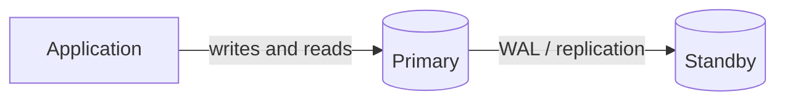
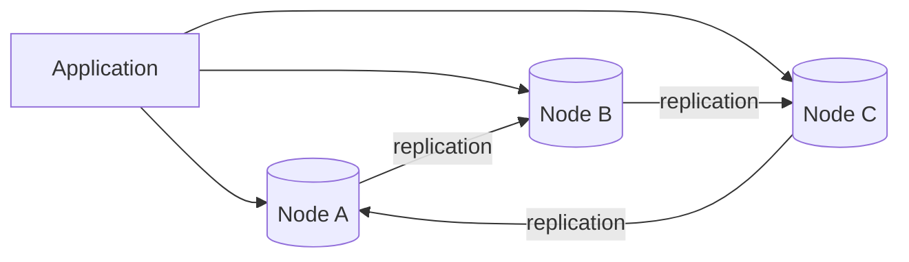
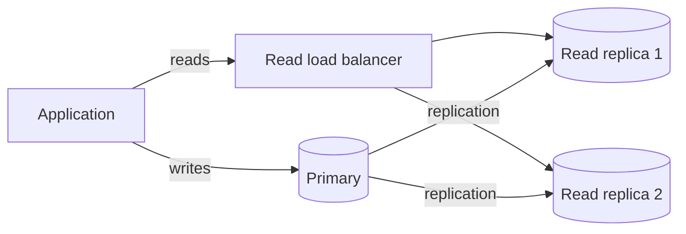
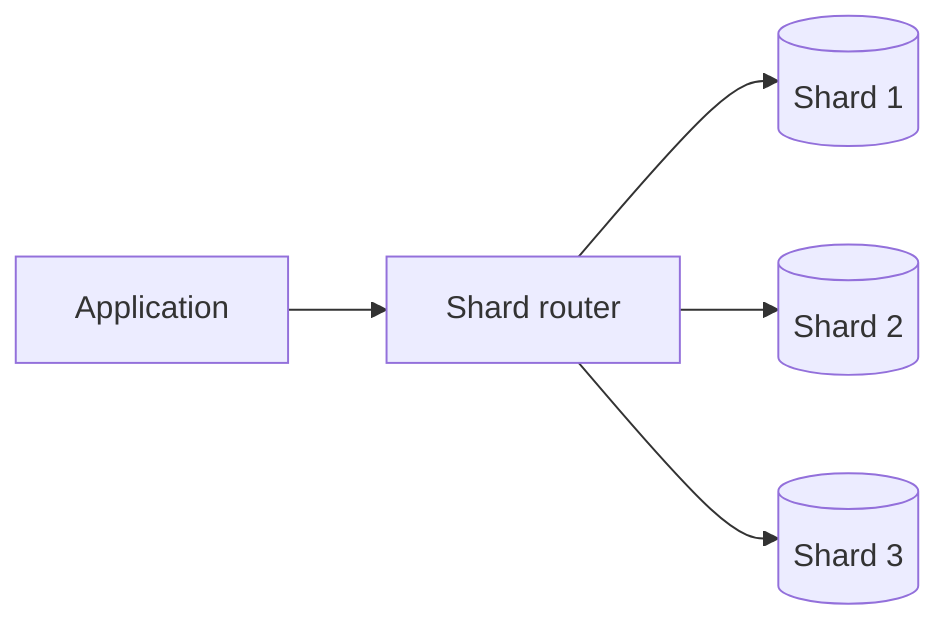

*This article is entirely based on a [YouTube video by Caleb Curry](https://www.youtube.com/watch?v=oh8GvLf45t0).*

---

A single database instance is the natural starting point. It is simple, consistent, and easy to reason about. As traffic and data grow, the question becomes how to move from one instance to several while still presenting a single logical database, a cluster. Two techniques make that possible: replication and sharding. They are often mentioned together, but they solve different problems. Replication copies data for availability, durability, and read scaling; sharding partitions data to scale storage and writes.

This article starts with a relational database, because that is where the constraints are most visible. It then shows how caching and specialized stores can delay the need for a cluster, how replication provides failover and read capacity, and where multi-master and sharding enter the picture.

# Start With One Powerful Instance

The first instinct is often to add servers. For a traditional relational database (Oracle, MySQL, or PostgreSQL), the better first step is usually to make the existing server more powerful. Vertical scaling increases CPU, RAM, disk, and network capacity on a single instance. Before moving to multiple instances, it is better to use a powerful machine than a collection of commodity servers: relational databases benefit from fast disks, large memory, and reliable hardware, and a single well-sized primary can support many applications.

This is not a temporary hack. A single database instance is adequate for a surprising number of production systems. Before adding nodes, it is worth checking whether the workload can be reduced instead. Caching frequently read data in Redis, for example, removes requests from the database. The same principle applies to specialized stores.

# Reduce the Load Before Adding Nodes

Horizontal scaling is not the only way to relieve a database. The cheapest request is the one that never reaches it.

**Caching.** Redis, or another in-memory store, can hold data that does not need to be preserved forever. The application reads from Redis first; only a cache miss reaches the database. This reduces read load and latency.

**Specialized databases.** NoSQL is a category, not a single product. It includes databases optimized for specific workloads. A system can keep its main relational database and add specialized stores for particular jobs:

- Redis for caching and ephemeral data.
- Elasticsearch for search-heavy workloads, offloading search from the main database.
- IndexedDB for client-side browser storage: local settings, game state, or data that does not need server persistence.
- A data warehouse for analytics, moving data from the transactional database (OLTP) to an analytical store (OLAP) so expensive analytical queries do not compete with transactions.

| Workload | Specialized store | Why it helps |
|---|---|---|
| Caching | Redis | In-memory, low latency |
| Search | Elasticsearch | Search-optimized index |
| Client-side state | IndexedDB | Local to the browser |
| Analytics | Data warehouse | OLAP-optimized |

These stores often supplement the main database rather than replace it. They absorb specific workloads, reducing the demand on the transactional system. That can postpone the need for replication or sharding; when the time comes, it makes the remaining workload easier to reason about.

# Replication for Availability

Reducing load improves performance, but it does not address the single point of failure. If the only database instance fails, the application goes down even if backups exist. Recovery may take longer than the business can tolerate.

The first replication pattern is the standby node. A standby is a copy of the primary that receives the same changes and is ready to take over, subject to the replication mode: a synchronous standby has all acknowledged writes, while an asynchronous standby may be behind. If the primary fails, traffic can be directed to the standby. The goal is to remove the single point of failure and reduce downtime.

How does the standby receive the data? Relational databases typically use a write-ahead log (WAL) or a similar replication log. Every change is recorded in the log; the standby applies the same changes. The application still issues one write; the database performs the replication work behind the scenes.

Replication is not free. Each replica consumes storage and network bandwidth, and cross-region replication adds latency and egress cost. The effect on write capacity depends on the replication topology. With a primary–standby setup, only the primary accepts writes; the standby adds availability and durability, not write throughput. With active–active full replication, every write is applied to every replica, so the cluster pays write amplification: if each node can handle 1,000 write operations per second in total, two fully replicated nodes still sustain roughly 1,000 client writes per second, not 2,000. With sharding or partial replication, each write goes only to the shard and replicas that own it, so write throughput can grow with the number of shards. This is a simplified example, but it illustrates the principle: full replication improves availability and durability, not write throughput; partitioning is what allows writes to scale.

Replication also has a consistency dimension. Synchronous replication waits for the standby to acknowledge the write before confirming it to the client; it reduces the risk of data loss but adds latency. Asynchronous replication confirms the write on the primary first; it is faster but may lose recent writes on failover. The right choice depends on the recovery point objective (how much data can be lost) and the latency budget.

Backups are also necessary, but they are not a failover mechanism. A backup preserves the data, not a running instance. A standby provides continuity; a backup provides recovery from accidental deletion or corruption. Both belong in a production database layer.

Managed databases often automate promotion and connection routing; self-hosted systems require orchestration and fencing to avoid split-brain. A standby is only useful if failover is fast and reliable.

# Multi-Master and Active-Active

A standby improves availability, but it does not increase write capacity. For that, the next step is a multi-master cluster, also called active-active: multiple nodes accept writes, and changes are replicated between them.

In a simplified three-node example with a replication factor of two, a write to node A might be replicated to node B, while a write to node C might be replicated to node A. Each write lands on two nodes, but not every write goes to every node. The cluster has three nodes of compute and can process more total writes than a single primary, while retaining redundancy. Real multi-master systems use quorums and conflict resolution; the ring is a simplification.

Multi-master can provide three benefits: redundancy, more write capacity, and potentially lower latency for local writes by placing data near the users who request it, at the cost of cross-node coordination. The costs are conflict resolution, ordering, and consistency. If two nodes accept writes to the same record, the cluster must decide which version wins. Traditional relational databases can support multi-master with additional tooling or managed services, but it is usually an enterprise-level step.

Many NoSQL databases were designed with multiple nodes in mind, but they bring their own data-modeling work. Data that must be accessed together should be stored together, and the cluster needs a replication factor (how many copies of each piece of data) and quorum settings (how many nodes must acknowledge reads and writes). These settings determine the balance between consistency, availability, and latency.

# Read Replicas

Before committing to multi-master, there is a simpler replication pattern: read replicas. A read replica is a copy of the primary that serves read traffic. The primary handles writes; replicas receive the changes and answer reads.

Read capacity can be scaled horizontally by adding replicas, while write capacity remains tied to the primary and is usually scaled vertically (or, later, through multi-master or sharding). Replicas can be placed in different regions, reducing read latency for nearby users. A read replica can also have its own standby, though this is less critical: if one read replica fails, another can usually take its place.

Read replicas are usually eventually consistent. The replica applies changes asynchronously, so it can lag behind the primary. A user writes a blog post, immediately reads from a replica, and may not see the post yet; after a short delay, it appears. For social media, blogging, and many other applications, this is acceptable.

If the application cannot tolerate stale reads, synchronous replication can be used: the primary waits for one or more replicas to acknowledge the write before returning success. This reduces the consistency window but increases write latency. The setting depends on the database and the hosting provider; managed services may expose only a subset of options.

With multiple read replicas, the application needs a way to distribute reads. Some databases or managed services provide a read endpoint with built-in load balancing. Others require weighted DNS routing, multiple connection strings with round-robin in application code, or a proxy such as HAProxy. Amazon Aurora PostgreSQL-compatible, for example, provides read load balancing as part of the service; Aurora can be provisioned or serverless depending on the workload.

# Sharding

Replication copies the same data to multiple nodes. Sharding takes a different approach: it splits the data across nodes, so each node holds a subset. A shard is not a full copy; it is a partition.

Sharding is more common in NoSQL systems, but it exists in relational databases too. The central design decision is the shard key: the value used to decide which shard owns a row. A good shard key balances even distribution against co-locating related data; the two goals often conflict. The application or a routing layer must direct each request to the correct shard.

Sharding scales storage and write capacity beyond what a single primary can handle, and it can distribute read load as well, but it introduces cross-shard queries, distributed transactions, rebalancing, and hot-shard risks. Replication can be combined with sharding: each shard can have its own replicas for availability and read scaling. The details of sharding (shard keys, routing, rebalancing, and cross-shard queries) deserve a dedicated treatment; the important point here is that sharding solves a different problem from replication.

# Choosing the Right Pattern

Replication and sharding are not interchangeable. The following table summarizes the main options.

| Pattern | What it does | Scales | Consistency | Complexity |
|---|---|---|---|---|
| Standby | Copy of the primary for failover | Availability | Sync or async | Low |
| Read replica | Copy of the primary for reads | Read throughput and some availability | Usually eventual | Medium |
| Multi-master | Multiple writable nodes | Write throughput and availability | Conflict handling | High |
| Sharding | Partitions data | Storage and write capacity | Depends on replication | High |

Each step adds capability and cost. The practical path is incremental: start with a single powerful instance; reduce load with caching and specialized stores; add a standby for availability; add read replicas for read scaling; consider multi-master only when write capacity and availability justify the complexity; shard only when a single primary cannot hold the data or the write volume.

# Conclusion

The cluster is not the goal. The goal is a database layer that meets availability, latency, and throughput requirements at an acceptable level of complexity. Replication copies data; sharding partitions it. A standby improves availability; read replicas improve read capacity; multi-master can improve write capacity at the cost of conflict handling; sharding improves storage and write capacity at the cost of routing and cross-shard complexity.

Measure the bottleneck before adding a component, and stop when the next step costs more than the problem it solves.

# Appendix: Topics for Future Expansion

The following topics are only touched on briefly, or deliberately left out, to keep this chapter close to the original video. They are candidates for a future revision or for separate notes.

- **Quorums and consensus**: Raft, Paxos, majority reads and writes, leader election, and how quorums balance consistency and availability.
- **Replication factor and quorum settings**: how many copies of each record exist, and how many nodes must acknowledge reads and writes.
- **Conflict resolution in multi-master**: last-write-wins, vector clocks, CRDTs, and application-level reconciliation.
- **Synchronous versus asynchronous replication**: latency, durability, replication lag, and recovery point objectives.
- **Failover automation and split-brain**: promotion, DNS and connection routing, fencing, and quorum.
- **Consistent hashing and shard rebalancing**: adding or removing shards without moving all data.
- **Cross-shard queries and distributed transactions**: fan-out reads, two-phase commit, sagas, and application-level compensation.
- **Hot shards and shard key selection**: skew, cardinality, access patterns, and rebalancing.
- **CAP theorem and PACELC**: consistency, availability, partition tolerance, and the latency/consistency trade-off outside partitions.
- **Read-after-write consistency**: session guarantees, routing reads to the primary, and monotonic reads.
- **Backups versus replicas**: why replication does not protect against deletion or corruption, and why restores must be tested.
- **Replication cost and capacity planning**: storage, network bandwidth, write amplification, cross-region egress, and the cost of keeping multiple copies.
- **Connection pooling and read load balancing**: pool sizing, PgBouncer, ProxySQL, HAProxy, and managed read endpoints.
- **Data warehouse, ETL, and OLAP**: batch versus streaming ingestion, columnar storage, and analytical query patterns.
- **NoSQL data modeling**: access-pattern-driven design, denormalization, and partition keys.
