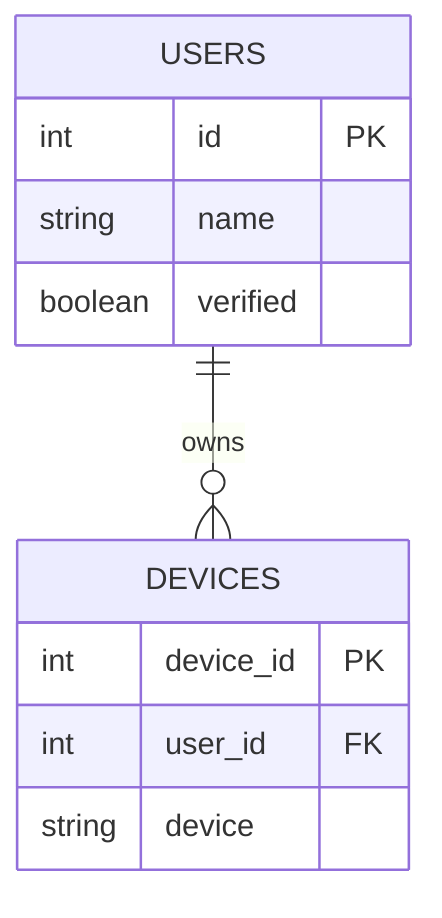
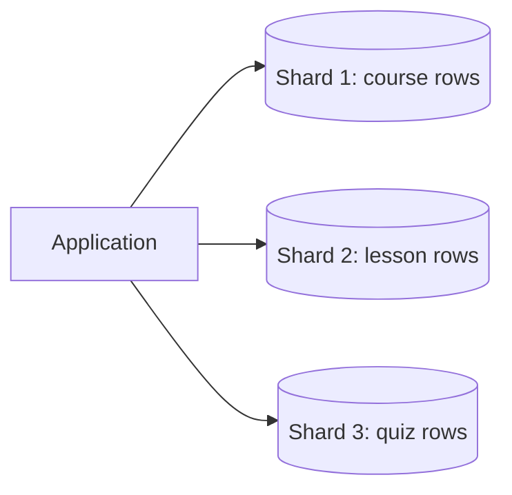
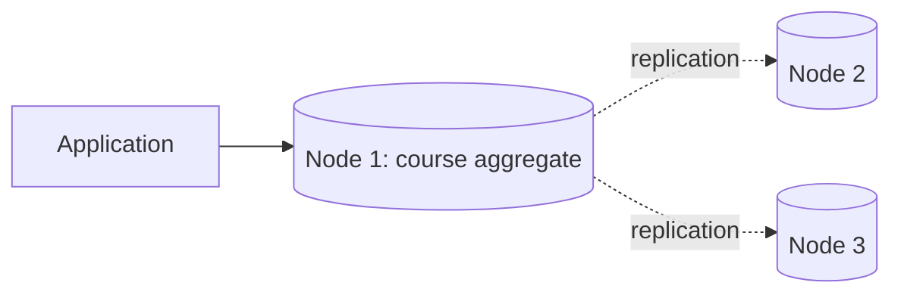
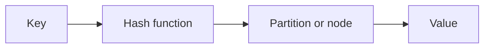
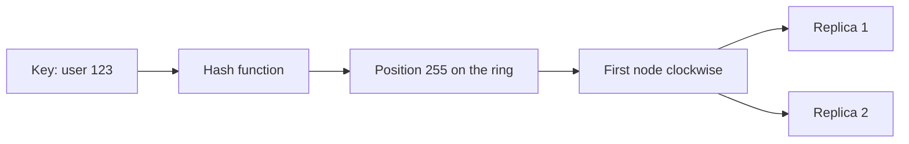

*This article is entirely based on a [YouTube video by Caleb Curry](https://www.youtube.com/watch?v=FRqrZGB8NBs).*

---

NoSQL is not a single database or a single data model. It is a family of databases that often trade some of the guarantees and constraints of the relational model for flexibility and horizontal scale. Many are aggregate-oriented; graph databases are relationship-oriented instead. The name is commonly expanded as “not only SQL,” which is a better description than “no SQL”: the point is not that SQL is useless, but that relational tables are not the only useful way to store data.

The category includes key-value stores, document databases, wide-column stores, graph databases, and several specialized variants. They differ sharply in data model and query style, so “use NoSQL” is not a design decision on its own. The useful question is which data model fits the way the application accesses its data.

This chapter builds the foundation: the relational model, the aggregate-oriented NoSQL model, schema-less design, query-driven modeling, the four main families, replication and quorums, consistent hashing, distributed ID generation, and two concrete table designs.

# What “Relational” Actually Means

SQL stands for **Structured Query Language**. It is a standard language for communicating with relational databases. Relational databases store data in tables, and most of them implement the SQL standard with small variations.

The word **relational** is often misunderstood. It does not mean “full of relationships.” In the relational model, a relation is a table. Relationships between tables are a consequence of how the data is modeled, not the meaning of the word. A relational database is one in which data is organized into tables.

A table has columns and rows. Each column has a name and a type; each row is a record. A simple user table might look like this:

| id | name | verified |
| --- | --- | --- |
| 1 | Caleb | true |
| 2 | John | false |
| 3 | Sara | true |

Every row has the same columns. That is the **schema**: the structure is defined up front, and every record must conform to it. The database can enforce types, uniqueness, nullability, and other constraints.

When data is connected, relational databases split it across tables and connect the tables with keys. A user can have several devices, so the devices might live in a separate table with a `user_id` column that references the user table.



This structure is normalized: shared data is stored once, and relationships are represented by keys. It is often the right design when the data is highly connected and the application needs to query it in arbitrary ways. Joins, constraints, and transactions are strengths, not accidents.

# The NoSQL Model: Access Together, Store Together

The NoSQL model starts from a different question. Instead of asking “how should this data be normalized across tables?”, it asks “what does the application read and write as a single unit?”

Consider the same user with devices. In a relational database, the user and devices are separate tables. In a document database, they can be one object:

```json
{
  "id": 2,
  "name": "John",
  "verified": false,
  "devices": [
    { "device_id": 37, "name": "Samsung" },
    { "device_id": 38, "name": "iPhone" }
  ]
}
```

The devices are nested inside the user. The application already works with an object like this in memory; the NoSQL database can store that object as a single unit instead of forcing the application to dismantle it into rows and reassemble it with joins.

This is not just a storage detail. It changes the unit of access. A relational database might require a join between `users` and `devices` to render a profile. A document database can return the entire profile with one lookup. The data that is accessed together is stored together.

The same idea appears in a course platform. A lesson page might show a video, notes, downloadable attachments, a quiz, and an author bio. In a relational schema, that page might draw from a course table, a lesson table, an attachments table, a quizzes table, and a users table. The page is assembled at request time from several tables.

If the page is always accessed as a whole, why not store it as a whole? A NoSQL database can keep the course page as one aggregate: the lesson, its attachments, its quiz, and the author information in a single object. Reading the page becomes one lookup instead of a set of joins.

But this is not always the right choice. If the application needs to query all quizzes independently, or all comments across every lesson, or arbitrary combinations that were not anticipated, then splitting the data into separate structures may be better. The aggregate model works when the access pattern is known and the data naturally forms a unit. It is a design decision, not a universal rule.

The principle is simple: **what is accessed together should be stored together**. The hard part is deciding what “together” means for a given application.

# Scalability and Sharding

NoSQL databases are often described as more scalable than relational databases. The claim is not that NoSQL is automatically faster. It is that the aggregate model makes a particular kind of horizontal scaling easier. A well-sharded relational database can also scale horizontally; the difference is often the data model, the access patterns it encourages, and the operational trade-offs.

Suppose a relational database is sharded across three nodes. A course page needs data from the course table, the lesson table, and the quiz table. If the shard key does not align with the page's access pattern and the rows for that page live on different shards, rendering one page may require reading from three nodes. The system has gained capacity by sharding, but it has lost the benefit for reads that need to assemble the page.



A NoSQL aggregate store takes the opposite approach. The entire course page is one aggregate, so it lives on one node. A cluster may have many nodes, but any given page is served from a single node. The read does not have to fan out across the cluster.



This is one reason NoSQL systems are often described as **cluster-friendly**. They are designed for data that can be partitioned by an aggregate key, with each partition replicated for availability.

A related distinction is between read replication and multi-master writes. Read replicas increase read throughput, but they do not increase write throughput because writes still go to a primary. Many NoSQL systems are designed for multi-master writes and multi-node reads: any node can accept a write, and reads can be served by several replicas. That can increase write availability and throughput, but it introduces conflict resolution and consistency trade-offs. Not every NoSQL database is multi-master; some use a single leader. The category is broad.

The important point is that NoSQL scalability comes from a data model that keeps related data together and from a cluster design that can partition and replicate that data. It is not a magic property of the word “NoSQL.”

# Schema-Less Does Not Mean Schema-Free

NoSQL databases are often described as **schema-less**. The term is misleading if it suggests that the data has no structure. It usually means that the database does not enforce a single fixed schema for every record. The structure is handled by the application, often called **schema-on-read**. This is most true of document stores; wide-column stores such as Cassandra still have a fixed CQL schema, even though their storage is sparse, and key-value stores define at least the key schema. Some document databases also support optional schema validation, but it is not the same as a relational schema enforced for every row.

Consider two user documents:

```json
{ "id": 1, "name": "Caleb", "email": "caleb@example.com" }
```

```json
{ "id": 2, "name": "John", "phone": "555-0100" }
```

The first user has an email and no phone. The second has a phone and no email. The attributes are not present with empty values; they are simply absent. A table representation would have to show empty or null cells, but that is not how the document is stored.

This flexibility is useful during prototyping. Adding a new attribute does not require a migration that adds a column to every existing row. The application can evolve the shape of its data quickly, which is valuable for early product development, user-defined dashboards, custom plugins, or any feature where the set of fields is not known in advance.

The cost appears at the application layer. If any record might be missing an attribute, the code must handle that possibility. A web page may need conditional rendering; a backend may need validation; a statically typed language may need optional fields or dynamic types. The database is no longer enforcing the structure, so the application has to be more careful. If the data is inconsistent, the application has to account for every variation, and the risk of `undefined`, null access, or runtime exceptions increases.

A relational database with a fixed schema pushes this work to the database and to the design phase. Columns can be marked `NOT NULL`; types are enforced; queries can rely on the shape of the data. There is more planning up front, but less defensive work in every application that reads the data.

Schema-less is therefore a trade-off, not a free lunch. It is a good fit when the structure is genuinely variable or rapidly changing. It is a poor fit when the application needs strong guarantees about every record.

There is also a middle ground: many relational databases support a JSON or JSONB column. A table can have a stable identity and a few relational columns, plus a JSON column for flexible attributes. This provides some of the flexibility of a document store without abandoning the relational database. For a team that needs a little schema flexibility but not a full NoSQL migration, it is often the first option to consider.

# Query-Driven Design

Relational design often starts with the data model: normalize the entities, define the relationships, and then write queries against that model. NoSQL design often starts with the queries: decide how the application will read and write the data, then model the data to make those operations efficient.

This is why NoSQL modeling is sometimes called **query-driven**. In a key-value store, the application must know the key. In a document store, it must know which fields are indexed and which query shapes are supported. In a wide-column store, it must choose the partition key and the clustering key around the access pattern. If the query changes later, the data model may need to change with it.

Relational databases are more flexible for ad hoc queries because joins can combine tables in ways that were not anticipated. NoSQL databases often trade that flexibility for predictable, fast access along known paths. The degree varies: a document database may support rich queries over nested fields, while a key-value store may support only key-based access. The general direction is the same: know the access pattern before choosing the model.

| Relational | NoSQL |
| --- | --- |
| Model the entities first | Model around the queries |
| Joins and normalization | Denormalization and aggregates |
| Ad hoc queries are common | Access paths are known in advance |
| Constraints enforced by the database | Validation often handled by the application |

# The Four Main NoSQL Families

The NoSQL category is broad. Most introductions focus on four families.

| Family | Data model | Query style | Examples |
| --- | --- | --- | --- |
| Key-value | Key mapped to a value; often opaque, but some stores expose richer structures | Get/put by key | Redis, DynamoDB (also document-oriented) |
| Document | Key mapped to a structured document | Query by fields and nested data | MongoDB, CouchDB |
| Wide-column | Partitioned rows with sparse, clustered columns | Partition and clustering keys | Bigtable, Cassandra, HBase, ScyllaDB |
| Graph | Nodes and edges | Traversals and relationship queries | Neo4j |

There are also specialized categories such as time-series databases, which are optimized for events over time, and search databases, which are optimized for full-text search over large datasets. The four families above cover the majority of general-purpose NoSQL systems.

## Key-Value Stores

A key-value store is the simplest model: a key maps to a value. Conceptually, it is a hashmap that happens to live in a database, with partitioning, replication, and persistence added around it.

A hashmap uses a hash function to turn a key into a storage location. The same key always produces the same hash, so the lookup can go directly to the value instead of scanning the data. In a database, the key is mapped to a partition or node, and the storage engine handles the exact location on disk.



In a pure key-value store, the value is opaque to the database. It can be a string, a number, a JSON object, or a blob, but the database treats it as a single unit. It does not know or care about the fields inside. If the value is a video with a nested comments array, the database can return the whole object, but it cannot efficiently query or update a single comment inside it. The application reads the object, modifies it, and writes it back.

Redis is a common example, often used as an in-memory cache in front of a database; it also exposes richer data structures, but the key remains the primary access path. DynamoDB is a key-value/document store: it supports item attributes and secondary indexes, but it still revolves around a partition key. The model is a good fit for sessions, caches, feature flags, simple lookups, and any data where the key is the primary access path.

## Document Databases

A document database is similar to a key-value store, but the value is a structured document and the database understands its shape. Instead of treating the value as an opaque box, it can query fields inside the document, index nested fields, and return a subset of the data.

```json
{
  "id": 2,
  "name": "John",
  "verified": false,
  "devices": [
    { "device_id": 37, "name": "Samsung" },
    { "device_id": 38, "name": "iPhone" }
  ]
}
```

MongoDB is the most familiar example; CouchDB is another. Document databases are a good fit when the application wants the key-value model but also needs rich queries over the object. The value is transparent: the database knows that `devices` is an array and can index or query inside it.

## Wide-Column Databases

Wide-column databases are often confused with column-oriented databases. They are not the same thing.

A **column-oriented database** stores data by column rather than by row. Instead of reading all the fields of one order, it can read all the total order amounts together, which is efficient for analytical queries. This is the world of OLAP (online analytical processing) and data warehousing, as opposed to OLTP (online transaction processing) workloads. It is not the NoSQL wide-column model.

A **wide-column NoSQL database** still stores rows, but the model is optimized for sparse data. In Cassandra and ScyllaDB, CQL tables have a fixed schema: the columns are defined by the table, and every row has the same set of columns. Rows can still be sparse (missing values do not consume storage), and the clustering columns determine how rows are grouped and ordered within a partition. Other wide-column systems, such as Bigtable and HBase, allow more schema flexibility at the column-family level, so different rows can carry different column qualifiers. This is different from a relational table, where every row has the same columns and missing values are represented as nulls.

```text
Row 1: { name: "Caleb", email: "caleb@example.com" }
Row 2: { name: "John", phone: "555-0100" }
```

In a CQL table, both `email` and `phone` would be declared in the schema; each row simply omits the value it does not have.

Google Bigtable and Apache Cassandra are the defining examples. HBase is the Hadoop ecosystem equivalent, and ScyllaDB is a C++ reimplementation of Cassandra. Cassandra is designed to scale horizontally on commodity hardware; it can run on very large clusters. That horizontal design is one of its main attractions.

## Graph Databases

A graph database stores data as nodes and edges. Nodes represent entities; edges represent relationships. Instead of joining tables, a graph database traverses the connections directly.

Neo4j is the best-known example. Graph databases are a good fit for social networks, recommendation engines, fraud detection, knowledge graphs, and any domain where the relationships are as important as the entities. They are not aggregate stores in the same sense as key-value, document, and wide-column databases, because the data is deliberately split across relationships.

# Aggregates and Aggregate Boundaries

Martin Fowler describes key-value, document, and wide-column stores as **aggregate databases**. An aggregate is a logical unit of information that is read and written together. An order with its line items is the canonical example: the order and its lines are separate entities in a relational model, but they form one aggregate when the application always reads and writes them as a unit.

The aggregate boundary matters because it determines what can be updated atomically. Many aggregate stores guarantee atomicity within a single document, row, or aggregate. Operations that cross aggregate boundaries may require transactions; some NoSQL databases now support multi-document transactions, but they are often more expensive or more limited than their relational counterparts. If the application needs to update two aggregates together, it has to handle the consistency risk explicitly.

This is why aggregate-oriented design encourages keeping related data together. It is not because normalization is wrong; it is because the unit of atomicity and the unit of access should align.

# Replication, Quorums, and Consistent Hashing

A NoSQL cluster distributes data across nodes. To avoid losing data when one node fails, the data is replicated. The **replication factor** (RF) is the number of copies of each piece of data. An RF of three means that each record is stored on three nodes, not on every node in the cluster.

When a client writes, it may write to one node, and the database replicates the write to the other copies. The client may wait for a certain number of acknowledgments before considering the write successful. That number is **W**. When a client reads, it may read from a certain number of replicas; in a quorum-based system, that number is **R**.

| Parameter | Meaning |
| --- | --- |
| RF | Number of copies of each record |
| W | Number of write acknowledgments required |
| R | Number of read responses required |

If `W + R > RF`, the write quorum and the read quorum must overlap. At least one node in the read set has seen the latest write, so the read can return the most recent value, provided the protocol also uses versioning and read repair. The formula is a condition for overlap, not a complete proof of linearizability.

For example, with `RF = 3`, `W = 2`, and `R = 2`, the write set and the read set must share at least one node. If the write succeeded on two nodes and the read consults two nodes, the overlap guarantees that the read sees the new value.

This is a trade-off. Lowering `R` to one makes reads faster but increases the chance of reading a stale replica. Raising `W` and `R` improves consistency but increases latency and reduces availability during failures. The system can expose these parameters as tunable consistency levels.

These trade-offs are the practical face of the CAP theorem: during a partition, a system with replicated data must choose between serving a possibly stale value and refusing the request. Quorum parameters decide which operations can proceed, but they do not make the choice disappear.

A **coordinator** node receives the client request and routes it to the nodes that hold the data. The coordinator may be any node in the cluster; it does not have to be the owner of the data. This is where **consistent hashing** comes in.

## Consistent Hashing

Consistent hashing maps keys to nodes on a ring. The hash function turns a key into a number in a fixed range; the ring wraps around at the maximum value. Nodes are placed at positions on the ring, and a key belongs to the first node at or after its position, moving clockwise.



The same key always hashes to the same position, so the same node is selected for reads and writes. When a node is added or removed, only the keys in the adjacent range need to move; the rest of the ring stays where it is. That is the property that makes the hashing **consistent**: the assignment changes incrementally rather than reshuffling every key.

The ring is a simplified model. Real systems use virtual nodes, replication, and rebalancing strategies to keep the distribution even and to handle failures. Those details are a natural next topic, but the core idea is the same: hash the key, find the position, follow the ring to the responsible node.

# Generating IDs in a Distributed System

Relational databases often provide auto-incrementing IDs. A NoSQL database distributed across many nodes cannot rely on a single sequence unless it coordinates with the other nodes. If two nodes both think the last ID is 123, they may both try to create 124, which creates a conflict.

There are several solutions.

**Centralized ID generator.** A separate service hands out IDs. It can be an auto-increment server, or a load-balanced pair of servers that split the sequence (one for odd numbers, one for even). This works, but it adds an external dependency and a potential single point of failure. It also adds a network round trip to every insert.

**Natural key.** Use a value that already identifies the data, such as an email address, a username, or a composite of business fields. This requires no external service, but natural keys are not always stable or unique, and they can change.

**UUID or GUID.** A universally unique identifier is a 128-bit value generated at the application level. The space is large enough that collisions are extremely unlikely. The downside is that traditional random UUIDs, such as UUIDv4, are not sortable in a meaningful order, and every key consumes 128 bits even for small data.

**Snowflake ID.** A Snowflake is a 64-bit value with encoded information: a sign bit, a 41-bit timestamp relative to a custom epoch, a 10-bit machine or system ID, and a 12-bit sequence number.

```text
| 1 bit sign | 41 bits timestamp | 10 bits machine ID | 12 bits sequence |
```

The timestamp makes Snowflake IDs roughly sortable, the machine ID avoids collisions across servers, and the sequence allows many IDs per millisecond. The result is compact, sortable, and rich enough to extract creation time. The cost is additional complexity: the system needs unique machine IDs and a clock that does not move backwards.

| Strategy | Strength | Weakness |
| --- | --- | --- |
| Centralized auto-increment | Simple, numeric, ordered | External dependency, single point of failure |
| Natural key | No external service, meaningful | Not always stable or unique |
| Random UUID/GUID | Decentralized, effectively unique | Not sortable, 128 bits per key |
| Snowflake | Sortable, compact, encodes time | Requires machine IDs and clock discipline |

The important shift is that ID generation is no longer the database's job. It is the application's responsibility, or the responsibility of a dedicated service that the application calls.

# Designing a Comments Table

A video platform needs to store comments. A comment has a video ID, a timestamp, a user ID, and the comment text.

In a relational database, the comment would have its own primary key and foreign keys to the users and videos tables. In a NoSQL wide-column store, the design starts from the access pattern: “show all comments for a video, ordered by time.”

The **partition key** is the video ID. All comments for a video are stored on the same partition, so they can be retrieved together. The **sort key**, also called the clustering key, is the timestamp. The primary key is the composite of the partition key and the sort key.

| Partition key | Sort key | Attributes |
| --- | --- | --- |
| video_id | timestamp | user_id, content |

There is no separate comment ID in this design. The combination of `video_id` and `timestamp` is used as the primary key, which matches the way the data is read. This works if the timestamp has enough precision to distinguish comments posted in the same millisecond; otherwise a sequence number or a Snowflake-style ID is needed. The user ID and video ID are just values; they are not foreign keys with referential integrity enforced by the database. If the application needs to join comments to users or videos, it does that at the application level, or uses a transaction if the database supports one.

This design has a limitation: retrieving all comments by a particular user is inefficient because the data is partitioned by video. A **secondary index** on `user_id` can support that query, but every index must be maintained on writes. Indexes are not free. The designer has to know which queries matter and create only those indexes.

If the comment ID is a Snowflake, it already contains a timestamp. In that case, the comment ID can be the sort key instead of a separate timestamp column. The partition key remains the video ID, and the comments are still grouped by video and sorted by time.

# The Discord Example

Discord stores an enormous number of messages. Its primary key follows the same pattern: `channel_id` as the partition key and `message_id` as the sort key. All messages for a channel are stored together, and the message ID is a Snowflake that contains the creation timestamp. That allows Discord to retrieve a channel's messages in order without a separate timestamp index.

Discord used Cassandra and later moved to ScyllaDB. The exact architecture is more complex, but the data model illustrates the principle: partition by the thing that is accessed together, and use the sort key to control the order.

# Choosing Between SQL and NoSQL

There is no universal answer. The choice depends on the application's data, access patterns, scale, consistency requirements, and team.

| If the application needs… | Lean toward |
| --- | --- |
| Strong relationships, ad hoc queries, transactions | Relational |
| Known access patterns, aggregate-oriented data, horizontal scale | NoSQL |
| A mix of stable relational data and flexible attributes | Relational with a JSON column, or polyglot persistence |

Relational databases are not obsolete, and NoSQL databases are not automatically better. A relational database with a JSON column can handle many cases that would otherwise require a document store. A NoSQL database can be the right choice when the aggregate model and horizontal scaling are the dominant requirements.

One practical recommendation is to put a data-access layer between the application and the database. Instead of scattering raw database drivers across every microservice, expose a small API or SDK with operations such as `getUser`, `createUser`, or `getCommentsForVideo`. The application depends on that interface, not on the database's query language. If the database changes later, the interface can translate between the old and new models, and the consumers do not have to be rewritten.

This is not abstraction for its own sake. A data-access layer adds code and can hide useful database features. But it creates a seam between the application and the storage engine, which is valuable when the data model is likely to evolve.

# Appendix: Topics for Future Expansion

The following topics are only touched on briefly, or deliberately left out, to keep this chapter close to the original video. They are candidates for a future revision or for separate notes.

- **Consistent hashing in depth**: virtual nodes, replication, rebalancing, and hotspot avoidance.
- **Quorum reads and writes**: read repair, hinted handoff, sloppy quorums, tunable consistency, and the link to CAP/PACELC.
- **Multi-master replication**: conflict resolution, last-writer-wins, vector clocks, CRDTs, and idempotent retries.
- **ID generation**: ULID, UUIDv7, Snowflake variants, clock skew, and machine-ID allocation.
- **NoSQL data modeling**: single-table design, aggregate boundaries, denormalization, secondary indexes, hot partitions, and partition-key cardinality.
- **Cross-partition queries**: secondary indexes, scatter-gather, fan-out, and query planning.
- **Wide-column versus column-oriented databases**: OLTP row stores, OLAP column stores, and when each is appropriate.
- **Graph databases**: traversal algorithms, property graphs, and relationship-heavy domains.
- **Time-series and search databases**: specialized indexes, retention policies, and full-text search.
- **Transactions in NoSQL**: single-document atomicity, multi-document transactions, isolation levels, and the cost of cross-aggregate updates.
- **Schema validation**: JSON Schema, application-level validation, and schema evolution.
- **Backups versus replicas**: why replication is not a backup, and how to recover from logical corruption.
- **Read-your-writes and session guarantees**: per-session consistency, monotonic reads, and read repair.
- **ACID versus BASE**: the consistency vocabulary behind NoSQL systems, and how it relates to CAP/PACELC.
- **Migrations and polyglot persistence**: moving from SQL to NoSQL, mixing stores, and keeping data consistent.
- **Operational concerns**: compaction, tombstones, repair, monitoring, and capacity planning.
